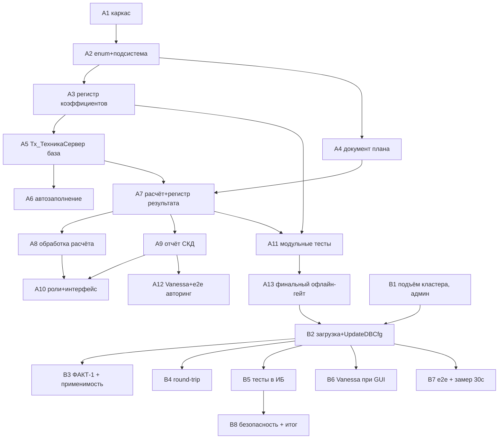

# Tasks: Анализ дефицита техники (по технологическим картам)

> Requirements: @requirements.md
> Design: @design.md
> Status: Approved (ночной автономный прогон по standing-инструкции; ревью утром)
> Last Updated: 2026-10-07
> Контекст инцидента: кластер 1С недоступен до утра (docs/agent-execution-plan.md,
> «Инцидент»); все задачи разбиты на Фазу A (офлайн-авторинг, выполняется ночью)
> и Фазу B (загрузка/верификация в ИБ, после подъёма кластера утром, требует админа).

## Фазы

- **Фаза A (A1–A13): офлайн-авторинг.** XML-исходники расширения
  `src/cfe/ПланированиеТехникиАПК/`, BSL-модули, формы, роли, тесты как код.
  Гейты: `pre_load_validate.py` + `bsl-ls` (MCP) после каждой правки BSL.
  База не нужна.
- **Фаза B (B1–B8): загрузка и верификация в ИБ.** Зависит от подъёма кластера
  (Start-Service ragent + pagefile — админ). Загрузка, UpdateDBCfg, round-trip
  verify, кросс-проверка ФАКТ-1, прогоны тестов.

## Requirement Coverage

| Requirement | Tasks | Notes |
|-------------|-------|-------|
| FR-001 (хранение коэффициентов) | A3 | регистр Тх_КоэффициентыПересчетаРабот, design §4.3 |
| FR-002 (форма ведения коэффициентов) | A3 | форма списка с отбором по периоду, s02 |
| FR-003 (базовая модель 1,00) | A3, A11 | ресурс БазоваяМодель + контроль ПередЗаписью + тесты |
| FR-004 (автозаполнение по мощности) | A6, A11 | Тх_ЗаполнениеКоэффициентов; модель без мощности — строка не создаётся (design §18.6) |
| FR-005 (документ план техресурсов) | A4 | шапка Орг/Подразделение/Сценарий |
| FR-006 (ТЧ до конкретных ТС) | A4 | 3 ТЧ, хоз.номер рантайм-колонкой |
| FR-007 (признак «Принят») | A4, A7, A11 | только Принят=Истина в расчёте |
| FR-008 (потребность из техкарт) | A7, A8 | регистры годового плана, TD-002 |
| FR-009 (доступные смены) | A7, A8 | Принятые × дни × СменВДень (Q-001→default 1) |
| FR-010 (пересчёт через K) | A7, A11 | эквивалент = смены_аналога / K, TD-004 |
| FR-011 (нет коэффициента — пометка) | A7, A9, A11 | флаг КоэффициентНеЗадан |
| FR-012 (расчёт дефицита) | A7, A11 | max(0, потребность − доступность) |
| FR-013 (структура отчёта) | A9 | СКД по Тх_ДефицитТехники, s05 |
| FR-014 (фильтры отчёта) | A9 | 7 параметров СКД |
| FR-015 (только дефицитные строки) | A9 | параметр ТолькоДефицит, default Истина (Should Have) |
| FR-016 (подсистема и командный интерфейс) | A2, A10 | раздел навигации + действий |
| FR-017 (роли) | A10, B8 | Тх_Чтение / Тх_Редактирование |
| FR-018 (контроль дублей коэффициентов) | A3, A11 | измерения = ключ записи; тест |
| NFR-001 (usability) | A3, A4, A9, A12 | типовые паттерны, без модальности |
| NFR-002 (performance) | A7, A9, B7 | двухфазная схема TD-003; замер ≤ 30 с — Фаза B |
| NFR-003 (compatibility, префикс) | A1, A3, A4, B3, B4 | префикс Тх_ (TD-006), проверка применимости |
| NFR-004 (security) | A10, B8 | роли только на новые объекты |
| NFR-005 (reliability) | A7, A9, A11 | детерминизм, пометки вместо ошибок |
| US-001 | A3, A6 | коэффициенты: ведение + автозаполнение |
| US-002 | A4 | план техресурсов |
| US-003 | A7, A8, A9 | расчёт + отчёт |
| US-004 | A10, B8 | разграничение доступа |
| US-005 | A2, A10 | навигация по подсистеме |

## Design Coverage Check

| Requirement | Design Coverage | Status | Notes |
|-------------|-----------------|--------|-------|
| FR-001..FR-018 | design §2 (полная таблица), §4.3–§4.9 | Pass | все Must Have покрыты разделами дизайна |
| NFR-001..NFR-005 | design §5–§8, §11, §13 | Pass | |
| Q-001..Q-007 | design §18 Requirements feedback | Pass (в дизайне) | в requirements.md статус Q остаётся open — ревью утром |
| ФАКТ-1 (типы между расширениями) | design §4.1, §15 | Pass с отложенной верификацией | эмпирическая проверка — задача B3 |

## Implementation Readiness Check

| Check | Status | Notes |
|-------|--------|-------|
| Must Have requirements have tasks | Pass | FR-001..FR-017 → A-задачи; FR-018 (Should) тоже покрыт |
| Tasks map to requirements, NFRs, design decisions, or enabling work | Pass | A1/A13/B1/B2/B4 — enabling (каркас, гейты, инфраструктура кластера) |
| Critical Questions in requirements.md are answered | Pass (условно) | Q-001..Q-007 закрыты в design §18; формально в requirements — open, ревью утром не блокирует задачи (D-008) |
| Tasks have dependencies, acceptance criteria, files, and verification | Pass | каждая задача содержит все поля |
| Verification commands are identified or marked manual/N/A | Pass | офлайн: `pre_load_validate.py`, `bsl_analyze`; в ИБ: явно «отложено до кластера» (Фаза B) |
| No blocking design or requirements gaps remain | Pass | пробелов нет; риски — см. «Risks» ниже |

> Гейт пройден в рамках ночного автономного прогона (standing-инструкция);
> ревью задач — утром вместе с Q-001..Q-007 и design §17–18.

### Risks / оговорки readiness (не блокируют, но влияют на задачи)

1. **Q-001..Q-007 открыты в requirements** — закрыты решениями дизайна (§18);
   утреннее ревью может изменить формулу K (TD-004) и состав расчёта →
   переработка A6/A7 ограничена одним модулем (логика локализована в
   Тх_ТехникаСервер — преднамеренно).
2. **ФАКТ-1 не верифицирован эмпирически** (кластер упал до проверки):
   если платформа не допустит generic-доступ к таблицам расширения №1 —
   рантайм-запросы упадут; fallback = эскалация (design §15, риск High-impact).
   Проверяется задачей B3 до массовой заливки данных.
3. **Все задачи Фазы B зависят от админ-действия** (Start-Service ragent +
   pagefile ≥ 32–48 ГБ) — вне контроля агента.
4. **GUI-доступность не подтверждена** — B6 (Vanessa) выполняется только
   в интерактивной сессии; e2e (B7) — через веб-клиент, GUI не требует.
5. **Тестовый набор NFR-002 не существует** — генерация данных объёма
   холдинга входит в B7 (замер ≤ 30 с без данных невозможен).

## Implementation Slices

### MVP Slice

- **Goal:** минимальный полезный инкремент — потребность из техкарт
  сопоставлена с парком, дефицит виден в отчёте.
- **User Stories:** US-001, US-002, US-003 (частично US-005).
- **Tasks:** A1, A2, A3, A4, A5, A7, A8, A9, A10 + B1, B2, B4, B5.
- **Independent validation:** расчёт на демо-данных dev_erpapk_demo
  (техкарты уже есть) → отчёт «Не хватает смен» по s05; модульные тесты B5.

### US-001 Slice: Коэффициенты пересчёта

- **Goal:** ведение K + автозаполнение по мощности.
- **Tasks:** A3, A6 (+ A11 — тесты формул).
- **Independent validation:** тест АвтозаполнениеПоМощности (кейс s02:
  базовая 1,00, аналог 0,80) — офлайн bsl-ls, в ИБ — B5.

### US-002 Slice: План технических ресурсов

- **Goal:** документ доступности парка до конкретных ТС.
- **Tasks:** A4 (+ часть A7 — запрос доступности).
- **Independent validation:** формы документа/списка открываются, хоз.номер
  виден, счётчик «Принято» работает (B6/B7); непринятые исключены (B5).

### US-003 Slice: Отчёт о дефиците

- **Goal:** расчёт и отчёт «Дефицит техники».
- **Tasks:** A7, A8, A9.
- **Independent validation:** сценарий «Расчёт дефицита и отчёт с фильтрами»
  (Vanessa, B6), детерминизм повторного расчёта (B5).

### US-004/US-005 Slice: Роли и навигация

- **Goal:** обнаружимость и разграничение.
- **Tasks:** A2, A10, B8.
- **Independent validation:** пользователь без ролей не видит подсистему (B8).

### Polish / Cross-Cutting

- **Tasks:** A12 (авторинг сценариев/чек-листов), A13 (финальный офлайн-гейт),
  B3 (верификация ФАКТ-1 + возможная оптимизация типов), B6, B7.
- **Purpose:** качество, производительность, безопасность, готовность к ревью.

## Task Summary

| Task | Title | Phase | Priority | Estimate | Dependencies | Status |
|------|-------|-------|----------|----------|--------------|--------|
| A1 | Каркас расширения ПланированиеТехникиАПК (cfe-init) | A | P0 | 30m | none | pending |
| A2 | Перечисление Тх_ВидыТехники + подсистема Тх_ПланированиеТехники | A | P0 | 30m | A1 | pending |
| A3 | Регистр Тх_КоэффициентыПересчетаРабот + модуль набора + форма списка | A | P0 | 2h | A2 | pending |
| A4 | Документ Тх_ПланТехническихРесурсов + модуль + формы | A | P0 | 2h | A2 | pending |
| A5 | Общий модуль Тх_ТехникаСервер: базовые функции и рантайм-запросы | A | P0 | 1.5h | A3 | pending |
| A6 | Обработка Тх_ЗаполнениеКоэффициентов (автозаполнение по мощности) | A | P1 | 1.5h | A5 | pending |
| A7 | Алгоритм расчёта дефицита + регистр Тх_ДефицитТехники | A | P0 | 2h | A4, A5 | pending |
| A8 | Обработка Тх_РасчетДефицита (форма запуска) | A | P0 | 1h | A7 | pending |
| A9 | Отчёт Тх_ДефицитТехники (СКД) | A | P0 | 2h | A7 | pending |
| A10 | Роли Тх_Чтение / Тх_Редактирование + командный интерфейс подсистемы | A | P1 | 1.5h | A3, A4, A8, A9 | pending |
| A11 | Модульные тесты: общий модуль Тх_Тесты + раннер | A | P1 | 2h | A3, A4, A7 | pending |
| A12 | Vanessa .feature (авторинг) + e2e чек-лист | A | P2 | 1.5h | A3, A4, A9 | pending |
| A13 | Финальный офлайн-гейт: bsl-ls по всем модулям + pre_load_validate + состав | A | P0 | 1h | A3–A11 | pending |
| B1 | Подъём кластера 1С + pagefile (админ) | B | P0 | 30m | кластер доступен | pending |
| B2 | Загрузка расширения db-load-xml + UpdateDBCfg | B | P0 | 1h | B1, A13 | pending |
| B3 | Кросс-проверка ФАКТ-1 (прямые типы между расширениями) + применимость CFE | B | P0 | 1h | B2 | pending |
| B4 | Round-trip verify (загрузка → выгрузка → compare_dump_dirs) | B | P0 | 1h | B2 | pending |
| B5 | Прогон модульных тестов в ИБ (COM / /Execute) + исправления | B | P1 | 2h | B2, A11 | pending |
| B6 | Vanessa-прогон сценариев (только при GUI-сессии) | B | P2 | 2h | B2, A12 | pending |
| B7 | E2E веб-клиент + генерация тестового набора NFR-002 + замер ≤ 30 с | B | P1 | 2h | B2, A12 | pending |
| B8 | Проверка безопасности (пользователь без ролей) + назначение ролей + итог | B | P1 | 1h | B2, B5 | pending |

## Dependency Diagram

---

## Task A1: Каркас расширения «ПланированиеТехникиАПК» (cfe-init)

**Phase:** A (офлайн)  
**Priority:** P0  
**Estimate:** 30m  
**Dependencies:** none  
**Covers:** enabling (TD-006, NFR-003)  
**Status:** pending

### Overview

Создать scaffold XML-исходников расширения в `src/cfe/ПланированиеТехникиАПК/`
по отработанному пути (тестовое расширение `src/cfe/ТестКроссСсылок`).
Имя CFE — «ПланированиеТехникиАПК», префикс объектов — «Тх_» (TD-006).

### Work

- [ ] Запустить cfe-init через кириллице-безопасную обёртку:
      `python3 scripts/run_skill.py C:/MyProjects/PiPack/skills/1c/cfe-init/scripts/cfe-init.ps1`
      с параметрами имени расширения и каталога (кириллица — только в скрипте,
      не инлайн в bash).
- [ ] Проверить структуру: `Configuration.xml` (корень с namespace
      `{MDClasses}MetaDataObject`), `Languages/`, назначить префикс Тх_
      в свойствах конфигурации расширения.
- [ ] Сверить каркас с эталоном `src/cfe/ТестКроссСсылок` (Configuration.xml,
      Languages) — отличия только в имени/синонимах.

### Acceptance Criteria

- [ ] Каталог `src/cfe/ПланированиеТехникиАПК/` содержит валидный
      Configuration.xml и Languages; имя и синоним — «ПланированиеТехникиАПК».
- [ ] `pre_load_validate.py` проходит по каталогу без ошибок (0 ошибок —
      проверка выполнена, не «0 файлов»).

### Files

- `src/cfe/ПланированиеТехникиАПК/Configuration.xml` — create; каркас CFE.
- `src/cfe/ПланированиеТехникиАПК/Languages/*` — create; русский язык.

### Verification

- [ ] Валидация XML: `python3 C:/MyProjects/1cDevTry/scripts/pre_load_validate.py <src/cfe/ПланированиеТехникиАПК>` — exit 0.
- [ ] Состав каталога идентичен по структуре `src/cfe/ТестКроссСсылок` (визуально, ls).

### Notes

- Загрузка в базу — Фаза B (B2); сейчас только исходники.

---

## Task A2: Перечисление Тх_ВидыТехники + подсистема Тх_ПланированиеТехники

**Phase:** A  
**Priority:** P0  
**Estimate:** 30m  
**Dependencies:** A1  
**Covers:** FR-016 (частично), US-005 (частично), enabling  
**Status:** pending

### Overview

Два объекта без зависимостей от остальных: перечисление, различающее каталоги
моделей внутри generic-типа, и подсистема-контейнер, в которую далее
включаются все объекты продукта (design §4.0, §4.2).

### Work

- [ ] Создать Enum `Тх_ВидыТехники`: значения СХТехника, Автотранспорт,
      Оборудование (синонимы на русском).
- [ ] Создать Subsystem `Тх_ПланированиеТехники` (синоним «Планирование техники»);
      включить в её состав перечисление.
- [ ] Зарегистрировать оба объекта в ChildObjects конфигурации (иначе —
      сироты, не загрузятся: правило round-trip).

### Acceptance Criteria

- [ ] Enum содержит ровно 3 значения; имена и синонимы совпадают с design §4.0.
- [ ] Оба объекта присутствуют в ChildObjects Configuration.xml.
- [ ] pre_load_validate — без ошибок.

### Files

- `src/cfe/ПланированиеТехникиАПК/Enums/Тх_ВидыТехники/` — create.
- `src/cfe/ПланированиеТехникиАПК/Subsystems/Тх_ПланированиеТехники/` — create.
- `src/cfe/ПланированиеТехникиАПК/Configuration.xml` — modify (ChildObjects).

### Verification

- [ ] `python3 C:/MyProjects/1cDevTry/scripts/pre_load_validate.py <каталог>` — exit 0.

---

## Task A3: Регистр Тх_КоэффициентыПересчетаРабот + модуль набора + форма списка

**Phase:** A  
**Priority:** P0  
**Estimate:** 2h  
**Dependencies:** A2  
**Covers:** FR-001, FR-002, FR-003, FR-018, NFR-001, US-001  
**Status:** pending

### Overview

Ядро НСИ продукта: регистр коэффициентов с жёстким контролем целостности
(одна базовая модель, K=1,00, валидация generic-ссылок) и интерактивная
форма ведения по референсу s02 (design §4.3, §4.1).

### Work

- [ ] Метаданные регистра: измерения Период (Дата), Работа (СправочникСсылка,
      generic → ВидыРаботСотрудников), МодельТехники (СправочникСсылка, generic),
      ВидТехники (EnumRef.Тх_ВидыТехники); ресурсы Коэффициент (Число 10,4),
      БазоваяМодель (Булево). Режим записи — независимый, непериодический
      по реквизиту «период» в измерении.
- [ ] Модуль набора записей, ПередЗаписью: (а) не более одной строки
      БазоваяМодель=Истина на (Работа+Период+ВидТехники); (б) у базовой строки
      Коэффициент принудительно 1,00; (в) K > 0 (отказ при 0/отрицательном);
      (г) рантайм-валидация типов generic-полей через `Тип("СправочникСсылка.<Имя>")`
      (константы имён из design §4.1 п.3 — пока локально, в A5 переедут
      в Тх_ТехникаСервер).
- [ ] Форма списка `Тх_ФормаСписка`: динамический список, реквизит шапки
      «Период» с отбором, колонки Работа/МодельТехники/Коэффициент/
      БазоваяМодель, команды создания/удаления записи, без модальности.
      Генерация — по form-compile/XML-паттернам, состав элементов важнее
      пикселей.
- [ ] Подключить регистр и форму в подсистему (ChildObjects + CommandInterface
      после A10 — здесь только состав подсистемы).

### Acceptance Criteria

- [ ] Измерения = ключ записи: дубль «период+работа+модель+вид» невозможен
      физически (FR-018).
- [ ] ПередЗаписью отклоняет: две базовые модели в наборе; K ≤ 0; ссылку
      «не того» типа в generic-поле (текст отказа — по-русски, немодально).
- [ ] У базовой строки K всегда 1,00 (FR-003).
- [ ] Форма списка содержит отбор по периоду и все 4 колонки (s02).

### Files

- `src/cfe/ПланированиеТехникиАПК/InformationRegisters/Тх_КоэффициентыПересчетаРабот/` — create (метаданные, модуль набора записей .bsl, форма списка).
- `Configuration.xml` / Subsystem `Тх_ПланированиеТехники` — modify.

### Verification

- [ ] BSL-гейт: `bsl_analyze` (MCP bsl-ls) по модулю набора записей и модулю
      формы — 0 синтаксических ошибок; «0 файлов» = проверка НЕ выполнена.
- [ ] `pre_load_validate.py` — exit 0.
- [ ] Исполнение в ИБ — отложено до кластера (B2/B5).

---

## Task A4: Документ Тх_ПланТехническихРесурсов + модуль + формы

**Phase:** A  
**Priority:** P0  
**Estimate:** 2h  
**Dependencies:** A2  
**Covers:** FR-005, FR-006, FR-007, NFR-001, US-002  
**Status:** pending

### Overview

Документ доступности парка: шапка (Организация, Подразделение, Сценарий),
три ТЧ до конкретных ТС с признаком «Принят», проведение с неблокирующими
проверками (design §4.4, Q-003: только конкретные ТС).

### Work

- [ ] Метаданные документа: шапка — Организация (CatalogRef.Организации),
      Подразделение (CatalogRef.СтруктураПредприятия, FAQ Q6), СценарийПланирования
      (СправочникСсылка, generic → АпкСценарииПланирования), Комментарий.
- [ ] Три ТЧ (ОсновнаяТехника/Оборудование/Автотранспорт): ТранспортноеСредство
      (CatalogRef.ТранспортныеСредства, обязательное), МодельТехники
      (СправочникСсылка, generic), Принят (Булево, default Истина),
      Количество (Число 5,0, default 1), Комментарий.
- [ ] Модуль объекта: ОбработкаПроведения — контроль дублей ТС внутри документа
      (отказ); проверка «то же ТС принято в другом подразделении того же
      сценария» → `Сообщение = Новый СообщениеПользователю` (предупреждение,
      не отказ, FAQ Q5). Движения не создаём (FAQ Q9).
- [ ] Серверная функция заполнения при изменении ТС: рантайм-запрос
      АпкМодель/АпкХозНомер выбранного ТС (через обёртку из A5 — пока
      локальный запрос с обработкой исключения «модуль АПК недоступен»).
- [ ] Форма документа: шапка + 3 закладки ТЧ, вычисляемая колонка «ХозНомер»
      (не сохраняется), счётчики «Принято единиц» в заголовках закладок;
      форма списка с отборами по организации/подразделению/сценарию.
      form-compile-подход, без модальности.

### Acceptance Criteria

- [ ] Строка без ТС не проводится (отказ с понятным сообщением).
- [ ] При выборе ТС модель подставляется рантайм-запросом; хоз.номер виден
      в строке (s04).
- [ ] «Принят» по умолчанию Истина; непринятые видны, но помечены (FR-007
      применяет фильтр только в расчёте — A7).
- [ ] Проведение с ТС в двух подразделениях — предупреждение, проведение
      проходит.

### Files

- `src/cfe/ПланированиеТехникиАПК/Documents/Тх_ПланТехническихРесурсов/` — create (Object module .bsl, формы документа и списка).
- `Configuration.xml` / Subsystem — modify.

### Verification

- [ ] `bsl_analyze` по модулю объекта и модулям форм — 0 ошибок.
- [ ] `pre_load_validate.py` — exit 0.
- [ ] Интерактивная проверка форм — отложено (B6/B7).

---

## Task A5: Общий модуль Тх_ТехникаСервер: базовые функции и рантайм-запросы

**Phase:** A  
**Priority:** P0  
**Estimate:** 1.5h  
**Dependencies:** A3  
**Covers:** enabling (TD-001, TD-002), FR-001 (выборка K на дату)  
**Status:** pending

### Overview

Единое место серверной логики: константы имён объектов АПК, обёртка
рантайм-запросов с диагностикой «модуль АПК недоступен», функции дат
и выборки коэффициентов (design §4.7, §4.1).

### Work

- [ ] Создать серверный общий модуль `Тх_ТехникаСервер`.
- [ ] Константы строковых имён объектов расширения №1 (ВидыРаботСотрудников,
      АпкМоделиСХТехники, АпкМоделиАвтотранспорта, АпкСценарииПланирования,
      таблицы регистров годового плана, реквизиты ТС).
- [ ] `ВыполнитьЗапросАПК(Текст, Параметры)`: выполнить запрос в рантайме,
      поймать исключение → понятное сообщение + отмена расчёта.
- [ ] `ЧислоДнейПериода(Начало, Окончание)` — календарные дни, границы
      включены (FAQ Q1).
- [ ] `КоэффициентНаДату(Работа, Модель, ВидТехники, ДатаВзятия)` — запрос
      среза «последняя запись с Период <= D»; возвращает Число или
      Неопределено.
- [ ] `ВалидироватьТипАПК(Значение, ИмяОбъекта)` — рантайм-`Тип()`,
      используется модулем набора A3 (дублировать локальную реализацию A3
      вызовом сюда).

### Acceptance Criteria

- [ ] Все функции экспортные, серверные, без клиентского кода.
- [ ] Обёртка запроса ловит исключение и возвращает структурированную
      ошибку (текст по-русски: «Модуль АПК отключён, расчёт невозможен»).
- [ ] КоэффициентНаДату возвращает Неопределено, если записей нет (FR-011
      завяжется на это).

### Files

- `src/cfe/ПланированиеТехникиАПК/CommonModules/Тх_ТехникаСервер/` — create (.bsl).

### Verification

- [ ] `bsl_analyze` по модулю — 0 ошибок.
- [ ] `pre_load_validate.py` — exit 0.
- [ ] Исполнение запросов к АПК — отложено (B3/B5; офлайн рантайм-запросы
      не проверить).

---

## Task A6: Обработка Тх_ЗаполнениеКоэффициентов (автозаполнение по мощности)

**Phase:** A  
**Priority:** P1  
**Estimate:** 1.5h  
**Dependencies:** A5  
**Covers:** FR-004, US-001, NFR-002 (цель ≤ 5 с)  
**Status:** pending

### Overview

Инструмент начального наполнения регистра: K = Мощн(базовой)/Мощн(аналога)
(TD-005), модели без мощности пропускаются с сообщением, ручные правки
не перезаписываются (design §4.6).

### Work

- [ ] Метаданные обработки + форма: поля Работа (generic-выбор из
      ВидыРаботСотрудников по имени), Период (Дата), БазоваяМодель (generic-
      выбор из АпкМоделиСХТехники), кнопка «Заполнить».
- [ ] Серверная процедура `Тх_ТехникаСервер.АвтозаполнениеПоМощности`:
      рантайм-запрос моделей с МощностьДвигателя > 0; базовая → K=1,00,
      БазоваяМодель=Истина; прочие → K = Мб/Ма, округление 4 знака;
      запись только отсутствующих ключей; сообщения «создано N строк,
      пропущено M моделей без мощности: ...».
- [ ] Формы выбора generic-полей открывать по строковому имени
      (`ОткрытьФорму("Справочник.<Имя>.ФормаВыбора")`, FAQ Q8).

### Acceptance Criteria

- [ ] Кейс s02 воспроизводится формулой: базовая мощность 100, аналог 125
      → K аналога = 0,80.
- [ ] Модель без мощности не получает строку; её имя — в сообщении (design
      §18.6, вариант «не создавать»).
- [ ] Существующие записи с тем же ключом не перезаписываются.
- [ ] Немодальные сообщения; один запрос + запись наборов (NFR-002).

### Files

- `src/cfe/ПланированиеТехникиАПК/DataProcessors/Тх_ЗаполнениеКоэффициентов/` — create.
- `src/cfe/ПланированиеТехникиАПК/CommonModules/Тх_ТехникаСервер/` — modify.

### Verification

- [ ] `bsl_analyze` — 0 ошибок.
- [ ] `pre_load_validate.py` — exit 0.
- [ ] Функциональная проверка на данных (кейс 0,80) — отложено (B5,
      тест ТестАвтозаполнениеПоМощности).

---

## Task A7: Алгоритм расчёта дефицита + регистр Тх_ДефицитТехники

**Phase:** A  
**Priority:** P0  
**Estimate:** 2h  
**Dependencies:** A4, A5  
**Covers:** FR-007..FR-012, FR-018 (косвенно), NFR-005, US-003  
**Status:** pending

### Overview

Сердце продукта: серверный расчёт (потребность из регистров годового плана
→ доступность из принятых ТС → пересчёт через K → дефицит) и материализация
результата в собственный регистр (TD-002, TD-003, TD-004, TD-007;
design §4.5, §4.7).

### Work

- [ ] Метаданные регистра `Тх_ДефицитТехники`: измерения и ресурсы строго
      по design §4.5 (Организация, Подразделение, СценарийПланирования,
      ПериодНачала, ПериодОкончания, ВидРаботы, МодельТехники, ВидТехники;
      ресурсы ПотребностьСмен, ДоступноСмен, НехватаетСмен, ДнейПериода,
      СменВДень, КоэффициентНеЗадан, ПланТехресурсовОтсутствует).
- [ ] `ЗапросПотребности(Пар)`: UNION ALL рантайм-запросов к
      АпкМеханизированныеРаботыПоГодовомуПлануОбороты (Техника → модель,
      ВидТехники = СХТехника) и АпкТранспортныеРаботыПоГодовомуПлануОбороты
      (Автомобиль → модель, ВидТехники = Автотранспорт, модель в модель
      без K — D-007/FAQ Q4); ресурс `Смен<Суффикс>` (`_Мин/_Вер/_Макс`,
      параметр ВариантОбъема, default `_Вер`); отборы по пересечению
      интервалов.
- [ ] `ЗапросДоступности(Пар)`: ТЧ документа, Проведен=ИСТИНА,
      Принят=ИСТИНА, группировка по сценарию/подразделению/модели/виду,
      сумма Количество.
- [ ] `РассчитатьДефицит(Пар)`: псевдокод design §4.7 шаги 3–5 — очистка
      регистра СТРОГО по отборам запуска; по строкам потребности: Дней =
      ЧислоДнейПериода; СХТехника — суммирование доступности: своя модель
      + аналоги `смены_аналога / K` (K из КоэффициентНаДату; Неопределено →
      модель исключена, КоэффициентНеЗадан=Истина, FR-011); Автотранспорт —
      модель в модель; Дефицит = max(0, Окр(Потребность − Дост, 2));
      флаг ПланТехресурсовОтсутствует при отсутствии планов в подразделении.
- [ ] Запись результата в регистр; возврат числа записей.

### Acceptance Criteria

- [ ] Все формулы соответствуют TD-004: эквивалент доступности аналога =
      смены_аналога / K; базовая модель считается напрямую.
- [ ] Строка без K не подставляет 1,00 молча — модель исключена, флаг
      КоэффициентНеЗадан=Истина (FR-011).
- [ ] Непринятые ТС отсутствуют в доступности (FR-007).
- [ ] Дефицит ≥ 0, округление 2 знака (FR-012).
- [ ] Повторный запуск с теми же данными даёт тот же результат (NFR-005 —
      очистка + перезапись по отборам).
- [ ] Оборудование в расчёт не входит (D-007).

### Files

- `src/cfe/ПланированиеТехникиАПК/InformationRegisters/Тх_ДефицитТехники/` — create.
- `src/cfe/ПланированиеТехникиАПК/CommonModules/Тх_ТехникаСервер/` — modify.

### Verification

- [ ] `bsl_analyze` — 0 ошибок (объёмный модуль — прогонять целиком).
- [ ] `pre_load_validate.py` — exit 0.
- [ ] Функциональные проверки (детерминизм, исключение моделей, max(0,...)) —
      отложено (B5, задачи Тест* из A11).

---

## Task A8: Обработка Тх_РасчетДефицита (форма запуска)

**Phase:** A  
**Priority:** P0  
**Estimate:** 1h  
**Dependencies:** A7  
**Covers:** FR-008..FR-012 (оркестрация), US-003, NFR-001  
**Status:** pending

### Overview

Пользовательская точка входа расчёта: форма отборов и параметров
(§4.7), серверный вызов, открытие отчёта (design §4.8).

### Work

- [ ] Метаданные обработки + форма: Организация, Подразделение,
      СценарийПланирования (generic), Период с..по, ВидТехники, СменВДень
      (Число 5,1, default 1 — Q-001/FAQ Q2), ВариантОбъема (Минимальный/
      Вероятный/Максимальный, default Вероятный — FAQ Q3); кнопка
      «Рассчитать и открыть отчёт».
- [ ] Клиент-серверный вызов `Тх_ТехникаСервер.РассчитатьДефицит`,
      сообщение о числе записей, затем `ОткрытьФорму("Отчет.Тх_ДефицитТехники.Форма")`.
- [ ] Без фоновых заданий и модальности (NFR-001).

### Acceptance Criteria

- [ ] Все параметры из §4.7 присутствуют, defaults: СменВДень=1,
      ВариантОбъема=Вероятный.
- [ ] После расчёта отчёт открывается; сообщение о числе записей.
- [ ] Пустой результат → отчёт пуст + сообщение «выполните Расчет дефицита»
      (edge case §8).

### Files

- `src/cfe/ПланированиеТехникиАПК/DataProcessors/Тх_РасчетДефицита/` — create.

### Verification

- [ ] `bsl_analyze` — 0 ошибок; `pre_load_validate.py` — exit 0.
- [ ] Интерактивный прогон — отложено (B6/B7).

---

## Task A9: Отчёт Тх_ДефицитТехники (СКД)

**Phase:** A  
**Priority:** P0  
**Estimate:** 2h  
**Dependencies:** A7  
**Covers:** FR-011 (отображение), FR-013, FR-014, FR-015, NFR-001, NFR-002, NFR-005, US-003  
**Status:** pending

### Overview

Фаза 2 двухфазной схемы: СКД читает ТОЛЬКО регистр Тх_ДефицитТехники —
никаких рантайм-запросов к расширению №1 в СКД (TD-003). Группировки
и колонки по s05.

### Work

- [ ] Метаданные отчёта + основная схема СКД (skd-compile-подход): набор
      данных «Запрос» к Тх_ДефицитТехники.
- [ ] Ресурсы: ПотребностьСмен, ДоступноСмен, НехватаетСмен (суммы).
- [ ] Параметры-отборы (FR-014): Организация, Подразделение,
      СценарийПланирования, Период (с..по по ПериодНачала/ПериодОкончания),
      ВидРаботы, МодельТехники, ВидТехники; параметр ТолькоДефицит
      (Булево, default Истина) → отбор НехватаетСмен > 0 (FR-015).
- [ ] Группировки: Подразделение → ПериодНачала («Дата начала») →
      ПериодОкончания («Дата окончания») → ВидРаботы → МодельТехники;
      колонки: ПотребностьСмен, ДоступноСмен, «Не хватает смен»,
      ДнейПериода, СменВДень.
- [ ] Условное оформление: КоэффициентНеЗадан=Истина → пометка
      «коэффициент не задан»; ПланТехресурсовОтсутствует=Истина → пометка
      «план техресурсов отсутствует» (не ноль и не ошибка, NFR-005).

### Acceptance Criteria

- [ ] В тексте запроса СКД — только таблица Тх_ДефицитТехники
      (grep-проверка: нет «Апк» в запросе набора).
- [ ] Все 7 отборов + ТолькоДефицит работают как параметры.
- [ ] Структура группировок/колонок соответствует FR-013/s05.

### Files

- `src/cfe/ПланированиеТехникиАПК/Reports/Тх_ДефицитТехники/` — create (метаданные, СКД).

### Verification

- [ ] `pre_load_validate.py` — exit 0 (СКД-XML входит в проверку).
- [ ] Grep текста запроса схемы: таблица источника — только
      `Тх_ДефицитТехники`; вхождений «Апк» — 0.
- [ ] Формирование отчёта — отложено (B5/B7).

---

## Task A10: Роли Тх_Чтение / Тх_Редактирование + командный интерфейс подсистемы

**Phase:** A  
**Priority:** P1  
**Estimate:** 1.5h  
**Dependencies:** A3, A4, A8, A9  
**Covers:** FR-016, FR-017, NFR-004, US-004, US-005  
**Status:** pending

### Overview

Разграничение доступа (только на новые объекты) и обнаружимость продукта
в интерфейсе (design §4.2, §4.9).

### Work

- [ ] Роль `Тх_Чтение`: чтение трёх регистров/документа, использование
      отчёта и обработок (просмотр).
- [ ] Роль `Тх_Редактирование`: Тх_Чтение + добавление/изменение/проведение
      документа, добавление/изменение коэффициентов, запуск расчёта
      и автозаполнения.
- [ ] Проверить (role-info): права ролей не содержат типовых объектов АПК/ERP
      (NFR-004).
- [ ] Командный интерфейс подсистемы: панель навигации — «Планы технических
      ресурсов», «Коэффициенты пересчёта работ», «Дефицит техники»;
      панель действий — создание документа, «Заполнение коэффициентов»,
      «Расчет дефицита».
- [ ] Финальный состав подсистемы: все объекты §4.0 включены, ChildObjects
      полон.

### Acceptance Criteria

- [ ] В Rights.xml ролей — только объекты с префиксом Тх_.
- [ ] Все команды трёх панелей присутствуют в CommandInterface подсистемы.
- [ ] В подсистеме — все 12 объектов из design §4.0 (кроме Тх_Тесты —
      он без интерфейса; включается в состав без команд).

### Files

- `src/cfe/ПланированиеТехникиАПК/Roles/Тх_Чтение/`, `Roles/Тх_Редактирование/` — create.
- `src/cfe/ПланированиеТехникиАПК/Subsystems/Тх_ПланированиеТехники/` — modify.
- `Configuration.xml` — modify.

### Verification

- [ ] Grep Rights.xml: вхождений «Апк» и типовых справочников — 0.
- [ ] `pre_load_validate.py` — exit 0.
- [ ] Проверка «без ролей не видит» под пользователем — отложено (B8).

---

## Task A11: Модульные тесты: общий модуль Тх_Тесты + раннер

**Phase:** A  
**Priority:** P1  
**Estimate:** 2h  
**Dependencies:** A3, A4, A7  
**Covers:** FR-003, FR-004, FR-007, FR-010..FR-012, FR-018, NFR-005  
**Status:** pending

### Overview

Серверный модуль тестов по упрощённому xUnit-паттерну: экспортные
`Тест*()`, вызываемые обработкой-раннером или COM/`/Execute` (headless,
design §11). Тесты как код — авторинг офлайн, исполнение в Фазе B.
Это дизайн-компонент №12 (инфраструктура тестирования продукта —
единственное допустимое «testing-only» исключение по скиллу).

### Work

- [ ] Общий модуль `Тх_Тесты` (серверный) со всеми тестами из design §11:
      ТестЧислоДнейПериода, ТестКоэффициентБазовойМоделиЕдиница,
      ТестОтказДвеБазовыеМодели, ТестДубльКоэффициентовНевозможен,
      ТестАвтозаполнениеПоМощности (K=Мб/Ма; кейс s02: базовая 1,00,
      аналог 0,80), ТестАвтозаполнениеМодельБезМощности,
      ТестКоэффициентНаДату_СрезПоследних,
      ТестПересчетДоступностиЧерезКоэффициент (смены_аналога / K),
      ТестКоэффициентНеЗадан_МодельИсключенаИСтрокаПомечена,
      ТестНеПринятыеТСИсключены, ТестДефицитМаксНуля,
      ТестТранспортныеРаботыМодельВМодельБезКоэффициентов,
      ТестПланТехресурсовОтсутствует_ПометкаНеНоль,
      ТестДетерминированностьПовторногоРасчета, ТестВалидацииGenericТипов.
- [ ] Каждый тест создаёт свои данные, прогоняет, сверяет, очищает за собой;
      диагностические сообщения — через `Сообщить`/журнал.
- [ ] Обработка-раннер (в составе расширения или внешний EPF — решить
      по объёму; проще: маленькая обработка `Тх_РаннерТестов` в расширении
      без размещения в интерфейсе): перебирает `Тест*` модуля, считает
      passed/failed, выводит сводку; запуск в ИБ — COM или `/Execute`.

### Acceptance Criteria

- [ ] 15 тестов из design §11 реализованы, имена совпадают со списком.
- [ ] Тесты не оставляют данных в регистрах после прогона.
- [ ] Раннер не требует GUI (серверные вызовы, без модальности).

### Files

- `src/cfe/ПланированиеТехникиАПК/CommonModules/Тх_Тесты/` — create (.bsl).
- `src/cfe/ПланированиеТехникиАПК/DataProcessors/Тх_РаннерТестов/` — create.

### Verification

- [ ] `bsl_analyze` по Тх_Тесты и раннеру — 0 ошибок.
- [ ] `pre_load_validate.py` — exit 0.
- [ ] Прогон тестов — отложено до кластера (B5).

---

## Task A12: Vanessa .feature (авторинг) + e2e чек-лист

**Phase:** A  
**Priority:** P2  
**Estimate:** 1.5h  
**Dependencies:** A3, A4, A9  
**Covers:** NFR-001, NFR-004 (сценарии), US-001..US-005 (сценарная проверка)  
**Status:** pending

### Overview

Сценарные тесты как артефакты: 8 Vanessa-сценариев (design §11) — только
авторинг .feature, запуск требует GUI и отложен (FAQ Q10); e2e — чек-лист
документ, исполнение в B7.

### Work

- [ ] Создать каталог `tests/vanessa/`; написать .feature по 8 сценариям
      design §11 (Turbo Gherkin, шаги TestClient; имена форм/команд —
      из A3/A4/A8/A9): ведение коэффициентов и контроль базовой модели;
      автозаполнение по мощности; план техресурсов с принятыми/непринятыми
      ТС; предупреждение о ТС в двух подразделениях; расчёт и отчёт
      с фильтрами; скрытие строк без дефицита; пометка незаданных
      коэффициентов; пользователь без ролей не видит подсистему.
- [ ] Создать `tests/e2e/web-checklist.md`: чек-лист сценариев веб-клиента
      (навигация по подсистеме; полный поток коэффициенты → план → расчёт
      → отчёт; отчёт на наборе NFR-002 ≤ 30 с; вход без ролей — объекты
      скрыты) с колонками «шаг / ожидание / факт / статус».
- [ ] Не вылизывать тексты шагов до пиксельной точности — шаги должны
      ссылаться на устойчивые имена элементов.

### Acceptance Criteria

- [ ] 8 .feature файлов в `tests/vanessa/`, каждый ссылается на реальные
      имена объектов/форм/команд Тх_* (grep-сверка с исходниками).
- [ ] Чек-лист покрывает все пункты design §11 «E2E веб-клиент».

### Files

- `tests/vanessa/*.feature` — create.
- `tests/e2e/web-checklist.md` — create.

### Verification

- [ ] Grep: имена Тх_* в .feature существуют в src/cfe (нет «придуманных»).
- [ ] Синтаксис Gherkin — визуальная проверка структуры (Given/When/Then).
- [ ] Прогон Vanessa — отложено до GUI-сессии (B6).

---

## Task A13: Финальный офлайн-гейт: bsl-ls по всем модулям + pre_load_validate + состав

**Phase:** A  
**Priority:** P0  
**Estimate:** 1h  
**Dependencies:** A3, A4, A5, A6, A7, A8, A9, A10, A11  
**Covers:** enabling (гейт загрузки), NFR-003  
**Status:** pending

### Overview

Единый контроль готовности исходников к загрузке: полный статконтроль,
валидация XML, сверка состава — чтобы утром B2 не упала на тривиальном.

### Work

- [ ] `bsl_analyze` (MCP bsl-ls) по ВСЕМ .bsl расширения (список каталогов —
      все модули A3–A11); «0 файлов» = гейт НЕ пройден.
- [ ] `pre_load_validate.py` по корню `src/cfe/ПланированиеТехникиАПК/` —
      0 ошибок.
- [ ] Сверка состава: все файлы-объекты присутствуют в ChildObjects
      (сироты = не загрузятся); объекты = 12 из §4.0 + раннер A11.
- [ ] Патч-заметки для утреннего прогона: зафиксировать точную команду
      db-load-xml (из AGENTS.md, заменив имя расширения) в
      `docs/agent-execution-plan.md` — раздел «Действия утром».

### Acceptance Criteria

- [ ] bsl-ls: 0 синтаксических ошибок по всем модулям, отчёт сохранён.
- [ ] pre_load_validate: exit 0, 0 ошибок.
- [ ] Список файлов = список ChildObjects (скрипт-сверка или ручная
      таблица в ответе).

### Files

- не создаёт новых исходников; допускаются точечные фиксы по результатам
  гейтов (в соответствующих каталогах объектов).

### Verification

- [ ] Команды выше с exit 0 и непустым списком проверенных файлов.
- [ ] Гейт пройден = сигнал «Фаза A завершена, Фаза B готова к старту
      после B1».

---

## Task B1: Подъём кластера 1С + pagefile (админ)

**Phase:** B (требует кластер)  
**Priority:** P0  
**Estimate:** 30m  
**Dependencies:** доступность админа (docs/agent-execution-plan.md «Инцидент»)  
**Covers:** enabling  
**Status:** pending

### Overview

Восстановление окружения после инцидента 02:19 (ragent Stopped,
DESIGNER съел 40 ГБ). Без этого все B-задачи невозможны.

### Work

- [ ] Start-Service '1C:Enterprise 8.5 Server Agent (x86-64)' (elevation —
      вручную админом).
- [ ] Увеличить pagefile ≥ 32–48 ГБ (15 ГБ RAM мало для DESIGNER на ERP+АПК)
      ЛИБО договориться о pg-пароле для ibcmd-загрузки.
- [ ] Проверка: база dev_erpapk_demo отвечает (db-list / простой запуск).

### Acceptance Criteria

- [ ] Сервис Running; база доступна.

### Files

- — (операции ОС).

### Verification

- [ ] `rac cluster list` / db-list показывает кластер и базу; вручную — ок.

---

## Task B2: Загрузка расширения db-load-xml + UpdateDBCfg

**Phase:** B  
**Priority:** P0  
**Estimate:** 1h  
**Dependencies:** B1, A13  
**Covers:** enabling, NFR-003  
**Status:** pending

### Overview

Первая реальная загрузка расширения «ПланированиеТехникиАПК» в
dev_erpapk_demo.

### Work

- [ ] Запустить db-load-xml.ps1: `-V8Path "C:\Program Files\1cv8\8.5.4.1683\bin"
      -InfoBaseServer "localhost" -InfoBaseRef "dev_erpapk_demo" -UserName
      "Администратор" -Password "" -ConfigDir "<project>\src\cfe\ПланированиеТехникиАПК"
      -Mode Full -Extension "ПланированиеТехникиАПК" -UpdateDB`
      (кириллица — через python-обёртку/scripts, не инлайн; если «расширение
      уже существует» — без -UpdateDB, затем повторно с ним).
- [ ] Контроль памяти процесса DESIGNER (после инцидента 40 ГБ); при
      повторном Resource-Exhaustion — пасть на ibcmd (pg-пароль).
- [ ] UpdateDBCfg выполнен (без него изменения не применятся).

### Acceptance Criteria

- [ ] Команда завершилась без ошибок; расширение видно в базе
      (db-cfe-admin список), статус — активно, применимо.

### Files

- — (загрузка существующих исходников).

### Verification

- [ ] db-cfe-admin: расширение в списке, ошибок применимости нет.
- [ ] Лог загрузки сохранён в docs/ или артефактах сессии.

---

## Task B3: Кросс-проверка ФАКТ-1 (прямые типы между расширениями) + применимость CFE

**Phase:** B  
**Priority:** P0  
**Estimate:** 1h  
**Dependencies:** B2  
**Covers:** TD-001 (верификация), NFR-003, риск §15-1  
**Status:** pending

### Overview

Эмпирическая верификация архитектурного допущения: допустимы ли прямые
типы/запросы из расширения №2 к объектам расширения №1 на платформе 8.5.
Выполняется ДО массовой заливки данных и до признания MVP готовым.

### Work

- [ ] На тестовом расширении ТестКроссСсылок (уже создано): тестовый реквизит
      с прямым типом `CatalogRef.АпкМоделиСХТехники` → попытка загрузки
      (db-load-xml). Зафиксировать результат.
- [ ] Проверка рантайм-запроса из расширения №2 к таблице регистра
      расширения №1 (через Тх_Тесты/консоль запросов): ВыполнитьЗапросАПК
      в живой базе — работает / падает.
- [ ] Проверка применимости расширения «ПланированиеТехникиАПК»
      (db-cfe-admin) — без ошибок.
- [ ] Вывод: (а) всё работает → архитектура подтверждена, generic-типы
      можно оставить (оптимизация прямыми типами — опционально, отдельное
      решение на утреннем ревью); (б) прямые типы не грузятся, но
      рантайм-запросы работают → план без изменений; (в) рантайм-запросы
      падают → ЭСКАЛАЦИЯ (design §15: вопрос объединения поставок в одно
      расширение) — стоп, не продолжать B5–B8 по расчёту.

### Acceptance Criteria

- [ ] Результаты (а/б/в) зафиксированы в docs/ (заметка верификации ФАКТ-1).
- [ ] Проверка применимости CFE — без ошибок.

### Files

- `src/cfe/ТестКроссСсылок/` — modify (тест-реквизит; временный).
- `docs/verification-fact1.md` — create (результаты).

### Verification

- [ ] Логи загрузки тест-реквизита + текст результата рантайм-запроса
      сохранены; вывод однозначен (а/б/в).

---

## Task B4: Round-trip verify (загрузка → выгрузка → compare_dump_dirs)

**Phase:** B  
**Priority:** P0  
**Estimate:** 1h  
**Dependencies:** B2  
**Covers:** NFR-003, enabling (доказательство идентичности исходников и базы)  
**Status:** pending

### Overview

Byte-гейт структурных правок: выгрузить расширение из базы в НОВЫЙ каталог
и сравнить с исходниками. «content diff (REAL)» = блокер.

### Work

- [ ] DumpConfigToFiles расширения в новый каталог (db-dump-xml путь,
      -Extension «ПланированиеТехникиАПК»).
- [ ] `compare_dump_dirs.py` (скрипт скилла 1c-roundtrip-verify): сравнение
      src vs dump.
- [ ] Разбор диффа: «only in source» = объект-сирота (не в ChildObjects —
      вернуться к A13 и починить состав); содержательные различия — починить
      и повторить B4.

### Acceptance Criteria

- [ ] compare: 0 content diff (REAL), 0 сирот.

### Files

- `<temp>/dump-ПланированиеТехникиАПК/` — create (выгрузка, вне src).

### Verification

- [ ] Вывод compare_dump_dirs.py: совпадение содержимого; иначе —
      блокер с перечнем.

---

## Task B5: Прогон модульных тестов в ИБ (COM / /Execute) + исправления

**Phase:** B  
**Priority:** P1  
**Estimate:** 2h  
**Dependencies:** B2, A11  
**Covers:** FR-003, FR-004, FR-007, FR-010..FR-012, FR-018, NFR-005  
**Status:** pending

### Overview

Исполнение Тх_Тестов headless (COM-соединение или `1cv8 /Execute` раннера)
без GUI — единственный полноценный функциональный гейт ночью/днём без
интерактивной сессии.

### Work

- [ ] Запустить раннер Тх_РаннерТестов через COM или /Execute; сводка
      passed/failed — в файл-артефакт.
- [ ] Каждый failed тест: диагностика (байты/лог, не догадки) → фикс
      в исходниках → bsl-ls на изменённый модуль → повторная загрузка
      (частичная или Full) → повторный прогон. 2 неудачных попытки по
      одной ошибке — стоп и классификация (bash-diagnose-fail).
- [ ] Итог: 15/15 passed; сохранить сводку в docs/ или артефактах.

### Acceptance Criteria

- [ ] Все 15 тестов passed; сводка сохранена.

### Files

- точечные фиксы в исходниках (модули A5–A7, A11) по результатам.

### Verification

- [ ] Лог прогона: passed=15, failed=0 (или согласованные исключения
      с обоснованием).

---

## Task B6: Vanessa-прогон сценариев (только при GUI-сессии)

**Phase:** B  
**Priority:** P2  
**Estimate:** 2h  
**Dependencies:** B2, A12, интерактивная сессия (1c-headless-capability)  
**Covers:** US-001..US-005, NFR-001, NFR-004 (сценарная проверка)  
**Status:** pending

### Overview

Запуск 8 авторинг-сценариев в интерактивной сессии. Если сессия headless —
задача остаётся pending с пометкой «требует GUI», это не блокер MVP
(B5 уже покрыл логику).

### Work

- [ ] Pre-flight: уточнить у пользователя, интерактивна ли сессия
      (правило AGENTS.md). Headless → не запускать, пометить задачу
      «отложено: GUI».
- [ ] При GUI: Vanessa Automation, прогон tests/vanessa/*.feature,
      фиксация падений шагов, правка .feature/форм (через bsl-ls-гейт),
      повторный прогон.

### Acceptance Criteria

- [ ] 8/8 сценариев зелёные, ИЛИ задача явно помечена «отложено: GUI»
      с обоснованием.

### Files

- точечные правки .feature / форм по результатам.

### Verification

- [ ] Отчёт Vanessa (сводка по сценариям) сохранён в артефактах.

---

## Task B7: E2E веб-клиент + тестовый набор NFR-002 + замер ≤ 30 с

**Phase:** B  
**Priority:** P1  
**Estimate:** 2h  
**Dependencies:** B2, A12, B5 (данные расчёта корректны)  
**Covers:** US-003, US-005, NFR-001, NFR-002  
**Status:** pending

### Overview

Пользовательский уровень: чек-лист e2e по веб-клиенту (публикация Apache
если база не опубликована) и замер производительности на тестовом наборе
объёма холдинга.

### Work

- [ ] Убедиться в публикации базы (web-info/web-publish при необходимости);
      открыть веб-клиент (erpuh3-web/web-test подходы, Chrome DevTools).
- [ ] Пройти чек-лист tests/e2e/web-checklist.md: навигация, полный поток
      коэффициенты → план → расчёт → отчёт, вход без ролей.
- [ ] Сгенерировать тестовый набор NFR-002 (10 организаций, 50 подразделений,
      1000 техкарт / ~10 000 строк, 1000 ТС, 3 сценария) — скрипт-генератор
      (scripts/gen_test_register.py-паттерн или новый scripts/gen_nfr002_dataset.py).
- [ ] Замер: расчёт + формирование отчёта ≤ 30 с; автозаполнение одной
      работы (100 моделей) ≤ 5 с. Результаты — в чек-лист и артефакты.

### Acceptance Criteria

- [ ] Чек-лист пройден, все пункты «статус: OK» или согласованные
      исключения.
- [ ] Замеры уложились в NFR-002 (или зафиксировано отставание —
      эскалация на ревью).

### Files

- `tests/e2e/web-checklist.md` — modify (факт/статус).
- `scripts/gen_nfr002_dataset.py` — create.

### Verification

- [ ] Скриншоты/логи веб-клиента + числа замеров сохранены.

---

## Task B8: Проверка безопасности (пользователь без ролей) + назначение ролей + итог

**Phase:** B  
**Priority:** P1  
**Estimate:** 1h  
**Dependencies:** B2, B5  
**Covers:** FR-017, NFR-004, US-004  
**Status:** pending

### Overview

Финальный security-гейт: пользователь без ролей Тх_* не видит продукт;
роли работают как задумано; итоговый отчёт по фазам для утреннего ревью.

### Work

- [ ] Создать (или взять существующего) тестового пользователя без ролей
      Тх_Чтение/Тх_Редактирование; вход (веб-клиент или тонкий клиент):
      подсистемы и отчёт не видны; «Все функции» — объекты недоступны.
- [ ] Назначить Тх_Чтение → просмотр работает, изменение запрещено;
      назначить Тх_Редактирование → создание/правка/расчёт работают.
- [ ] Проверить, что типовые права не изменились (роли Тх_* содержат только
      Тх_-объекты — сверка Rights.xml из A10 плюс поведенческая проверка).
- [ ] Итоговый отчёт: статус всех задач A/B, результаты гейтов, открытые
      пункты утреннего ревью (Q-001..Q-007, ФАКТ-1, FAQ Q5) — в
      docs/ или артефакты сессии.

### Acceptance Criteria

- [ ] Без ролей — объекты скрыты; Тх_Чтение — только чтение;
      Тх_Редактирование — полный доступ к новым объектам.
- [ ] Типовые роли не расширены.
- [ ] Итоговый отчёт сохранён.

### Files

- `docs/morning-report-<date>.md` — create (итог по фазам).

### Verification

- [ ] Скриншоты/логи проверок доступа; отчёт со статусами задач.

---

## Completion Rules

- Не помечать задачу выполненной без верификационных доказательств
  (лог гейта, вывод команды, артефакт).
- Фаза B не стартует до B1 (кластер) и A13 (офлайн-гейт).
- B3 результат (в) «рантайм-запросы падают» = стоп-блокер для B5–B8
  в части расчёта; эскалация на утреннее ревью.
- Vanessa (B6) при headless-сессии — «отложено: GUI», не блокер MVP.
- Если задача вскрывает пробел требований/дизайна — стоп и обновление
  артефакта через соответствующий гейт (не правка на лету).
- Правки BSL — всегда через цикл: правка → bsl-ls → загрузка → проверка.
