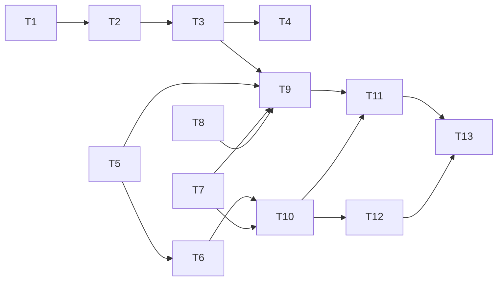

# Tasks: Редизайн «Планирования техники АПК» — расчёт потребности по техкартам

> Requirements: @requirements.md (approved, D-001..D-008)
> Design: @design.md (approved, TD-001..TD-008, FAQ Q1–Q4 ок)
> Status: Approved (2026-10-09)
> Спека: 002-redesign-planirovaniia-tekhniki

## Общий пайплайн каждой задачи (§9 redesign-prompt, строго)

```text
pre_load_validate.py → bsl-ls (MCP bsl_analyze; 0 файлов = НЕ выполнено) → v8std (MCP)
→ db-load-xml.ps1 Full -Extension ПланированиеТехникиАПК -UpdateDB
→ прочитать СВЕЖИЙ load_log.txt ($TEMP/db_load_xml_*, utf-8-sig|cp1251)
→ при структурных изменениях: kill 1cv8* → designer_agent stop/start → agent_cmd_apply
→ при структурных правках метаданных: dump_extension.py → compare (content diff REAL = блокер)
→ назначение ролей (va_assign_roles_direct.py) → VA-прогон (по необходимости)
→ коммит + строка в heartbeat/night.log
```

Загрузка: `powershell.exe -NoProfile -File C:/MyProjects/PiPack/skills/1c/db-load-xml/scripts/db-load-xml.ps1
-V8Path "C:\Program Files\1cv8\8.5.4.1683\bin" -InfoBaseServer "localhost" -InfoBaseRef "dev_erpapk_demo"
-UserName "Администратор (ОрловАВ)" -Password "" -ConfigDir "C:\MyProjects\APKTechPlan\src\cfe\ПланированиеТехникиАПК"
-Mode Full -Extension "ПланированиеТехникиАПК" -UpdateDB`
VA: `PYTHONIOENCODING=utf-8 python scripts/run_va_feature.py <feature> <timeout>`; вердикт только
по строке «Выполнение сценариев закончено. Ошибок не было./БЫЛИ ОШИБКИ.». Кириллица — только
python-скриптами (utf-8-sig, CRLF, newline='').

## Requirement Coverage

| Req | Tasks | Notes |
|-----|-------|-------|
| FR-001 (типы) | T2, T3 | шапка+регистр (T2), ТЧ+формы (T3) |
| FR-002 (сцепка) | T4 | форма + серверная валидация |
| FR-003 (обработка) | T7, T8, T9 | потребность (T7), доступность (T8), сборка (T9) |
| FR-004 (коэффициенты) | T5, T6, T9 | функция (T5), переключение расчёта (T6), замещение (T9) |
| FR-005 (удаление) | T6 | атомарно с переключением (TD-004) |
| FR-006 (синонимы) | T1 | + тексты VA 01/02 |
| FR-007 (права/Агроном) | T10, T12 | роли (T10), правовой сценарий (T12) |
| NFR-001 (НТТ) | T2, T3, T4 | следствие ретайпинга; проверяется в VA |
| NFR-002 (производительность) | T7 | 2 запроса оборотов; таймауты VA 08 |
| NFR-003 (прямые типы CFE) | T2 | первый загрузочный зонд |
| NFR-004 (права не под админом) | T12 | |
| US-001 | T7, T8, T9, T11 | |
| US-002 | T3, T4 | |
| US-003 | T1, T6 | |
| US-004 | T10, T12 | |

## Implementation Readiness Check

| Check | Status | Notes |
|-------|--------|-------|
| Must Have покрыты задачами | Pass | FR-001..FR-007 → T1..T12 |
| Requirements покрыты дизайном | Pass | design §2 mapping |
| Критические Questions закрыты | Pass | Q-001/Q-002 → D-007/D-008; FAQ Q1–Q4 ок |
| У задач есть зависимости/критерии/файлы/верификация | Pass | ниже |
| Команды верификации известны | Pass | пайплайн выше; ручные — помечены |

## Implementation Slices

- **Slice «Гигиена» (MVP, US-003):** T1 → T2 → T3 → T4 → T5 → T6
- **Slice «Расчёт» (US-001):** T7 → T8 → T9 → T11
- **Slice «Права» (US-004):** T10 → T12
- **Финал:** T13

---

## T1: Синонимы (FR-006) — DONE (2026-10-09, VA 01/02 PASS, round-trip PASS)

**Priority:** P0 | **Estimate:** 1h | **Depends:** none | **Covers:** FR-006, US-003

Work:
- [x] Documents/Тх_ПланТехническихРесурсов.xml: Synonym → «Потребность в технике»; Comment под новую семантику
- [x] Reports/Тх_ДефицитТехники/…: Synonym → «Анализ дефицита техники» (+заголовки СКД, если захардкожены)
- [x] Enums/Тх_ВидыТехники.xml: Synonym → «Виды техники (Тх)»
- [x] tests/vanessa/01,02: тексты шагов (01/02 не содержали старых заголовков; обновлены 03–08) навигации по заголовкам («Дефицит техники»→«Анализ дефицита техники», «План технических ресурсов»→«Потребность в технике»)

Acceptance: синонимы в UI различимы; внутренние имена НЕ изменены (git diff — только Synonym-блоки).
Files: 3 XML + 2 feature.
Verification: пайплайн (структурных изменений нет → без apply); round-trip; VA 01, VA 02 PASS.

## T2: Ретайпинг шапки документа + регистра дефицита (FR-001, NFR-003) — DONE (2026-10-09, NFR-003 подтверждён, RT PASS)

**Priority:** P0 | **Estimate:** 1h | **Depends:** T1 | **Covers:** FR-001, NFR-001, NFR-003, TD-001

Work:
- [x] scripts/retype_extension.py: замена `<v8:TypeId>GUID</v8:TypeId>` → `<v8:Type>cfg:CatalogRef.X</v8:Type>` по таблице design §5.1 (шапка) и §5.2 (регистр Тх_ДефицитТехники: 7 измерений; МодельТехники — составной 4 типов)
- [x] Формы: Form.xml реквизитов (generic-реквизитов в формах не оказалось — проверено) с новыми типами (Тх_ФормаДокумента; ФормаЗаписи регистра дефицита, если есть)
- [x] Это ПЕРВЫЙ зонд NFR-003: прямые cfg-типы в CFE — маленький коммит

Acceptance: в XML нет `TypeId` у ретайпированных реквизитов; pre_load_validate clean; загрузка приняла прямые типы (иначе — СТОП, эскалация, НЕ откат в generic).
Files: Documents/Тх_ПланТехническихРесурсов.xml, InformationRegisters/Тх_ДефицитТехники.xml, формы, scripts/retype_extension.py.
Verification: пайплайн ПОЛНЫЙ (структурное изменение: apply + round-trip обязательны); UI: поля без «Выбор типа данных» (скриншот-проба опционально).

## T3: Ретайпинг ТЧ + новые колонки документа (FR-001, D-008, TD-002)

**Priority:** P0 | **Estimate:** 2h | **Depends:** T2 | **Covers:** FR-001, NFR-001, US-002 (частично)

Work:
- [ ] ТЧ ОсновнаяТехника: МодельТехники→`CatalogRef.АпкМоделиСХТехники`, Оборудование→`CatalogRef.АпкМоделиСХОборудования`; + ВидРаботы (`ВидыРаботСотрудников`), ПотребностьСмен, ПотребностьЧасов, ДоступноЕдиниц
- [ ] ТЧ Автотранспорт: МодельТехники→`АпкМоделиАвтотранспорта`, Оборудование→`АпкМоделиПрицепов`; + те же 3 колонки
- [ ] ТЧ Оборудование: МодельТехники→`АпкМоделиСХОборудования` (без новых колонок, FAQ Q1)
- [ ] ТранспортноеСредство → `CatalogRef.ТранспортныеСредства`; Количество/Принят — конкретные типы
- [ ] Форма Тх_ФормаДокумента: колонки таблиц (id=25/58/91) + BeforeAddRow-дефолты сохранены (baseline!)
- [ ] ObjectModule: при необходимости чистка рантайм-заглушек под старые generic-типы

Acceptance: НТТ-проходимость — все поля форм вводимы, generic-полей нет; сценарий 03 (строки/дефолты) — на своих шагах зелёный.
Files: Documents/…/Тх_ПланТехническихРесурсов.xml, Forms/Тх_ФормаДокумента/Ext/Form.xml + Module.bsl, ObjectModule.bsl.
Verification: полный пайплайн + round-trip; bsl-ls/v8std на Module.bsl; VA 03 (навигация — известная проблема, допустим FAIL только на ней).

## T4: Совместимость сцепки (FR-002)

**Priority:** P0 | **Estimate:** 2h | **Depends:** T3 | **Covers:** FR-002, NFR-001

Work:
- [ ] Тх_ТехникаСервер.ВалидироватьСцепку(Модель, Оборудование): ТипЗнч-контроль пары; вызов из ObjectModule (ПередЗаписью) → Отказ
- [ ] Форма: при изменении МодельТехники — очистка несовместимого Оборудования; фильтрация списка выбора Оборудования по типу модели (НачалоВыбора/АвтоПодборВыбора)
- [ ] Unit-тесты (Тх_Тесты): пары совместимо/несовместимо ×4

Acceptance: невозможная сцепка не выбирается и не записывается (серверный отказ).
Files: CommonModules/Тх_ТехникаСервер, Тх_Тесты, Forms/Тх_ФормаДокумента.
Verification: пайплайн; unit-тесты (scripts/run_unit_tests.py) PASS.

## T5: КоэффициентЗамещенияМоделей (FR-004, TD-003) — аддитивно

**Priority:** P0 | **Estimate:** 2h | **Depends:** none (параллельно T1–T4) | **Covers:** FR-004

Work:
- [ ] Тх_ТехникаСервер.КоэффициентЗамещения(МодельОригинал, МодельЗамены): приоритеты реквизитов по видам (design §6.4), старт по МощностьДвигателя (есть МощностьДвигателяМодели), Неопределено если неоткуда взять (КоэффициентНеЗадан)
- [ ] Тх_ТехникаСервер.РеквизитЗамещения(Модель) — выбор базового реквизита
- [ ] Unit-тесты: 4 вида моделей, приоритет ручных, старт по мощности, пустые реквизиты → Неопределено

Acceptance: К = Реквизит(замены)/Реквизит(оригинала) на демо-моделях «Тх_Тест Базовая/Аналог» (ширина 1.5×).
Files: CommonModules/Тх_ТехникаСервер, Тх_Тесты.
Verification: пайплайн; unit-тесты PASS.

## T6: Удаление Тх_КоэффициентыПересчетаРабот + Тх_ЗаполнениеКоэффициентов, переключение расчёта (FR-005, TD-004)

**Priority:** P0 | **Estimate:** 3h | **Depends:** T5 | **Covers:** FR-005, FR-004 (переключение), US-003

Work (АТОМАРНО, один коммит):
- [ ] Удалить: InformationRegisters/Тх_КоэффициентыПересчетаРабот.xml + каталог (ФормаЗаписи/ФормаСписка); DataProcessors/Тх_ЗаполнениеКоэффициентов.xml + каталог
- [ ] Configuration.xml: убрать из ChildObjects; Subsystems/Тх_ПланированиеТехники/Content — строка регистра и обработки
- [ ] Roles/Тх_Чтение/Rights.xml, Тх_Редактирование/Rights.xml — права удалённых объектов
- [ ] Тх_ТехникаСервер: −КоэффициентНаДату(356), −ТочностьКоэффициента(338), −блок записи наборов(955), −валидация регистра(1178); ДоступноСменСтроки(889) → на КоэффициентЗамещения
- [ ] Тх_РасчетДефицита: проверить ссылки (bsl-ls покажет); списки форм — обновить
- [ ] Тх_Тесты: −12 тестов старого регистра, +тесты ДоступноСменСтроки на модельных коэффициентах

Acceptance: bsl-ls 0 Error по всему расширению; в базе объекты отсутствуют (db_cfe_list.py); рантайм-баг §2.3 закрыт (формы нет).
Files: см. выше (полный список в design §5.5).
Verification: полный пайплайн + round-trip (удаление — структурное!); unit-тесты PASS; VA 01/02 PASS (шаги не трогают удалённое).

## T7: Обработка Тх_ФормированиеПланаРаботТехники + запрос потребности (FR-003.1–2, TD-005/006)

**Priority:** P0 | **Estimate:** 3h | **Depends:** none (после T2 желательно — общий retype-скрипт) | **Covers:** FR-003, NFR-002

Work:
- [ ] DataProcessor Тх_ФормированиеПланаРаботТехники.xml (+форма): параметры Организация/Подразделение/Сценарий/ПериодС/ПериодПо/ДнейПериода/СменВдень — все с конкретными типами
- [ ] Тх_ТехникаСервер.ПотребностьПоТехкартам(Параметры): 2 запроса оборотов (Механизированные/Транспортные; dot-синтаксис 8.5 + Oborot, паттерн ЗапросПотребности), отборы Подразделение В ИЕРАРХИИ + Сценарий + Организация + окно периода (FAQ Q2: пересечение); Σ Смен_Вер/Часов_Вер
- [ ] Кнопка «Сформировать» — явная Button + Form.Command.Сформировать
- [ ] Unit-тесты на демо-данных 2014–2015: суммы смен по моделям «Тх_Тест Базовая/Аналог», фильтр чужого подразделения

Acceptance: запросы компилируются (bsl-ls); суммы сходятся с ручной проверкой по выгрузке (COM-проба).
Files: DataProcessors/Тх_ФормированиеПланаРаботТехники/**, CommonModules/Тх_ТехникаСервер, Тх_Тесты.
Verification: полный пайплайн + round-trip; unit-тесты PASS.

## T8: Доступность моделей подразделения (FR-003.4, TD-007)

**Priority:** P0 | **Estimate:** 2h | **Depends:** none | **Covers:** FR-003

Work:
- [ ] Тх_ТехникаСервер.ДоступныеМоделиПодразделения(Организация, Сценарий, Подразделение): проведённые АпкПланТехническихРесурсов, Подразделение В ИЕРАРХИИ ТЧ.Подразделения; 4 ТЧ ТС → Справочник.ТранспортныеСредства.АпкМодель → КОЛИЧЕСТВО(*) по моделям
- [ ] Флаг «План распределения отсутствует» (нет документа → пустая карта)
- [ ] Unit-тесты: по демо-данным НИВА/Отделение №2 (Тх_Тест ТС 001..004), без документа → флаг

Acceptance: карта модель→количество единиц корректна; флаг работает.
Files: CommonModules/Тх_ТехникаСервер, Тх_Тесты.
Verification: пайплайн; unit-тесты PASS.

## T9: ЗаполнитьПланРабот — сборка документа (FR-003.3/5, TD-008, §6.3–6.4)

**Priority:** P0 | **Estimate:** 3h | **Depends:** T3, T5, T7, T8 | **Covers:** FR-003, FR-004 (замещение)

Work:
- [ ] Тх_ТехникаСервер.ЗаполнитьПланРабот(Документ, Параметры): строки по (модель, прицепное, вид работы); ДоступноЕдиниц из T8; Количество = ОКРВВЕРХ(ПотребностьСмен/(ДнейПериода×СменВдень)); замещение §6.4 (max К≥1, иначе max К<1 с пометкой; фиксация в строке + комментарий «замещение: …»)
- [ ] Создание нового документа из обработки / «Перезаполнить текущий» (подтверждение, FAQ Q8)
- [ ] Edge-cases design §9 (пустые техкарты → сообщение, без документа; модель без ТС и без коэффициента → КоэффициентНеЗадан-строка)
- [ ] Unit-тесты: полный прогон на 2014–2015 (потребность vs доступность vs замещение)

Acceptance: обработка формирует корректируемый документ; сценарий юзера (ширина 1.5× → смен/1.5) воспроизводится тестом.
Files: CommonModules/Тх_ТехникаСервер, DataProcessors/…/Forms/Форма/Ext/Form/Module.bsl, Тх_Тесты.
Verification: пайплайн; unit-тесты PASS; ручная UI-проверка (сессия интерактивна).

## T10: Подсистема, роли, команды (FR-007 prep)

**Priority:** P1 | **Estimate:** 1h | **Depends:** T6, T7 | **Covers:** FR-007 (подготовка)

Work:
- [ ] Subsystems/Тх_ПланированиеТехники: +Тх_ФормированиеПланаРаботТехники в состав и командный интерфейс
- [ ] Roles: права новой обработки (Чтение — Тх_Чтение; Использование — Тх_Редактирование)
- [ ] Ревизия всех команд раздела после синонима «Потребность в технике»

Acceptance: команда «Формирование плана работ техники» видна в разделе под админом.
Files: Subsystems/**, Roles/**.
Verification: пайплайн; UI-проверка панели раздела.

## T11: VA-сценарий 08 (e2e обработки) + фикс 03 (US-001)

**Priority:** P1 | **Estimate:** 3h | **Depends:** T9, T10 | **Covers:** FR-003, NFR-001/002

Work:
- [ ] tests/vanessa/08-formirovanie-plana-rabot-tekhniki.feature: серверная подготовка (техкарты/план распределения 2014–2015) → открытие обработки → параметры → Сформировать → проверка строк (модели, смены, замещение) → корректировка → Записать; НТТ: ссылки — «ввожу текст»
- [ ] 03-…feature: разобрать FAIL навигации «Планы технических ресурсов» (переименовано в «Потребность в технике»!) → чинить; если проблема видимости воспроизводится и после переименования — под «Агроном» в T12
- [ ] Прогон 01, 02, 03, 08 — все PASS

Acceptance: VA-вердикты «Ошибок не было» по 01/02/03/08.
Files: tests/vanessa/03, 08 (+ step-файлы при необходимости).
Verification: run_va_feature.py по каждой; логи heartbeat/va_*.

## T12: Правовые тесты под «Агроном» (FR-007, US-004, NFR-004)

**Priority:** P1 | **Estimate:** 2h | **Depends:** T10 | **Covers:** FR-007, NFR-004

Work:
- [ ] Smoke: «Агроном» открывает базу (COM/enterprise запуск; без Тх_-ролей)
- [ ] va_assign_roles_direct.py Агроном add (Тх_Чтение; затем Тх_Редактирование)
- [ ] tests/vanessa/09-prava-agronom.feature: видимость раздела/команд по ролям; отказ без роли; СЦЕНАРИИ ТОЛЬКО ПОД «АГРОНОМОМ» (не под админом!)
- [ ] Если «команда не найдена в панели» (открытая проблема §8 промта) воспроизводится под Агрономом — зафиксировать диагностику (метаданные vs CommandInterface vs права) в night.log и отчёте

Acceptance: правовой сценарий PASS под Агрономом; вывод о видимости команд документирован.
Files: tests/vanessa/09.feature, scripts/va_assign_roles_direct.py (если надо).
Verification: VA под Агрономом; логи.

## T13: Финальная верификация + handoff (все FR/NFR)

**Priority:** P1 | **Estimate:** 2h | **Depends:** T11, T12 | **Covers:** весь spec

Work:
- [ ] Полный round-trip: dump_extension → compare_dump_dirs.py → «only in source» = 0, content diff REAL = 0
- [ ] Полный VA-набор 01–03, 08, 09 PASS; unit-тесты PASS; bsl-ls+v8std по всему расширению 0 Error
- [ ] inventory_extension.py: контроль типов (ни одного TypeId у ретайпированных)
- [ ] heartbeat/night.log: итоговая запись; sdd-brief.md обновить

Acceptance: все гейты зелёные — материал для sdd-review.
Files: heartbeat/**, .ai/sdd/handoff/sdd-brief.md.
Verification: см. шаги; отчёт в чате по формату Command/Exit/Summary/Verdict.

---

## Dependency Graph



Порядок исполнения: T1 → T2 → T3 → T4 → T5 → T6 → T7 → T8 → T9 → T10 → T11 → T12 → T13
(T5/T7/T8 можно выполнять между T1–T4 — аддитивные, конфликтов с ретайпингом нет,
но загрузки в базу всё равно последовательные).
