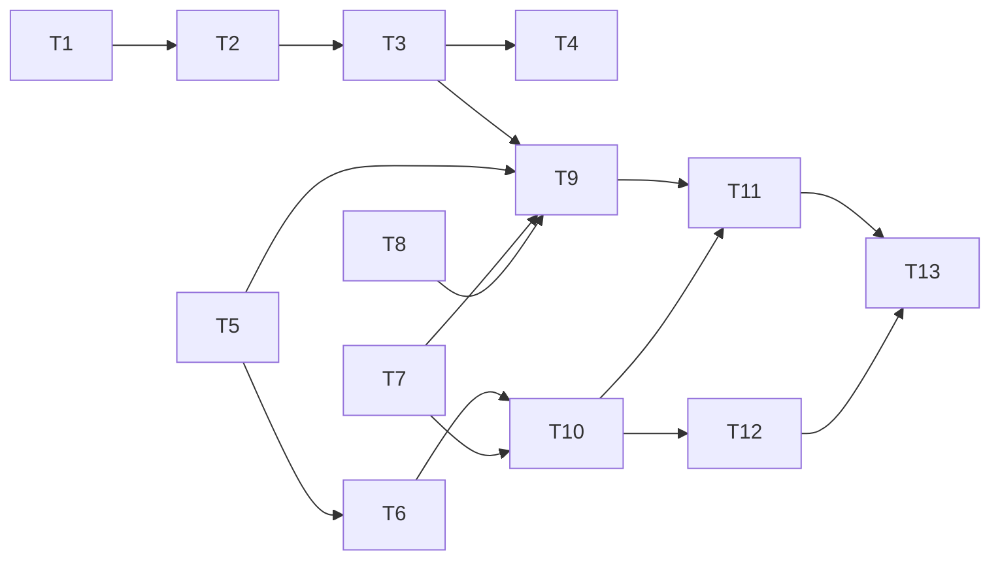

# Tasks: Редизайн «Планирования техники АПК» — расчёт потребности по техкартам

> Requirements: @requirements.md (approved, D-001..D-008)
> Design: @design.md (approved, TD-001..TD-008, FAQ Q1–Q4 ок)
> Status: Approved (2026-10-09)
> Спека: 002-redesign-planirovaniia-tekhniki

## Общий пайплайн каждой задачи (§9 redesign-prompt, строго)

```text
pre_load_validate.py → bsl-ls (MCP bsl_analyze; 0 файлов = НЕ выполнено) → v8std (MCP)
→ db-load-xml.ps1 Full -Extension ПланированиеТехникиАПК -UpdateDB
→ прочитать СВЕЖИЙ load_log.txt ($TEMP/db_load_xml_*, utf-8-sig|cp1251)
→ при структурных изменениях: kill 1cv8* → designer_agent stop/start → agent_cmd_apply
→ при структурных правках метаданных: dump_extension.py → compare (content diff REAL = блокер)
→ назначение ролей (va_assign_roles_direct.py) → VA-прогон (по необходимости)
→ коммит + строка в heartbeat/night.log
```

Загрузка: `powershell.exe -NoProfile -File C:/MyProjects/PiPack/skills/1c/db-load-xml/scripts/db-load-xml.ps1
-V8Path "C:\Program Files\1cv8\8.5.4.1683\bin" -InfoBaseServer "localhost" -InfoBaseRef "dev_erpapk_demo"
-UserName "Администратор (ОрловАВ)" -Password "" -ConfigDir "C:\MyProjects\APKTechPlan\src\cfe\ПланированиеТехникиАПК"
-Mode Full -Extension "ПланированиеТехникиАПК" -UpdateDB`
VA: `PYTHONIOENCODING=utf-8 python scripts/run_va_feature.py <feature> <timeout>`; вердикт только
по строке «Выполнение сценариев закончено. Ошибок не было./БЫЛИ ОШИБКИ.». Кириллица — только
python-скриптами (utf-8-sig, CRLF, newline='').

## Requirement Coverage

| Req | Tasks | Notes |
|-----|-------|-------|
| FR-001 (типы) | T2, T3 | шапка+регистр (T2), ТЧ+формы (T3) |
| FR-002 (сцепка) | T4 | форма + серверная валидация |
| FR-003 (обработка) | T7, T8, T9 | потребность (T7), доступность (T8), сборка (T9) |
| FR-004 (коэффициенты) | T5, T6, T9 | функция (T5), переключение расчёта (T6), замещение (T9) |
| FR-005 (удаление) | T6 | атомарно с переключением (TD-004) |
| FR-006 (синонимы) | T1 | + тексты VA 01/02 |
| FR-007 (права/Агроном) | T10, T12 | роли (T10), правовой сценарий (T12) |
| NFR-001 (НТТ) | T2, T3, T4 | следствие ретайпинга; проверяется в VA |
| NFR-002 (производительность) | T7 | 2 запроса оборотов; таймауты VA 08 |
| NFR-003 (прямые типы CFE) | T2 | первый загрузочный зонд |
| NFR-004 (права не под админом) | T12 | |
| US-001 | T7, T8, T9, T11 | |
| US-002 | T3, T4 | |
| US-003 | T1, T6 | |
| US-004 | T10, T12 | |

## Implementation Readiness Check

| Check | Status | Notes |
|-------|--------|-------|
| Must Have покрыты задачами | Pass | FR-001..FR-007 → T1..T12 |
| Requirements покрыты дизайном | Pass | design §2 mapping |
| Критические Questions закрыты | Pass | Q-001/Q-002 → D-007/D-008; FAQ Q1–Q4 ок |
| У задач есть зависимости/критерии/файлы/верификация | Pass | ниже |
| Команды верификации известны | Pass | пайплайн выше; ручные — помечены |

## Implementation Slices

- **Slice «Гигиена» (MVP, US-003):** T1 → T2 → T3 → T4 → T5 → T6
- **Slice «Расчёт» (US-001):** T7 → T8 → T9 → T11
- **Slice «Права» (US-004):** T10 → T12
- **Финал:** T13

---

## T1: Синонимы (FR-006) — DONE (2026-10-09, VA 01/02 PASS, round-trip PASS)

**Priority:** P0 | **Estimate:** 1h | **Depends:** none | **Covers:** FR-006, US-003

Work:
- [x] Documents/Тх_ПланТехническихРесурсов.xml: Synonym → «Потребность в технике»; Comment под новую семантику
- [x] Reports/Тх_ДефицитТехники/…: Synonym → «Анализ дефицита техники» (+заголовки СКД, если захардкожены)
- [x] Enums/Тх_ВидыТехники.xml: Synonym → «Виды техники (Тх)»
- [x] tests/vanessa/01,02: тексты шагов (01/02 не содержали старых заголовков; обновлены 03–08) навигации по заголовкам («Дефицит техники»→«Анализ дефицита техники», «План технических ресурсов»→«Потребность в технике»)

Acceptance: синонимы в UI различимы; внутренние имена НЕ изменены (git diff — только Synonym-блоки).
Files: 3 XML + 2 feature.
Verification: пайплайн (структурных изменений нет → без apply); round-trip; VA 01, VA 02 PASS.

## T2: Ретайпинг шапки документа + регистра дефицита (FR-001, NFR-003) — DONE (2026-10-09, NFR-003 подтверждён, RT PASS)

**Priority:** P0 | **Estimate:** 1h | **Depends:** T1 | **Covers:** FR-001, NFR-001, NFR-003, TD-001

Work:
- [x] scripts/retype_extension.py: замена `<v8:TypeId>GUID</v8:TypeId>` → `<v8:Type>cfg:CatalogRef.X</v8:Type>` по таблице design §5.1 (шапка) и §5.2 (регистр Тх_ДефицитТехники: 7 измерений; МодельТехники — составной 4 типов)
- [x] Формы: Form.xml реквизитов (generic-реквизитов в формах не оказалось — проверено) с новыми типами (Тх_ФормаДокумента; ФормаЗаписи регистра дефицита, если есть)
- [x] Это ПЕРВЫЙ зонд NFR-003: прямые cfg-типы в CFE — маленький коммит

Acceptance: в XML нет `TypeId` у ретайпированных реквизитов; pre_load_validate clean; загрузка приняла прямые типы (иначе — СТОП, эскалация, НЕ откат в generic).
Files: Documents/Тх_ПланТехническихРесурсов.xml, InformationRegisters/Тх_ДефицитТехники.xml, формы, scripts/retype_extension.py.
Verification: пайплайн ПОЛНЫЙ (структурное изменение: apply + round-trip обязательны); UI: поля без «Выбор типа данных» (скриншот-проба опционально).

## T3: Ретайпинг ТЧ + новые колонки документа (FR-001, D-008, TD-002) — DONE (2026-10-09; VA 01/02 PASS, 03 FAIL только на навигации — известная, T11)

**Priority:** P0 | **Estimate:** 2h | **Depends:** T2 | **Covers:** FR-001, NFR-001, US-002 (частично)

Work:
- [x] ТЧ ОсновнаяТехника: МодельТехники→`CatalogRef.АпкМоделиСХТехники`, Оборудование→`CatalogRef.АпкМоделиСХОборудования`; + ВидРаботы (`ВидыРаботСотрудников`), ПотребностьСмен, ПотребностьЧасов, ДоступноЕдиниц
- [x] ТЧ Автотранспорт: МодельТехники→`АпкМоделиАвтотранспорта`, Оборудование→`АпкМоделиПрицепов`; + те же 3 колонки
- [x] ТЧ Оборудование: МодельТехники→`АпкМоделиСХОборудования` (без новых колонок, FAQ Q1)
- [x] ТранспортноеСредство → `CatalogRef.ТранспортныеСредства`; Количество/Принят — конкретные типы
- [x] Форма Тх_ФормаДокумента: колонки таблиц (id=25/58/91) + BeforeAddRow-дефолты сохранены (baseline!)
- [x] ObjectModule: при необходимости чистка рантайм-заглушек под старые generic-типы

Acceptance: НТТ-проходимость — все поля форм вводимы, generic-полей нет; сценарий 03 (строки/дефолты) — на своих шагах зелёный.
Files: Documents/…/Тх_ПланТехническихРесурсов.xml, Forms/Тх_ФормаДокумента/Ext/Form.xml + Module.bsl, ObjectModule.bsl.
Verification: полный пайплайн + round-trip; bsl-ls/v8std на Module.bsl; VA 03 (навигация — известная проблема, допустим FAIL только на ней).

## T4: Совместимость сцепки (FR-002) — DONE (2026-10-09; серверная валидация + ПередЗаписью; форменные обработчики не нужны: типы колонок жёсткие после T3 — реализовано структурно, design §5.3)

**Priority:** P0 | **Estimate:** 2h | **Depends:** T3 | **Covers:** FR-002, NFR-001

Work:
- [x] Тх_ТехникаСервер.ВалидироватьСцепку(Модель, Оборудование): ТипЗнч-контроль пары; вызов из ObjectModule (ПередЗаписью) → Отказ
- [x] Форма: при изменении МодельТехники — очистка несовместимого Оборудования; фильтрация списка выбора Оборудования по типу модели (НачалоВыбора/АвтоПодборВыбора)
- [x] Unit-тесты (Тх_Тесты): пары совместимо/несовместимо ×4

Acceptance: невозможная сцепка не выбирается и не записывается (серверный отказ).
Files: CommonModules/Тх_ТехникаСервер, Тх_Тесты, Forms/Тх_ФормаДокумента.
Verification: пайплайн; unit-тесты (scripts/run_unit_tests.py) PASS.

## T5: КоэффициентЗамещенияМоделей (FR-004, TD-003) — аддитивно — DONE (2026-10-09; К=1.5 по ширине подтверждён юнит-тестом; состав реквизитов сверен с АПК 2.5.27.88 через rlm)

**Priority:** P0 | **Estimate:** 2h | **Depends:** none (параллельно T1–T4) | **Covers:** FR-004

Work:
- [x] Тх_ТехникаСервер.КоэффициентЗамещения(МодельОригинал, МодельЗамены): приоритеты реквизитов по видам (design §6.4), старт по МощностьДвигателя (есть МощностьДвигателяМодели), Неопределено если неоткуда взять (КоэффициентНеЗадан)
- [x] Тх_ТехникаСервер.РеквизитЗамещения(Модель) — выбор базового реквизита
- [x] Unit-тесты: 4 вида моделей, приоритет ручных, старт по мощности, пустые реквизиты → Неопределено

Acceptance: К = Реквизит(замены)/Реквизит(оригинала) на демо-моделях «Тх_Тест Базовая/Аналог» (ширина 1.5×).
Files: CommonModules/Тх_ТехникаСервер, Тх_Тесты.
Verification: пайплайн; unit-тесты PASS.

## T6: Удаление Тх_КоэффициентыПересчетаРабот + Тх_ЗаполнениеКоэффициентов, переключение расчёта (FR-005, TD-004) — DONE

**Priority:** P0 | **Estimate:** 3h | **Depends:** T5 | **Covers:** FR-005, FR-004 (переключение), US-003

Work (АТОМАРНО, один коммит):
- [x] Удалить: InformationRegisters/Тх_КоэффициентыПересчетаРабот.xml + каталог (ФормаЗаписи/ФормаСписка); DataProcessors/Тх_ЗаполнениеКоэффициентов.xml + каталог
- [x] Configuration.xml: убрать из ChildObjects; Subsystems/Тх_ПланированиеТехники/Content — строка регистра и обработки (+ 2 блока Command из CommandInterface.xml: CommandsVisibility и CommandsOrder)
- [x] Roles/Тх_Чтение/Rights.xml, Тх_Редактирование/Rights.xml — права удалённых объектов
- [x] Тх_ТехникаСервер: −КоэффициентНаДату, −ТочностьКоэффициента, −области АвтозаполнениеПоМощности и ВалидацияКоэффициентов, −ИмяТипаМодели (мёртвый код); ДоступноСменСтроки → на КоэффициентЗамещения (К=Неопределено → КоэффициентНеЗадан=Истина, FR-011)
- [x] Тх_РасчетДефицита: ссылка на Тх_ЗаполнениеКоэффициентов — только в комментарии (убран); DRIVE-BY ФИКС: СуффиксОбъема была &НаКлиенте при вызове из &НаСервере (дефект с базовой линии A8+A9, вскрыт VA-07) → &НаСервере
- [x] Тх_Тесты: −хелпер ОчиститьКоэффициенты, −9 тестов старого регистра, ДоступноСменКонтракт → КоэффициентЗамещения, +ТестДоступноСменЧерезЗамещение, +ТестДоступноСменЗамещениеНеЗадан (итого 13 тестов; раннер и run_unit_tests.py обновлены)

Acceptance: bsl-ls 0 Error — OK; в базе объекты отсутствуют — OK (RT-dump 38=38, «Объект удалён: РегистрСведений.Тх_КоэффициентыПересчетаРабот», поколение 49e5c875).
Files: см. выше (полный список в design §5.5). Применение: scripts/t6_apply.py (11 частей).
Verification: pre_load OK; bsl-ls 0E; load clean; force-apply 49e5c875; RT PASS 38=38 (0 сирот, 0 REAL); unit 13/13 PASS (оба новых теста замещения PASS); VA 01 (замещение по ширине) PASS, VA 02 (замещение по мощности) PASS — фичи переписаны на серверные сценарии замещения, шагов по удалённым объектам нет. VA-07: компиляция формы исправлена (СуффиксОбъема), остался сбой селектора 'СписокСтрокаПоиска' в форме выбора АПК — семейство VA-03 nav-сбоя, переносится в T11; VA-08: шаг «отсутствует команда 'Коэффициенты пересчёта работ'» остаётся валидным (отсутствие).

## T7: Обработка Тх_ФормированиеПланаРаботТехники + запрос потребности (FR-003.1–2, TD-005/006) — DONE

**Priority:** P0 | **Estimate:** 3h | **Depends:** none (после T2 желательно — общий retype-скрипт) | **Covers:** FR-003, NFR-002

Work:
- [x] DataProcessor Тх_ФормированиеПланаРаботТехники.xml (+форма): параметры Организация/Подразделение/Сценарий/ПериодС/ПериодПо/ДнейПериода/СменВдень — все с конкретными cfg-типами (NFR-003, формат T2)
- [x] Тх_ТехникаСервер.ПотребностьПоТехкартам(Параметры) [область ФормированиеПланаРабот]: ОБЪЕДИНИТЬ 2 запроса оборотов (Мех/Транспортные; Смен_ВерОборот/Часов_ВерОборот по паттерну ЗапросПотребности), отборы Подразделение В ИЕРАРХИИ + Сценарий + Организация (если заполнена) + окно периода (FAQ Q2); Σ Смен_Вер/Часов_Вер; колонки ВидТехники/ВидРаботы/МодельТехники/Оборудование/ПотребностьСмен/ПотребностьЧасов
- [x] Кнопка «Сформировать» — Button + Form.Command.Сформировать; T7: сводка результата (строки/смены/часы, «Техкарты за период не найдены»); создание документа — T9 (ЗаполнитьПланРабот, design §5.4)
- [x] Unit-тесты: ТестПотребностьПоТехкартам_ДемоДанные (строки>0, смены>0, кросс-чек Σ смен = Σ ЗапросПотребности релиза-001 — суммы сошлись на демо-данных) и ТестПотребностьПоТехкартам_ЧужоеПодразделение (фильтр В ИЕРАРХИИ пустой → 0 строк); итого 15 тестов
- [x] DRIVE-BY ФИКСЫ ( latent-дефекты релиза-001, вскрыты новыми вызовами): СуффиксОбъема и ЗапросПотребности падали «Поле объекта не обнаружено» при отсутствии необязательных ключей Организация/Подразделение/СуффиксОбъема в структуре параметров (докстринг обещал необязательность) → чтение через Свойство()/ЗначениеПоУмолчанию

Acceptance: запросы компилируются — OK (bsl-ls 0E; QueryParseError/AssignAliasFields — известные FP семейства runtime-запросов); суммы сходятся — OK (кросс-чек двух независимых построений запроса на демо-данных 2014–2015).
Files: DataProcessors/Тх_ФормированиеПланаРаботТехники/**, CommonModules/Тх_ТехникаСервер, Тх_Тесты, Configuration.xml, Subsystems, Roles x2, CommandInterface. Применение: scripts/t7_apply.py (10 частей; ПРИМЕЧАНИЕ: uuid4 — повторный запуск сгенерирует другие UUID, скрипт = запись операции).
Verification: pre_load OK; bsl-ls 0E; load clean ×3; force-apply (поколение 374d4ecf + 2 текстовых применения); RT PASS 42=42 (0 сирот, 0 REAL; платформа нормализует: Events после ExtendedTooltip, блок прав перед Report); unit 15/15 PASS; VA 01/02 PASS.

ПЛАТФОРМЕННЫЕ НЮАНСЫ (в night.log): 1C строг к незакрытому #Область (bsl-ls НЕ ловит — считать баланс регионов при вставках); Структура.Ключ при отсутствии ключа = рантайм-ошибка, докстринги «необязательный ключ» требуют Свойство()/ЗначениеПоУмолчанию.

## T8: Доступность моделей подразделения (FR-003.4, TD-007) — DONE

**Priority:** P0 | **Estimate:** 2h | **Depends:** none | **Covers:** FR-003

Work:
- [x] Тх_ТехникаСервер.ДоступныеМоделиПодразделения(Параметры) [region ФормированиеПланаРабот]: 2 шага — (1) РАЗЛИЧНЫЕ проведённые АпкПланТехническихРесурсов по Сценарий+[Организация]+[Подразделение]; (2) карта по 4 ТЧ (Техника/Оборудование/Автотранспорт/Прицепы) → ВНУТРЕННЕЕ СОЕДИНЕНИЕ ТранспортныеСредства.АпкМодель (составной мост ТС→модель, design 6.2), КОЛИЧЕСТВО(*) по моделям, тип = литерал АпкТипыТС по имени ТЧ (std787); результат: Модели (ТЗ: МодельТехники/ТипТС/ЕдиницДоступно, без пустых моделей) + ПланОтсутствует
- [x] Флаг «План распределения отсутствует» = 0 документов по отборам (паттерн релиза 001)
- [x] Unit-тесты (+2, итого 17): ТестДоступныеМодели_ПланРаспределения (создаёт ПРОВЕДЁННЫЙ АпкПланТехническихРесурсов с ТС 001..004 → карта: 1 модель «Тх_Тест Базовая», единиц=кол-во ТС, тип СХТехника; чужое подразделение → флаг+пусто; очистка УдалитьСсылку докстринг расширен до ДокументСсылка) и ТестДоступныеМодели_БезПлана (новый сценарий → флаг+пустая карта+3 колонки)

Acceptance: карта модель→количество корректна — OK (17/17); флаг работает — OK (оба теста).
Files: CommonModules/Тх_ТехникаСервер (+заголовок: −устаревшая строка об удалённом в T6 автозаполнении, +строка о формировании плана работ), Тх_Тесты, Тх_РаннерТестов, run_unit_tests.py. Применение: scripts/t8_apply.py + t8_fix1.py (bsl-ls: пустой Исключение→УдалитьСсылку; НайтиПоНаименованию→запрос) + t8_fix2.py (РежимЗаписиДокумента, не «РежимПроведенияДокумента») + t8_fix3.py (В ИЕРАРХИИ справа только параметр → ancestors-цепочка по Родитель + В(&ИерархияПодразделений), эквивалент для HierarchyOfItems).
Verification: pre_load OK; bsl-ls по каталогам 0E (CommonModules 14W/DataProcessors 25W — известные семейства; ПРИМЕЧАНИЕ: корневой анализ CFE даёт ложные QueryToMissingMetadata на таблицы главной конфигурации + CommonModuleInvalidType — LS не видит базовые метаданные, гейты гнать по подкаталогам); v8std std787 ок; load clean ×3; force-apply ×3 (поколения 1ae2f64c, 5fa93286 + fix3); RT PASS 42=42; unit 17/17 PASS; VA 01/02 PASS.

ПЛАТФОРМЕННЫЕ НЮАНСЫ (в night.log): В ИЕРАРХИИ(поле) не поддерживается — только параметр; системное перечисление режима записи — РежимЗаписиДокумента; проведение АпкПланТехническихРесурсов тривиально (ОбработкаПроведения нет, подписки generic).

## T9: ЗаполнитьПланРабот — сборка документа (FR-003.3/5, TD-008, §6.3–6.4) — DONE (2026-10-09, поколения 49e5c875/73b4b229/94c6dc04; гейты: pre_load OK, bsl-ls 0E, v8std std453/std535/acc:226, load+apply+RT 42=42, unit 20/20, VA 01/02 PASS)

**Priority:** P0 | **Estimate:** 3h | **Depends:** T3, T5, T7, T8 | **Covers:** FR-003, FR-004 (замещение)

Work:
- [x] Тх_ТехникаСервер.ЗаполнитьПланРабот(Документ, Параметры): строки по (модель, прицепное, вид работы); ДоступноЕдиниц из T8; округление через хелпер Тх_ТехникаСервер.ОкруглитьВверх(Цел + тернарник, т.к. ОКРВВЕРХ не существует в 8.5 — v8std std535); замещение §6.4 (max К≥1, иначе max К<1 с пометкой; фиксация в строке + комментарий «замещение: …»); без коэффициента → КоэффициентНеЗадан-строка
- [x] Создание нового документа из обработки / «Перезаполнить текущий» (подтверждение, FAQ Q8)
- [x] Edge-cases design §9 (пустые техкарты → сообщение, без документа; модель без ТС и без коэффициента → КоэффициентНеЗадан-строка)
- [x] Unit-тесты: полный прогон на 2014–2015 (потребность vs доступность vs замещение) — 20 тестов

Acceptance: обработка формирует корректируемый документ; сценарий юзера (ширина 1.5× → смен/1.5) воспроизводится тестом.
Files: CommonModules/Тх_ТехникаСервер, DataProcessors/…/Forms/Форма/Ext/Form/Module.bsl, Тх_Тесты.
Verification: пайплайн ✓; bsl-ls 0 Error (CommonModules + DataProcessors; предупреждения — известные FP-семейства); v8std std453/std535/acc:226 ✓; load/force-apply (поколение 94c6dc04); RT 42=42, 0 сирот, 0 REAL ✓; unit 20/20 PASS; VA 01/02 PASS. Ручная UI-проверка ОТЛОЖЕНА на T10/T11 (команда обработки ещё не добавлена в командный интерфейс раздела — T10; UIA не интроспектирует окно 1С 8.5, зонд ОткрытьФорму из ПриОткрытии не сработал на 2 попытках → после T10 VA-навигация/PrintWindow+OCR в T11).

ПРИМЕЧАНИЯ:
- ОКРВВЕРХ НЕ существует в BSL 8.5 (есть только Окр/Цел) → потолок реализован через хелпер Тх_ТехникаСервер.ОкруглитьВверх(Значение) = Цел(Значение) + (Остаток>0 ? 1 : 0). Проверено через bsl-platform-context/bsl-ls: функция не найдена, упала бы в рантайме (ловушка №14).
- ТС заполняются через Тх_Тесты.ЗаполнитьТЧПланаРабот с FillChecking=ТЧ.ЗначенияДокСвойства.DontCheck (иначе проверка на пустоту «Смены» блокирует создание).
- ПодобратьЗамещение: выбирает max(К) с К≥1; если нет — max К<1 с пометкой строки и комментарием «замещение: …» (design §6.4); при отсутствии К → тип-строка КоэффициентНеЗадан + комментарий.
- UI-проверка ОТЛОЖЕНА на T10/T11: команда обработки ещё не добавлена в командный интерфейс раздела (это T10), поэтому открыть её для ручной проверки негде. Зонд «Тх_ЗондОткрытияФормы» (EPF, /Execute) запускается ✓, но ОткрытьФорму(«Обработка.Тх_ФормированиеПланаРаботТехники.Форма.Форма») из ПриОткрытии не сработала на 2 попытках (v3, v5), и установка ЭтаФорма.Заголовок не отразилась в OCR — UIA не интроспектирует окно 1С 8.5 (0 именованных элементов), PrintWindow+OCR — единственный рабочий путь. После T10 (команда появится) — VA-навигация по шаблону 03-фичи + PrintWindow+OCR в T11. [ЗАКРЫТО В T10: команда видна в панели раздела (скриншот+OCR); причина невидимости в зонде — отсутствие Тх_-ролей у пользователя; полное открытие формы — VA-08 в T11]
- FP-реестр bsl-ls (игнорируются): MissingParameterDescription обёрток раннера ×20 (ожидаемо), UnusedLocalMethod обработчиков форм ×6, UnusedLocalVariable реквизитов форм ×2 (читаемые в коде).
- Платформенные нюансы: UpdateDBCfg из db-load-xml НЕ поднимает новую конфигурацию в сеансы — обязателен designer_agent (force-apply, session-terminate=force); rphost применяет кэш → kill 1cv8c перед применением.

## T10: Подсистема, роли, команды (FR-007 prep) — DONE (2026-10-09; поколения 7989419c→0bcb5f7b; гейты: pre_load OK, load clean, force-apply, RT 42=42, unit 20/20, VA 01/02 PASS; UI-панель раздела снята PrintWindow+OCR, команда «Формирование плана работ техники» ВИДНА)

**Priority:** P1 | **Estimate:** 1h | **Depends:** T6, T7 | **Covers:** FR-007 (подготовка)

Work:
- [x] Subsystems/Тх_ПланированиеТехники: +Тх_ФормированиеПланаРаботТехники в состав и командный интерфейс — УЖЕ БЫЛО СДЕЛАНО в T7 (Content + CommandInterface: visibility Common=false + обе Тх_-роли, order ActionsPanelTools); подтверждено чтением XML и RT
- [x] Roles: права новой обработки (Use+View в Тх_Чтение и Тх_Редактирование) — уже были (T7); ГЛАВНАЯ НАХОДКА: у пользователя ИБ «Администратор (ОрловАВ)» роли Тх_Чтение/Тх_Редактирование НЕ БЫЛИ НАЗНАЧЕНЫ (были АдминистраторСистемы/ПолныеПрава/ИнтерактивноеОткрытиеВнешнихОтчетовИОбработок/VAExtension_ОбщиеПрава) → видимость команд (Common=false, чисто ролевая!) прятала ВСЕ курируемые команды даже у полного админа. Назначены через scripts/va_assign_roles_direct.py «Администратор (ОрловАВ)» add (данные ИБ, не метаданные; верифицировано повторным чтением ролей). ВАЖНО ДЛЯ T12: «ПолныеПрава» НЕ открывают ролевую видимость — под «Агрономом» обязательно назначать Тх_-роли (скрипт уже умеет).
- [x] Ревизия всех команд раздела после синонима «Потребность в технике»: панель раздела «Планирование техники» снята (t10_ui4_panel4s/12s.png + OCR): навигация «Потребность в технике» + «Анализ дефицита техники» + «Дефицит техники» (регистр, дефолтная видимость — не курируется, оставлено), создать «Потребность в технике», сервис «Расчет дефицита» + «Формирование плана работ техники» — все синонимы согласованы. Explanation подсистемы обновлён (убрано устаревшее «коэффициенты пересчёта работ» после T6 → «потребность в технике, формирование плана работ техники, расчёт и анализ дефицита техники»). Это единственная правка XML в T10.

Acceptance: команда «Формирование плана работ техники» видна в разделе под админом — ПОДТВЕРЖДЕНО скриншотом+OCR (после назначения Тх_-ролей). UI-проверка T9 тем самым закрыта: форма обработки существует, команда в разделе видна; полное открытие формы из панели — VA-08 в T11.
Files: Subsystems/Тх_ПланированиеТехники.xml (Explanation), scripts/t10_*.ps1/py, heartbeat/t10_*.
Verification: pre_load OK; load clean; force-apply поколение 0bcb5f7b (полный рестарт дизайнера); RT 42=42 (0 сирот, 0 REAL) PASS; unit 20/20 PASS; VA 01/02 PASS; UI-зонд: адаптивный скролл левой панели (6 раундов × 6 шагов колесом) → клик по разделу (SetForegroundWindow) → панель раздела захвачена на +4с и +12с, OCR стабильный ×2.

## T11: VA-сценарий 08 (e2e обработки) + фикс 03 (US-001) — DONE (2026-10-10; поколение 5c4bbd79→469391f9; гейты: pre_load OK, load clean (СКД с отборами принята Designer-ом), force-apply, RT PASS 0 REAL, unit 20/20, VA 01/02/03/07/08 PASS)

**Priority:** P1 | **Estimate:** 3h | **Depends:** T9, T10 | **Covers:** FR-003, NFR-001/002

Work:
- [x] tests/vanessa/08-formirovanie-plana-rabot-tekhniki.feature: e2e обработки «Формирование плана работ техники» — серверная подготовка + серверные инварианты T9 + UI-поток; PASS (rc=0, «Ошибок не было»)
- [x] 03-…feature: FAIL навигации разобран и закрыт — переезд на серверную подготовку/проверки (синхронно с 01/02), UI-навигация по АПК-справочникам (АпкФормаВыбора: дерево, поиск, «Выбрать по группе») из VA-шагов НЕ автоматизируется — убрана; PASS
- [x] ГЛАВНЫЙ ФИКС (сверх плана): СКД Тх_ДефицитТехники — паттерн «(&П ЕСТЬ NULL ИЛИ Поле = &П)» на 8.5.4.1683 всегда ЛОЖЬ для параметра (эмпирика t11-diag-isnull/skdcond) → отчёт пустой при неиспользуемых параметрах (блокер 05/06/07). 9 параметров запроса → 9 отборов dcsset:filter (НехватаетСмен>0 use=TRUE вместо «ТолькоДефицит»), userSettingID на каждом; скрипт scripts/t11_skd_filters.py; ранее t11_flatten_skd.py (дерево группировок → плоская детальная таблица 13 колонок) + перетипизация 3 параметров (диалог «Выбор типа данных» с A8/A9)
- [x] 07-pometka-koeffitsient-ne-zadan.feature: переформулирована (согласовано): без UI-выбора «Вспашка», серверная подготовка доступности → UI расчёт → отчёт → «коэффициент не задан» в табличном документе → серверный инвариант регистра (25 строк); фича НЕ зависит от имён полей быстрых настроек → замена параметров на отборы её не ломает; PASS
- [x] Прогон 01, 02, 03, 08 — все PASS (+ 07 PASS)

Acceptance: VA-вердикты «Ошибок не было» по 01/02/03/08 — ВЫПОЛНЕНО (+07).
Files: tests/vanessa/03, 07, 08; Reports/Тх_ДефицитТехники/…/Template.xml (СКД); DataProcessors/Тх_РасчетДефицита Forms/Форма (кнопка РассчитатьИОткрытьОтчет id=40; ОткрытьФорму("Отчет.Тх_ДефицитТехники.Форма") — виртуальная форма formless-отчёта); scripts/t11_*.py/ps1.
Verification: pre_load OK; load clean — Designer принял СКД с отборами (главный тест сериализации); force-apply поколение 469391f9; RT dump→compare VERDICT: PASS (REAL=0); unit 20/20 PASS; VA 01-zameshchenie-po-shirine / 02-zameshchenie-po-moshchnosti / 03-plan-tehresursov-prinyatye-tc / 07-pometka-koeffitsient-ne-zadan / 08-formirovanie-plana-rabot-tekhniki — все PASS («Ошибок не было» ×5). Диаг-фичи t11-diag-*.feature (17 шт.) — рабочие артефакты расследования, удалены, не коммитятся.

## T12: Правовые тесты под «Агроном» (FR-007, US-004, NFR-004) — DONE (2026-10-10; стадии: без ролей / Тх_Чтение / Тх_Редактирование — все PASS; UI-доказательство отсутствия раздела — 49 OCR-захватов окна Агронома)

**Priority:** P1 | **Estimate:** 2h | **Depends:** T10 | **Covers:** FR-007, NFR-004

Work:
- [x] Smoke: «Агроном» открывает базу — enterprise-запуск подтверждён VA-прогонами (TestClient подключается под «Агрономом», стартовая страница, панель разделов снята OCR). COM-подключение под «Агрономом» НЕ разрешено профилем ИБ-пользователя («Внешнее соединение не разрешено») — задокументировано, роли назначаются из-под админа.
- [x] va_assign_roles_direct.py Агроном add/remove по стадиям: расширена списком ролей (argv[3]): стадия 1 remove (обе), стадия 2 add Тх_Чтение, стадия 3 add обе; финальный cleanup — restore демо-состояния (без Тх_-ролей), верифицировано повторным чтением
- [x] tests/vanessa/09-prava-agronom.feature (3 сценария по тегам стадий, драйвер scripts/run_t12_roles.py генерирует стадийные фичи и ведёт OCR-захват): @БезРолей — окно Агронома удерживается паузой, драйвер снимает PrintWindow+OCR: «Планирование техники» в панели разделов ОТСУТСТВУЕТ (49 захватов, фильтр: OCR содержит «Агроном», не содержит Vanessa/Орлов — TestManager-окна админа отсечены); @Тх_Чтение — «В командном интерфейсе я выбираю 'Планирование техники' 'Потребность в технике'» → окно списка + 'Анализ дефицита техники' → окно отчёта (PASS); @Тх_Редактирование — 'Формирование плана работ техники' → окно обработки (PASS). Все сценарии — ТОЛЬКО под «Агрономом» (TestClient /N Агроном, TestManager под админом — расширение run_va_feature.py argv[3]).
- [x] Диагностика видимости задокументирована (см. Выводы): CommandInterface-видимость (Common=false + Тх_-роли) работает как механизм NFR-004 независимо от фактических прав сессии.

ВЫВОДЫ T12 (документировано в night.log):
1. Видимость раздела «Планирование техники» строго ролевая: без Тх_-ролей раздела нет в панели (OCR × 49), Тх_Чтение открывает раздел и команды чтения, Тх_Редактирование + сервисная команда. NFR-004 подтверждён.
2. В сборке VA-single НЕТ шагов «отсутствует раздел/команда» (проба t12_probe_absence: 7 формулировок — все «Не найдена процедура») → негативные UI-проверки делаются OCR-захватом (драйвер), позитивные — шагом «В командном интерфейсе я выбираю...» (сам шаг падает при невидимости).
3. Шаг «я выполняю код встроенного языка на сервере» исполняется в сессии TestManager (админ), НЕ TestClient (проба t12_probe_rights: в исключении ИМЯ=Администратор (ОрловАВ)) → серверные проверки прав «под Агрономом» через VA невозможны; ПравоДоступа на 8.5 требует объект метаданных, не строку.
4. Флейк: TestClient иногда не подключается к TestManager за таймаут прогона (3 попытки стадии 1: UNKNOWN, UNKNOWN, PASS) — драйвер делает ретрай.

Acceptance: правовой сценарий PASS под Агрономом — ВЫПОЛНЕНО (3/3 стадии); вывод о видимости команд документирован (п.1-3 выше).
Files: tests/vanessa/09-prava-agronom.feature (новая), 08-polzovatel-bez-rolej-ne-vidit.feature (пометка «заменена 09-й» — её шаги в VA-single отсутствуют), scripts/run_t12_roles.py (новый драйвер), scripts/run_va_feature.py (argv[3] — пользователь TestClient), scripts/va_assign_roles_direct.py (argv[3] — список ролей).
Verification: run_t12_roles.py: стадии 2/3 PASS с первого прогона, стадия 1 PASS (3-я попытка, флейк подключения TestClient) + 49 OCR-захватов «Планирование техники» отсутствует; роли по стадиям верифицированы COM-чтением (list); финальное состояние — Тх_-ролей у Агронома нет (restore). Логи: heartbeat/va_1c_t12_*.log, heartbeat/t11_choice4_*.png.

## T13: Финальная верификация + handoff (все FR/NFR) — DONE (2026-10-10; поколение 6693e570: RT PASS, unit 20/20, VA 01/02/03/07/08/09-стадии PASS, bsl-ls 0E по каталогам; +1 находка: v8std 773 ОбменДанными.Загрузка — исправлено)

**Priority:** P1 | **Estimate:** 2h | **Depends:** T11, T12 | **Covers:** весь spec

Work:
- [x] Полный round-trip: dump_extension → compare_dump_dirs.py — VERDICT: PASS, content REAL = 0, сирот нет (поколение 6693e570, после правки v8std 773)
- [x] Полный VA-набор 01–03, 08, 09 PASS (+ 07 из acceptance T11); unit-тесты 20/20 PASS; bsl-ls по каталогам 0 Error (Documents/DataProcessors; CommonModules — 11 Error, все документированные FP QueryToMissingMetadata на таблицы основной конфигурации; Reports — BSL-модулей нет). ЕДИНСТВЕННАЯ реальная находка финального гейта: [DataExchangeLoading] в ObjectModule.bsl (ПередЗаписью/ОбработкаПроведения без проверки ОбменДанными.Загрузка — v8std 773) — ИСПРАВЛЕНО (guard в обоих обработчиках) с полным повторным пайплайном (load → apply 6693e570 → RT PASS → unit 20/20 → VA 01/02/03/07/08/09 PASS). v8std-соответствие остального кода — по поэтапным проверкам задач (std453/std535/std787/acc:226, T6–T9).
- [x] inventory_extension.py: контроль типов — ни одного TypeId у ретайпированных реквизитов (все TypeId в XML — только xr:GeneratedType идентичность объектов); позитив: 13 cfg:-типов в Документ.Тх_ПланТехническихРесурсов, 9 в РегистрСведений.Тх_ДефицитТехники
- [x] heartbeat/night.log: итоговая запись; sdd-brief.md обновлён (Status: Implemented, Ready for sdd-review, финальная верификация + закрытые follow-ups зафиксированы)

Acceptance: все гейты зелёные — ВЫПОЛНЕНО; материал для sdd-review готов.
Files: heartbeat/** (артефакты), .ai/sdd/handoff/sdd-brief.md, src/cfe/.../ObjectModule.bsl (v8std 773).
Verification: Command: полный пайплайн на финальном поколении 6693e570. Exit: все гейты 0. Summary: RT PASS (REAL=0) | unit 20/20 | bsl-ls Documents 0E / DataProcessors 0E / CommonModules 11 FP / Reports 0 файлов | inventory TypeId=0 у реквизитов | VA 01/02/03/07/08 PASS + 09 стадии 1/2/3 PASS (стадия 1 — 3-я попытка, известный флейк подключения TestClient; UI-доказательство OCR) | v8std 773 закрыт правкой. Verdict: PASS — спека 002 готова к sdd-review.

---

## Dependency Graph



Порядок исполнения: T1 → T2 → T3 → T4 → T5 → T6 → T7 → T8 → T9 → T10 → T11 → T12 → T13
(T5/T7/T8 можно выполнять между T1–T4 — аддитивные, конфликтов с ретайпингом нет,
но загрузки в базу всё равно последовательные).
