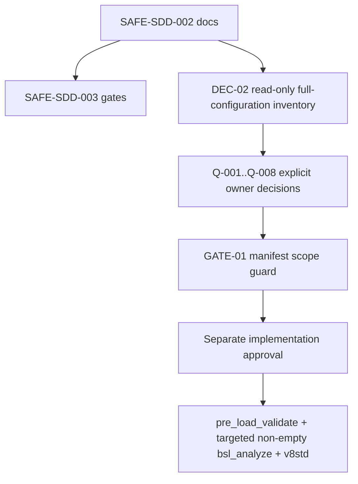

# Tasks: SAFE-SDD-003 remediation delta for APKTechPlan

> Requirements: `requirements.md`
> Design: `design.md`
> Baseline: spec-002 T13, generation `6693e570`
> Dependency: SAFE-SDD-001 (offline verification PASS, 2026-11-08)
> Status: Approved (user approval in chat; 2026-11-08); implementation in progress (owner reaffirmed variant 2, 2026-11-09)

## 1. Execution rules

- Use only models `erpband/deepseek-ai/deepseek-v4.1-flash-1017` (analysis) and `erpband/zai/glm-5.3:NVFP4` (synthesis) from provider `erpband`; anthropic and openai/gpt models are prohibited (owner decision 2026-11-09).
- This SAFE-SDD-003 task modifies only the three spec-003 artifacts listed by the scope fence.
- No type configuration object or main-configuration change is permitted. Approved safe implementation tasks may modify only their explicit CFE BSL/form/script scope; database, Designer, COM, Vanessa, Chrome, role mutation, and destructive operations are separate authorized gates.
- Q-001..Q-008 remain open. A review finding is not an owner decision and does not authorize implementation.
- Every implementation task below has an exact question gate; it remains `BLOCKED` until all named questions are explicitly closed and separate implementation authorization exists.
- `DEC-02` is the only pre-approval full-configuration preparation: read-only inventory only. It does not close questions or authorize implementation.
- `GATE-01` is a documentation/checking-only manifest guard. It rejects any type configuration object or unrelated main-configuration object change, regardless of static-analysis result.
- For any future BSL/XML edit, stop unless `GATE-01`, `pre_load_validate.py`, targeted non-empty `bsl_analyze`, and `v8std` when available all pass.
- Every task below must retain direct traceability to spec-002 or the dated 2026-11-07 review finding and to US-001..US-004 as applicable.

## 2. Dependency and readiness

| Check | Status | Evidence |
|---|---|---|
| SAFE-SDD-001 | PASS | `heartbeat/night.log`, 2026-11-08 |
| Baseline anchor | PASS | spec-002 T13, generation `6693e570` |
| Availability identity | Inherited | spec-002 D-006 / TD-007; posted `Документ.АпкПланТехническихРесурсов` |
| Q-002 narrowing | Applied, still open | requirements §8 and design §4 |
| Non-regression obligation | Applied | requirements FR-008; design §3 |
| Implementation authorization | Authorized (safe lane) | Owner decision 2026-11-09 (variant 2): safe source fixes + target test-IB verification approved; Q-001..Q-008 still block dependent business-rule tasks |
| BSL/XML static gates | Required for safe source tasks | pre_load_validate + targeted non-empty bsl_analyze + v8std where available |

## 3. Dependency graph

`DEC-02` is the only full-configuration preparation allowed before semantic approval. No implementation task is unblocked by this document-only change.

**Executable-lane rule:** no implementation task may move from `BLOCKED` until every question named in its matrix row is closed, GATE-01 passes, and separate implementation approval exists. Static analysis is downstream evidence, not a substitute for these prerequisites.

### 3.1 Question-to-task and verification-gate matrix

| Question | Exact FRs | Blocked implementation tasks | Blocked verification gate | Condition to become executable |
|---|---|---|---|---|
| Q-001 | FR-004, FR-008 | SRV-01 | GATE-02-PERIOD | Q-001 closed + implementation approval |
| Q-002 | FR-003, FR-008, FR-011 | SRV-02, UI-01 | GATE-02-AVAILABILITY | Q-002 closed + implementation approval |
| Q-003 | FR-003, FR-008 | SRV-02 | GATE-02-AVAILABILITY | Q-003 closed + implementation approval |
| Q-004 | FR-008 | SRV-08 (future concurrency lane; BLOCKED) | GATE-02-CONCURRENCY | Q-004 closed + implementation approval |
| Q-005 | FR-006, FR-008 | SRV-03, SRV-04 | GATE-02-ERROR | Q-005 closed + implementation approval |
| Q-006 | FR-007, FR-008, FR-011 | TEST-02 (role/IB/fixture boundary) | GATE-03-TEST | Q-006 closed + implementation approval |
| Q-007 | FR-005, FR-007, FR-008 | TEST-01, TEST-02 | GATE-03-TEST | Q-007 closed + implementation approval |
| Q-008 | FR-008, FR-011 | UI-01 (all UI follow-up remains in this blocked lane) | GATE-04-UI | Q-008 closed + implementation approval |

All rows remain BLOCKED. The matrix is a review control, not an authorization.

## 4. Safe preparation and documentation controls

### DEC-02 — Read-only full-configuration inventory

**Status:** ALLOWED PREPARATION ONLY; does not close any question.

**User stories:** US-002, US-003, US-004. **Requirements:** FR-003, FR-007, FR-011.

- [ ] inspect full-configuration metadata, modules, forms, roles, and existing tests only to establish facts for Q-002, Q-006, and Q-008 and to prepare a future manifest;
- [ ] record findings without editing BSL/XML, type configuration objects, roles, information bases, UI, or Vanessa artifacts;
- [ ] keep every dependent implementation task BLOCKED until the relevant question is explicitly closed.

**Acceptance:** read-only inventory only; no question is marked answered; no implementation authorization is inferred.

### GATE-01 — Manifest scope guard

**Status:** CHECKING/DOCUMENTATION ONLY; required before any future implementation lane.

**User stories:** US-001, US-003, US-004. **Requirements:** FR-001, FR-008, FR-012; NFR-001.

- [ ] inspect the declared manifest before static analysis;
- [ ] reject any type configuration object change, including properties/type metadata;
- [ ] reject any unrelated main-configuration object change;
- [ ] reject even when `pre_load_validate.py`, targeted `bsl_analyze`, or `v8std` would pass;
- [ ] do not mutate source, metadata, roles, or runtime state while checking.

**Acceptance:** scope violation is a hard FAIL; compliant documentation-only scope is PASS; this task has no product manifest.

## 4. Documentation tasks completed by SAFE-SDD-003

### SAFE-002-A — Anchor remediation to spec-002 T13

**Status:** DONE (documentation-only)

**Traceability:** spec-002 T13; generation `6693e570`; requirements FR-001; review report 2026-11-07.

- [x] Reference the approved spec-002 baseline and generation explicitly.
- [x] State that approved behavior remains inherited unless a future explicit owner decision supersedes it.
- [x] Preserve the baseline availability identity from D-006/TD-007.

**Acceptance:** requirements/design/tasks all name spec-002 T13 and `6693e570`; no spec-002 file is modified.

### SAFE-002-B — Classify overlapping topics

**Status:** DONE (documentation-only)

**Traceability:** spec-002 D-001..D-008, TD-001..TD-008, T1..T13; review findings P0-1..P2-6 (2026-11-07).

- [x] Label inherited behavior.
- [x] Label confirmed review deltas.
- [x] Label still-open questions and dependent blockers.
- [x] Keep Q-001..Q-008 open.

**Acceptance:** no finding is represented as an implicit business decision.

### SAFE-002-C — Narrow Q-002 without reopening document identity

**Status:** DONE (documentation-only)

**Traceability:** spec-002 D-006, TD-007, T8/T9; review P0-2, P2-4, P2-6; requirements FR-003; design §4.

- [x] Preserve `Документ.АпкПланТехническихРесурсов` as the current availability identity.
- [x] Request read-only confirmation of canonical tabular parts.
- [x] Request read-only confirmation of `Принят` filtering.
- [x] Request read-only confirmation of organization and subdivision scope.
- [x] Request read-only confirmation of quantity/capacity and duplicate-vehicle semantics.
- [x] Explicitly do not ask the owner to choose between the CFE document and the approved AПК availability document.
- [x] Leave Q-002 and Q-003 open.

**Acceptance:** Q-002 is factual/semantic confirmation only; it is not closed.

### SAFE-002-D — Add non-regression obligation

**Status:** DONE (documentation-only)

**Traceability:** spec-002 D-001..D-008, TD-001..TD-008, T1..T13; review report 2026-11-07; requirements FR-008.

- [x] Require preservation of approved spec-002 behavior outside the confirmed finding scope.
- [x] Block any change to a spec-002 decision until an explicit future owner decision records supersession and scope.
- [x] Preserve existing public contracts outside the precise finding being remediated.

**Acceptance:** requirements FR-008 and design §3.3 are enforceable review gates.

## 5. Future remediation tasks (defined, not authorized)

All tasks in this section remain **BLOCKED** unless their dependency questions are explicitly decided and separate implementation approval is granted.

### 5.0 Authorization matrix (owner decision 2026-11-09, variant 2)

Derived mechanically from each task's recorded question gate and the open-question list (Q-001..Q-008). The safe implementation lane approved on 2026-11-09 does NOT close any question.

| Task | Gate questions | Authorization |
|---|---|---|
| SRV-01 | Q-001 | blocked-by-Q-001 |
| SRV-02 | Q-002, Q-003 | blocked-by-Q-002/Q-003 |
| SRV-03 | Q-005 | blocked-by-Q-005 |
| SRV-04 | Q-005, SRV-03 | blocked-by-Q-005 |
| TEST-01 | Q-007 | blocked-by-Q-007 |
| TEST-02 | Q-006, Q-007 | blocked-by-Q-006/Q-007 |
| UI-01 | Q-008 | blocked-by-Q-008 |
| SAFE-LANE-01 — runner result contract (scripts/run_va_feature.py) | none (test-runner infrastructure, no business semantics) | unlocked (safe lane) |
| SAFE-LANE-02 — strict PASS/FAIL/SKIP status parsing in runner | none (test-runner infrastructure) | unlocked (safe lane) |
| SAFE-LANE-03 — numeric `СтрНайти` usage, source-confirmed | none (mechanical fix, no business semantics) | unlocked (safe lane) |
| SAFE-LANE-04 — error logging/classification in runner scripts | none (test-runner infrastructure) | unlocked (safe lane) |

Safe-lane edits must be source-confirmed, must not select any business semantic (period, availability, `Принят`, organization, quantity/capacity, SKIP policy, UX), and must pass the product static gates of design 8.2 before any load or runtime verification.

### SRV-01 — Period-scoped cleanup

**Status:** BLOCKED | **Depends:** Q-001, GATE-01, and implementation approval
**User stories:** US-001, US-003, US-004. **Traceability:** spec-002 T13; review P0-2; requirements FR-004/FR-008.

- [ ] implement only the owner-approved exact/overlap/full-scenario cleanup scope;
- [ ] preserve atomicity and approved result-writing behavior;
- [ ] add the January/February non-regression scenario without changing unrelated periods.

**No period semantics are selected by SAFE-SDD-003.**

### SRV-02 — Availability contract verification and implementation delta

**Status:** BLOCKED | **Depends:** Q-002/Q-003, GATE-01, and implementation approval
**User stories:** US-001, US-002, US-003, US-004. **Traceability:** spec-002 D-006, TD-007, T8/T9; review P0-2/P2-4/P2-6; requirements FR-002/FR-003/FR-008/FR-011.

- [ ] verify the approved availability document's canonical TЧ, accepted filter, organization, subdivision, and quantity/capacity behavior read-only;
- [ ] implement only confirmed corrections;
- [ ] do not replace the availability document or introduce a silent fallback.

**No availability, deduplication, hierarchy, or capacity semantics are selected by SAFE-SDD-003.**

### SRV-03 — Error logging and classification

**Status:** BLOCKED | **Depends:** Q-005, GATE-01, and implementation approval
**User stories:** US-001, US-003, US-004. **Traceability:** spec-002 T5/T9/T13; review P1-1/P1-2/P1-3; requirements FR-006/FR-008/FR-012.

- [ ] preserve the primary exception while correcting logging construction and numeric search;
- [ ] separate absent business requisite from infrastructure/rights/module/query failure only after Q-005;
- [ ] do not convert unknown failures to zero.

### SRV-04 — Batch/cache model properties

**Status:** BLOCKED | **Depends:** Q-005, SRV-03, GATE-01, and implementation approval
**User stories:** US-001, US-003, US-004. **Traceability:** spec-002 D-003, TD-003, T5/T9; review P1-4; requirements FR-006/FR-008/FR-012.

- [ ] batch/cache distinct model properties;
- [ ] prove numerical equivalence to spec-002 coefficient behavior;
- [ ] preserve approved fallback and error semantics after Q-005.

### TEST-01 — Result contract consumer

**Status:** BLOCKED | **Depends:** Q-007, GATE-01, and implementation approval
**Traceability:** spec-002 T12/T13; review P0-1/P1-6; requirements FR-005/FR-008/FR-013; US-001/US-003/US-004.

- [ ] align the UI consumer with `Статус` while preserving explicit PASS/FAIL/SKIP;
- [ ] preserve model-level plan behavior;
- [ ] preserve availability document identity and the posted-document baseline;
- [ ] preserve approved coefficient semantics;
- [ ] preserve accepted document/form contracts;
- [ ] preserve rights behavior validated by spec-002 T13;
- [ ] do not decide the SKIP terminal policy in code before Q-007;
- [ ] do not invent missing exception-schema details; verify only the fields/contracts actually specified by FR-008 and the approved baseline.

**Acceptance:** TEST-01 covers every FR-008 field listed above, with no invented exception schema, and remains BLOCKED until Q-007 and GATE-01 close.

### TEST-02 — Test boundary and cleanup

**Status:** BLOCKED | **Depends:** Q-006/Q-007, GATE-01, and implementation approval
**User stories:** US-003, US-004. **Traceability:** spec-002 T12/T13; review P1-5/P1-6/P1-7; requirements FR-007/FR-008/FR-012.

- [ ] define test-IB/role/marker boundary;
- [ ] guarantee fixture tracking and cleanup on all exits;
- [ ] make cleanup failure visible without mutating shared or production-like data.

### UI-01 — Form diagnostics and batching

**Status:** BLOCKED | **Depends:** Q-008, GATE-01, and implementation approval
**User stories:** US-001, US-003, US-004. **Traceability:** spec-002 T3/T9/T11/T12; review P2-1/P2-2/P2-3/P2-4/P2-5/P2-6; requirements FR-008/FR-012.

- [ ] preserve inherited forms and public contracts outside each confirmed finding;
- [ ] separate no-data from write/access failures;
- [ ] confirm supported platform row events and organization scope before implementation.

## 6. Cross-reference matrix: every task to baseline/finding

| Task | User stories | Spec-002 reference | Review reference | Decision/question gate | Status |
|---|---|---|---|---|
| SAFE-002-A | US-001, US-003 | T13 / `6693e570` | 2026-11-07 report | none; docs only | DONE |
| SAFE-002-B | US-001, US-003 | D-001..D-008, TD-001..TD-008, T1..T13 | P0-1..P2-6 | Q-001..Q-008 remain open | DONE |
| SAFE-002-C | US-002, US-003 | D-006, TD-007, T8/T9 | P0-2, P2-4, P2-6 | Q-002/Q-003 | DONE |
| SAFE-002-D | US-001, US-003, US-004 | D-001..D-008, TD-001..TD-008, T1..T13 | 2026-11-07 report | future owner decision for supersession | DONE |
| DEC-02 | US-002, US-003, US-004 | D-006, TD-007, T12/T13 | P0-2, P1-5, P2-1..P2-6 | read-only preparation; questions remain open | ALLOWED PREPARATION ONLY |
| GATE-01 | US-001, US-003, US-004 | T13; NFR-001 | all findings in declared manifest | scope manifest; static analysis cannot override | CHECKING ONLY |
| SRV-01 | US-001, US-003, US-004 | T13 | P0-2 | Q-001 + GATE-01 | BLOCKED |
| SRV-02 | US-001, US-002, US-003, US-004 | D-006, TD-007, T8/T9 | P0-2, P2-4, P2-6 | Q-002/Q-003 + GATE-01 | BLOCKED |
| SRV-03 | US-001, US-003, US-004 | T5/T9/T13 | P1-1/P1-2/P1-3 | Q-005 + GATE-01 | BLOCKED |
| SRV-04 | US-001, US-003, US-004 | D-003, TD-003, T5/T9 | P1-4 | Q-005 + SRV-03 + GATE-01 | BLOCKED |
| TEST-01 | US-001, US-003, US-004 | T12/T13 | P0-1/P1-6 | Q-007 + GATE-01 | BLOCKED |
| TEST-02 | US-003, US-004 | T12/T13 | P1-5/P1-6/P1-7 | Q-006/Q-007 + GATE-01 | BLOCKED |
| UI-01 | US-001, US-003, US-004 | T3/T9/T11/T12 | P2-1..P2-6 | Q-008 + GATE-01 | BLOCKED |

**Verification rule:** a task lacking both a spec-002 reference and a 2026-11-07 finding reference is invalid. No task above lacks both.

## 7. Verification plan and results

### 7.1 Documentation-only verification for SAFE-SDD-003

- [ ] verify only the three allowed SDD files changed;
- [ ] verify Q-001..Q-008 map to exact FRs, blocked implementation tasks, and verification gates;
- [ ] verify DEC-02 is the only full-configuration preparation and is read-only;
- [ ] verify every business-dependent BSL/XML, role, information-base, UI, and Vanessa task is BLOCKED until its own question gate closes;
- [ ] verify US-001..US-004 appear in requirement, task, decision, and verification traceability;
- [ ] verify TEST-01 covers every FR-008 field without inventing exception-schema details;
- [ ] verify GATE-01 rejects type configuration objects and unrelated main-configuration objects independently of static-analysis results;
- [ ] verify no dependency lets an unresolved question reach executable implementation;
- [ ] verify the scope guard is documentation/checking only;
- [ ] verify Q-001..Q-008 remain open and no database/runtime operation occurred.

### 7.2 Required product static gates for future implementation

Not run for this documentation-only task: no BSL/XML was changed, so `pre_load_validate.py`, targeted non-empty `bsl_analyze`, and `v8std` are not applicable. For any future BSL/XML task, stop on failure and run `GATE-01`, `pre_load_validate.py`, targeted non-empty `bsl_analyze`, and `v8std` when available, in that order. Database and runtime verification are separately authorized only after the offline gates and owner decisions.

### 7.3 Verification report

**Safe-lane run 2026-11-09 (post Phase-0 reconciliation, owner decision variant 2):** SAFE-CFE-005 / SAFE-PY-006 / SAFE-BSL-007 implemented and gated (pre_load_validate 29 files OK; targeted bsl_analyze 0 errors, warnings 63->40 strict subset; v8std no violations; py_compile + selftests green). Loaded to dev_erpapk_demo, generation `11c6cca2229497616f269b8004885a8608f2d10d`; CheckModules/UpdateDBCfg PASS. RT compare: 2 REAL diffs, both byte-identical to adjudicated pre-existing S10 baseline artifacts (see fix-log-2026-11-06 S10); all 5 edited product files round-tripped identical. VA suite 01-09: 9/9 PASS. Unit suite: total=20, passed=19, skipped=1 (Q-007 documented SKIP, not a failure), failed=0. Web E2E: NOT_AVAILABLE (no publication; evidence docs/web-e2e-probe-2026-11-09.md). Q-001..Q-008 remain open; SRV-01..04 / TEST-01..02 / UI-01 remain BLOCKED.

**Status:** pending execution in the current offline session. Results must be written here with exact commands, exit codes, and PASS/FAIL verdicts; unchecked items must not be represented as complete.

- Read-only matrix review: PASS — every implementation lane names a closed-question condition or is explicitly `BLOCKED`; unresolved Q-001..Q-008 do not reach executable implementation.
- Scope-control review: PASS — GATE-01 is documentation/checking only and independently rejects type configuration object and unrelated main-configuration object changes.

### 7.4 Final status

SAFE-SDD-003 documentation reconciliation is complete. Safe source tasks may proceed under their explicit scope and gates; business-dependent tasks remain BLOCKED. No question is closed.
