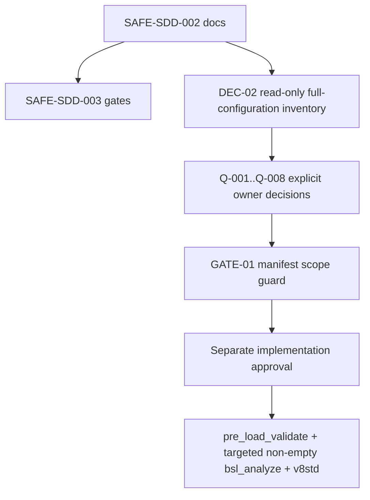

# Tasks: SAFE-SDD-003 remediation delta for APKTechPlan

> Requirements: `requirements.md`
> Design: `design.md`
> Baseline: spec-002 T13, generation `6693e570`
> Dependency: SAFE-SDD-001 (offline verification PASS, 2026-11-08)
> Status: Approved (user approval in chat; 2026-11-08); implementation in progress (owner reaffirmed variant 2, 2026-11-09)

## 1. Execution rules

- Use only models `erpband/deepseek-ai/deepseek-v4.1-flash-1017` (analysis) and `erpband/zai/glm-5.3:NVFP4` (synthesis) from provider `erpband`; anthropic and openai/gpt models are prohibited (owner decision 2026-11-09).
- This SAFE-SDD-003 task modifies only the three spec-003 artifacts listed by the scope fence.
- No type configuration object or main-configuration change is permitted. Approved safe implementation tasks may modify only their explicit CFE BSL/form/script scope; database, Designer, COM, Vanessa, Chrome, role mutation, and destructive operations are separate authorized gates.
- Q-001..Q-008 are ALL DECIDED as of 2026-11-09 (owner decisions recorded in chat). Closing a question does not grant implementation permission: every task below still needs GATE-01 plus explicit owner implementation approval. A review finding is not an owner decision and does not authorize implementation; closing a question does not authorize implementation either.
- Every implementation task below has an exact question gate; it remains `BLOCKED` until all named questions are explicitly closed and separate implementation authorization exists.
- `DEC-02` is the only pre-approval full-configuration preparation: read-only inventory only. It does not close questions or authorize implementation.
- `GATE-01` is a documentation/checking-only manifest guard. It rejects any type configuration object or unrelated main-configuration object change, regardless of static-analysis result.
- For any future BSL/XML edit, stop unless `GATE-01`, `pre_load_validate.py`, targeted non-empty `bsl_analyze`, and `v8std` when available all pass.
- Every task below must retain direct traceability to spec-002 or the dated 2026-11-07 review finding and to US-001..US-004 as applicable.

## 2. Dependency and readiness

| Check | Status | Evidence |
|---|---|---|
| SAFE-SDD-001 | PASS | `heartbeat/night.log`, 2026-11-08 |
| Baseline anchor | PASS | spec-002 T13, generation `6693e570` |
| Availability identity | Inherited | spec-002 D-006 / TD-007; posted `Документ.АпкПланТехническихРесурсов` |
| Q-002 narrowing | Applied, still open | requirements §8 and design §4 |
| Non-regression obligation | Applied | requirements FR-008; design §3 |
| Implementation authorization | Authorized (safe lane) | Owner decision 2026-11-09 (variant 2): safe source fixes + target test-IB verification approved; Q-001..Q-008 still block dependent business-rule tasks |
| BSL/XML static gates | Required for safe source tasks | pre_load_validate + targeted non-empty bsl_analyze + v8std where available |

## 3. Dependency graph

`DEC-02` is the only full-configuration preparation allowed before semantic approval. No implementation task is unblocked by this document-only change.

**Executable-lane rule:** no implementation task may move from `BLOCKED` until every question named in its matrix row is closed, GATE-01 passes, and separate implementation approval exists. Static analysis is downstream evidence, not a substitute for these prerequisites.

### 3.1 Question-to-task and verification-gate matrix

| Question | Exact FRs | Blocked implementation tasks | Blocked verification gate | Condition to become executable |
|---|---|---|---|---|
| Q-001 | FR-004, FR-008 | SRV-01 | GATE-02-PERIOD | Q-001 closed + implementation approval |
| Q-002 | FR-003, FR-008, FR-011 | SRV-02, UI-01 | GATE-02-AVAILABILITY | Q-002 closed + implementation approval |
| Q-003 | FR-003, FR-008 | SRV-02 | GATE-02-AVAILABILITY | Q-003 closed + implementation approval |
| Q-004 | FR-008 | SRV-08 (future concurrency lane; BLOCKED) | GATE-02-CONCURRENCY | Q-004 closed + implementation approval |
| Q-005 | FR-006, FR-008 | SRV-03, SRV-04 | GATE-02-ERROR | Q-005 closed + implementation approval |
| Q-006 | FR-007, FR-008, FR-011 | TEST-02 (role/IB/fixture boundary) | GATE-03-TEST | Q-006 closed + implementation approval |
| Q-007 | FR-005, FR-007, FR-008 | TEST-01, TEST-02 | GATE-03-TEST | Q-007 closed + implementation approval |
| Q-008 | FR-008, FR-011 | UI-01 (all UI follow-up remains in this blocked lane) | GATE-04-UI | Q-008 closed + implementation approval |

All rows remain BLOCKED. The matrix is a review control, not an authorization.

## 4. Safe preparation and documentation controls

### DEC-02 — Read-only full-configuration inventory

**Status:** ALLOWED PREPARATION ONLY; does not close any question.

**User stories:** US-002, US-003, US-004. **Requirements:** FR-003, FR-007, FR-011.

- [ ] inspect full-configuration metadata, modules, forms, roles, and existing tests only to establish facts for Q-002, Q-006, and Q-008 and to prepare a future manifest;
- [ ] record findings without editing BSL/XML, type configuration objects, roles, information bases, UI, or Vanessa artifacts;
- [ ] keep every dependent implementation task BLOCKED until the relevant question is explicitly closed.

**Acceptance:** read-only inventory only; no question is marked answered; no implementation authorization is inferred.

### GATE-01 — Manifest scope guard

**Status:** CHECKING/DOCUMENTATION ONLY; required before any future implementation lane.

**User stories:** US-001, US-003, US-004. **Requirements:** FR-001, FR-008, FR-012; NFR-001.

- [ ] inspect the declared manifest before static analysis;
- [ ] reject any type configuration object change, including properties/type metadata;
- [ ] reject any unrelated main-configuration object change;
- [ ] reject even when `pre_load_validate.py`, targeted `bsl_analyze`, or `v8std` would pass;
- [ ] do not mutate source, metadata, roles, or runtime state while checking.

**Acceptance:** scope violation is a hard FAIL; compliant documentation-only scope is PASS; this task has no product manifest.

## 4. Documentation tasks completed by SAFE-SDD-003

### SAFE-002-A — Anchor remediation to spec-002 T13

**Status:** DONE (documentation-only)

**Traceability:** spec-002 T13; generation `6693e570`; requirements FR-001; review report 2026-11-07.

- [x] Reference the approved spec-002 baseline and generation explicitly.
- [x] State that approved behavior remains inherited unless a future explicit owner decision supersedes it.
- [x] Preserve the baseline availability identity from D-006/TD-007.

**Acceptance:** requirements/design/tasks all name spec-002 T13 and `6693e570`; no spec-002 file is modified.

### SAFE-002-B — Classify overlapping topics

**Status:** DONE (documentation-only)

**Traceability:** spec-002 D-001..D-008, TD-001..TD-008, T1..T13; review findings P0-1..P2-6 (2026-11-07).

- [x] Label inherited behavior.
- [x] Label confirmed review deltas.
- [x] Label still-open questions and dependent blockers.
- [x] Keep Q-001..Q-008 open.

**Acceptance:** no finding is represented as an implicit business decision.

### SAFE-002-C — Narrow Q-002 without reopening document identity

**Status:** DONE (documentation-only)

**Traceability:** spec-002 D-006, TD-007, T8/T9; review P0-2, P2-4, P2-6; requirements FR-003; design §4.

- [x] Preserve `Документ.АпкПланТехническихРесурсов` as the current availability identity.
- [x] Request read-only confirmation of canonical tabular parts.
- [x] Request read-only confirmation of `Принят` filtering.
- [x] Request read-only confirmation of organization and subdivision scope.
- [x] Request read-only confirmation of quantity/capacity and duplicate-vehicle semantics.
- [x] Explicitly do not ask the owner to choose between the CFE document and the approved AПК availability document.
- [x] Leave Q-002 and Q-003 open.

**Acceptance:** Q-002 is factual/semantic confirmation only; it is not closed.

### SAFE-002-D — Add non-regression obligation

**Status:** DONE (documentation-only)

**Traceability:** spec-002 D-001..D-008, TD-001..TD-008, T1..T13; review report 2026-11-07; requirements FR-008.

- [x] Require preservation of approved spec-002 behavior outside the confirmed finding scope.
- [x] Block any change to a spec-002 decision until an explicit future owner decision records supersession and scope.
- [x] Preserve existing public contracts outside the precise finding being remediated.

**Acceptance:** requirements FR-008 and design §3.3 are enforceable review gates.

## 5. Future remediation tasks (defined, not authorized)

All tasks in this section remain **BLOCKED** unless their dependency questions are explicitly decided and separate implementation approval is granted.

### 5.0 Authorization matrix (owner decision 2026-11-09, variant 2)

Derived mechanically from each task's recorded question gate and the question list (Q-001..Q-008). The safe implementation lane approved on 2026-11-09 does NOT close any question. **Gate state refreshed 2026-11-09 after the Q-008 decision: all eight questions are closed.** No row below grants implementation permission — every READY task still needs GATE-01 plus an explicit owner implementation approval.

| Task | Gate questions | Authorization |
|---|---|---|
| SRV-01 | Q-001, Q-004 | Q-001 DECIDED 2026-11-09 (overlap-interval cleanup); Q-004 DECIDED 2026-11-09 (С1: exact-key managed lock via source data, all reads inside the transaction, bounded wait then cancel without retry, plan documents not locked). Gate questions closed — task is READY, awaiting explicit owner implementation approval (GATE-01 still applies) |
| SRV-02 | Q-002, Q-003 | Q-002 DECIDED 2026-11-09 (A2+B2+V1, remove Тх_ПланТехническихРесурсов); Q-003 DECIDED 2026-11-09 (per-machine count; attachment from АпкИсторияТранспортныхСредств, slice last once at period start). Gate questions closed — task is READY, awaiting explicit owner implementation approval (GATE-01 still applies) |
| SRV-03 | Q-005 | Q-005 DECIDED 2026-11-09 (Р1 metadata split, Warning+continue, Error+stop, no third state). Gate question closed — task is READY, awaiting explicit owner implementation approval (GATE-01 still applies) |
| SRV-04 | Q-005, SRV-03 | Q-005 DECIDED 2026-11-09; SRV-03 gate closed — task is READY, awaiting explicit owner implementation approval (GATE-01 still applies) |
| TEST-01 | Q-007 | **DONE 2026-11-10** (implemented after explicit owner session authorization; Ж1 policy in runners, skip cause removed by rewriting ТестПланТехресурсовОтсутствует_ПометкаНеНоль with a self-sufficient fixture on registrar АпкТехнологическиеКартыНаПоле; unit suite 20 PASS / 0 FAIL / 0 SKIP, exit 0, generation 97f9042d; VA 01-09 9/9 PASS; RT 42=42, 0 orphans, 2 adjudicated S10 diffs; independent post-run residue probes all zero) |
| TEST-02 | Q-006, Q-007 | Q-006 DECIDED 2026-11-09 (guarded runner; CFE constant + script check; script-only roles with guaranteed restore; registry cleanup with visible failure); Q-007 DECIDED 2026-11-09 (SKIP is always a failure). Gate questions closed — task is READY, awaiting explicit owner implementation approval (GATE-01 still applies) |
| TEST-03 — extract runner + test module into a separate test extension | none (engineering boundary, no business semantics) | DEFERRED by owner decision 2026-11-09: do AFTER the current development phase; not executable now |
| UI-01 | Q-008 | Q-008 DECIDED 2026-11-09 (no-data text in DCS, report still opens; full staleness marking; client input checks; closed event list; split no-data from write failures). Gate question closed — task is READY, awaiting explicit owner implementation approval (GATE-01 still applies) |
| SAFE-LANE-01 — runner result contract (scripts/run_va_feature.py) | none (test-runner infrastructure, no business semantics) | unlocked (safe lane) |
| SAFE-LANE-02 — strict PASS/FAIL/SKIP status parsing in runner | none (test-runner infrastructure) | unlocked (safe lane) |
| SAFE-LANE-03 — numeric `СтрНайти` usage, source-confirmed | none (mechanical fix, no business semantics) | unlocked (safe lane) |
| SAFE-LANE-04 — error logging/classification in runner scripts | none (test-runner infrastructure) | unlocked (safe lane) |

Safe-lane edits must be source-confirmed, must not IMPLEMENT any business semantic decided by Q-001..Q-008 (period scope, availability, duplicates, concurrency, error contract, test boundary, SKIP policy, form UX) — those belong to the named tasks — and must pass the product static gates of design 8.2 before any load or runtime verification.

### 5.1 Ready list as of 2026-11-09 (awaiting explicit owner implementation approval)

| Order | Task | Closed gates | Notes |
|---|---|---|---|
| 1 | SRV-01 — Period-scoped cleanup + concurrency | Q-001, Q-004 | atomicity and exact-key locking bundled, same transaction code |
| 2 | SRV-02 — Availability contract delta | Q-002, Q-003 | largest task: source switch, CFE document removal, two-level calc, two register numbers, trailers |
| 3 | SRV-03 — Error logging and classification | Q-005 | blocking prerequisite of SRV-04 |
| 4 | SRV-04 — Batch/cache model properties | Q-005, SRV-03 | after SRV-03 |
| 5 | TEST-01 — Result contract consumer + Ж1 policy | Q-007 | turns the historical 19+1 SKIP into a red run until the skip cause is removed |
| 6 | TEST-02 — Test boundary and cleanup | Q-006, Q-007 | marker, role boundary, registry cleanup |
| 7 | UI-01 — Form diagnostics and staleness marking | Q-008 | needs the new calculation-moment storage |
| deferred | TEST-03 — Extract runner into a test extension | owner decision | only after this development phase |

### SRV-01 — Period-scoped cleanup

**Status:** READY (gate questions Q-001/Q-004 closed 2026-11-09) — implementation NOT authorized | **Depends:** GATE-01, and implementation approval
**User stories:** US-001, US-003, US-004. **Traceability:** spec-002 T13; review P0-2; requirements FR-004/FR-008.

- [ ] implement the owner-approved overlap-interval cleanup scope (Q-001): remove every register row whose period intersects the requested range by at least one day, with the demand selection made by the same intersection rule;
- [ ] implement the Q-004 concurrency scheme: all reads inside the transaction, exact-key managed lock through `ИсточникДанных` + `ИспользоватьИзИсточникаДанных` (delete set plus written keys), bounded lock wait, rollback and a clear user message on expiry, no automatic retry, plan documents not locked;
- [ ] re-query the delete set after the lock is acquired (implementation note of Q-004);
- [ ] preserve atomicity and approved result-writing behavior outside the defect scope;
- [ ] add the January/February non-regression scenario without changing unrelated periods;
- [ ] add a parallel-run scenario proving that two simultaneous calculations for the same scope leave exactly one consistent result set and that the loser receives the bounded-wait message.

**Period scope (Q-001) and concurrency (Q-004) are now selected by the 2026-11-09 owner decisions; implementation still requires approval.**

### SRV-02 — Availability contract verification and implementation delta

**Status:** READY (gate questions Q-002/Q-003 closed 2026-11-09) — implementation NOT authorized | **Depends:** GATE-01, and implementation approval
**User stories:** US-001, US-002, US-003, US-004. **Traceability:** spec-002 D-006, TD-007, T8/T9; review P0-2/P2-4/P2-6; requirements FR-002/FR-003/FR-008/FR-011.

- [ ] verify read-only what is still factual: which tabular parts are canonical per category and how a machine's category is derived (document part vs `АпкМодель` type), and how organization/subdivision filters now apply to the history slice;
- [ ] implement the Q-002 delta: main-config `АпкПланТехническихРесурсов` as the only source, remove the CFE document `Тх_ПланТехническихРесурсов`, add the fourth enum value `Прицеп`, two-level A2/B2 calculation with two register numbers (shortage after own vehicles, final deficit) and move reporting;
- [ ] implement the Q-003 delta: count units per physical vehicle (a repeated row does not add a unit, no dedup flag and no posting lock), take attachment (organization + subdivision) from `РегистрСведений.АпкИсторияТранспортныхСредств` via one `СрезПоследних` at the calculation-period start (plan document date when the start is empty), and place machines without a history record into the shared pool only;
- [ ] do not replace the availability document or introduce a silent fallback;
- [ ] do not use `Исправно` for availability (explicitly out of scope until separately decided).

**Semantics selected by the 2026-11-09 owner decisions (Q-002, Q-003); implementation still requires approval.**

### SRV-03 — Error logging and classification

**Status:** READY (gate question Q-005 closed 2026-11-09) — implementation NOT authorized | **Depends:** GATE-01, and implementation approval
**User stories:** US-001, US-003, US-004. **Traceability:** spec-002 T5/T9/T13; review P1-1/P1-2/P1-3; requirements FR-006/FR-008/FR-012.

- [ ] preserve the primary exception while correcting logging construction and numeric search;
- [ ] implement the Q-005 (Р1) split: presence of the model requisite is checked against catalog metadata; absent requisite → journal Warning, property treated as unfilled, calculation continues; infrastructure failure (rights, query, module, execution) → journal Error, calculation stopped with a clear message referencing the journal entry, transaction rolled back, no partial rows;
- [ ] remove the swallowing points: `ЗначениеРеквизитаМодели` must not turn every exception into 0, and the non-reference branch of `ИмяСправочникаПоТипуСсылки` must not degrade silently;
- [ ] do not convert unknown failures to zero and do not parse platform error text;
- [ ] do not add a third result state ("property unavailable"): the journal entry is the agreed visibility, and `КоэффициентНеЗадан` keeps its approved meaning.

### SRV-04 — Batch/cache model properties

**Status:** READY (gate questions Q-005 and SRV-03 closed 2026-11-09) — implementation NOT authorized | **Depends:** GATE-01, and implementation approval
**User stories:** US-001, US-003, US-004. **Traceability:** spec-002 D-003, TD-003, T5/T9; review P1-4; requirements FR-006/FR-008/FR-012.

- [ ] batch/cache distinct model properties (one or two queries for all models of a calculation instead of up to eight queries per demand×availability pair);
- [ ] prove numerical equivalence of substitution coefficients to spec-002 behavior on the same data;
- [ ] preserve the Q-005 classification and fallback semantics; metadata checks are cached for the calculation.

### TEST-01 — Result contract consumer

**Status:** DONE 2026-11-10 (implemented under the explicit owner session authorization; evidence in §7.3) | **Depends:** Q-007 (closed 2026-11-09, variant Ж1)
**Traceability:** spec-002 T12/T13; review P0-1/P1-6; requirements FR-005/FR-008/FR-013; US-001/US-003/US-004.

- [x] align the UI consumer with `Статус` while preserving explicit PASS/FAIL/SKIP in the contract; the python report additionally surfaces a derived `Детали` line (СтрСоединить of the approved `Провалы` field) — no new statuses or exception-schema fields were introduced;
- [x] implement the Q-007 (Ж1) terminal policy in the runner: any SKIP fails the run, the "exit code 2 = SKIP-only" contract is retired, the skip counter and reason stay visible in output and artifact, strict status parsing and the expected-total check stay;
- [x] remove the skip cause of the currently skipped test (guarantee its data or rewrite the test so its conditions always hold); deleting or disabling it to reach green is forbidden; re-establish the T13 baseline as 20 PASS — the test was rewritten to create its entire fixture (scenario, subdivision, organization, work kind, model, registrar stub АпкТехнологическиеКартыНаПоле) and to write its demand row through the 8.5 movement-collection canon (Движения.Найти + Записывать = Истина + Движения.Записать), all deny-empty dimensions filled;
- [x] preserve model-level plan behavior;
- [x] preserve availability document identity and the posted-document baseline;
- [x] preserve approved coefficient semantics;
- [x] preserve accepted document/form contracts;
- [x] preserve rights behavior validated by spec-002 T13;
- [x] do not decide the SKIP terminal policy in code before Q-007 (policy implemented only after the 2026-11-09 owner decision);
- [x] do not invent missing exception-schema details; verify only the fields/contracts actually specified by FR-008 and the approved baseline.

**Acceptance:** TEST-01 covers every FR-008 field listed above, with no invented exception schema; the run verdict fails on any SKIP (Ж1); GATE-01 applies. — Met 2026-11-10: unit suite 20 PASS / 0 FAIL / 0 SKIP (exit 0), VA 01-09 9/9 PASS, RT adjudicated-clean, zero residue in independent probes.

### TEST-02 — Test boundary and cleanup

**Status:** READY (gate questions Q-006/Q-007 closed 2026-11-09) — implementation NOT authorized | **Depends:** GATE-01, and implementation approval
**User stories:** US-003, US-004. **Traceability:** spec-002 T12/T13; review P1-5/P1-6/P1-7; requirements FR-007/FR-008/FR-012.

- [ ] add the Q-006 test-infobase marker: a boolean CFE constant (proposed `Тх_ТестоваяБаза`, default False) set only in the test infobase; every test entry point and every writing test helper aborts with a clear exception when the marker is not set;
- [ ] add the second, independent line: launch scripts verify the target infobase reference before running anything;
- [ ] keep role assignment/removal exclusively in the external script (never in 1C scenarios), move the restore into a guaranteed block, verify the restored role state at the end and turn a failed restore into a VISIBLE run failure;
- [ ] keep a per-run registry of created objects and clean up from it on ANY exit; a failed cleanup is a VISIBLE run failure and the leftover list is written to an artifact file next to the logs;
- [ ] sweep scenario fixtures by name masks (`Тх_Тест…`, `Тх_Тест4…`, `Тх_VA_…`) in addition to the registry;
- [ ] do not mutate shared or production-like data and do not treat an "Information"-level journal entry as cleanup evidence.

### TEST-03 — Extract runner and test module into a separate test extension (DEFERRED)

**Status:** DEFERRED by owner decision 2026-11-09 — run AFTER the current development phase is finished | **Depends:** completion of the current phase; no open question
**User stories:** US-003, US-004. **Traceability:** spec-002 T12/T13; review P1-5/P1-6/P1-7; requirements FR-007/FR-012.

Owner wording: "раннер нужно вынести в отдельное расширение после того, как завершим этот этап разработки".

- [ ] move `Тх_РаннерТестов` and the test module `Тх_Тесты` out of the working CFE into a separate test extension;
- [ ] re-point the launch scripts, Vanessa features and the unit-test runner at the new extension without changing test semantics;
- [ ] keep the Q-006 infobase marker, role boundary and registry-based cleanup in force after the move;
- [ ] prove equivalence: the same suites produce the same PASS/FAIL/SKIP verdicts before and after the move;
- [ ] shrink the working CFE manifest accordingly (removing test objects must not break product modules).

This task is deliberately NOT executable during the current phase: it must not compete with SRV-01..SRV-04 / TEST-01 / TEST-02 / UI-01 work.

### UI-01 — Form diagnostics and batching

**Status:** READY (gate question Q-008 closed 2026-11-09) — implementation NOT authorized | **Depends:** GATE-01, and implementation approval
**User stories:** US-001, US-003, US-004. **Traceability:** spec-002 T3/T9/T11/T12; review P2-1/P2-2/P2-3/P2-4/P2-5/P2-6; requirements FR-008/FR-012.

- [ ] preserve inherited forms and public contracts outside each confirmed finding;
- [ ] configure the "no data" text in the deficit report data-composition scheme (Q-008 variant b); the report keeps opening with zero rows and the zero-record message in the calculation form stays;
- [ ] implement stale-value marking (Q-008 variant c, full): store the calculation moment, detect whether demand/availability sources changed after it, mark the data as stale and offer a recalculation; the detection mechanism is an engineering choice inside this task (stored per-row moment compared with the latest change moment of the sources; prefer the standard change-dates facility where available) — do NOT invent a new business rule for what counts as a source change beyond the sources named in Q-002/Q-003;
- [ ] add client-side input checks before the server call: period boundaries filled, start not later than end, "shifts per day" greater than zero — as a message, not as a platform exception;
- [ ] fix the closed list of supported events (`ПриИзменении`, `НачалоВыбора`, `ПередНачаломДобавления`, `ПриСозданииНаСервере`, form commands) in the form documentation and do not add handlers outside it without verifying them on platform 8.5;
- [ ] separate the "no data" branch from the "write/access operation failed" branch in the work-plan form, journal the original error and show a meaningful message (P2-2);
- [ ] record that P2-3 (document-form counters) disappears with the CFE document removed by Q-002 — no work is required there beyond removing that form;
- [ ] confirm organization scope of the forms before implementation.

## 6. Cross-reference matrix: every task to baseline/finding

| Task | User stories | Spec-002 reference | Review reference | Decision/question gate | Status |
|---|---|---|---|---|
| SAFE-002-A | US-001, US-003 | T13 / `6693e570` | 2026-11-07 report | none; docs only | DONE |
| SAFE-002-B | US-001, US-003 | D-001..D-008, TD-001..TD-008, T1..T13 | P0-1..P2-6 | Q-001..Q-008 remain open | DONE |
| SAFE-002-C | US-002, US-003 | D-006, TD-007, T8/T9 | P0-2, P2-4, P2-6 | Q-002/Q-003 | DONE |
| SAFE-002-D | US-001, US-003, US-004 | D-001..D-008, TD-001..TD-008, T1..T13 | 2026-11-07 report | future owner decision for supersession | DONE |
| DEC-02 | US-002, US-003, US-004 | D-006, TD-007, T12/T13 | P0-2, P1-5, P2-1..P2-6 | read-only preparation; questions remain open | ALLOWED PREPARATION ONLY |
| GATE-01 | US-001, US-003, US-004 | T13; NFR-001 | all findings in declared manifest | scope manifest; static analysis cannot override | CHECKING ONLY |
| SRV-01 | US-001, US-003, US-004 | T13 | P0-2 | Q-001/Q-004 closed 2026-11-09 + GATE-01 | READY (approval pending) |
| SRV-02 | US-001, US-002, US-003, US-004 | D-006, TD-007, T8/T9 | P0-2, P2-4, P2-6 | Q-002/Q-003 closed 2026-11-09 + GATE-01 | READY (approval pending) |
| SRV-03 | US-001, US-003, US-004 | T5/T9/T13 | P1-1/P1-2/P1-3 | Q-005 closed 2026-11-09 + GATE-01 | READY (approval pending) |
| SRV-04 | US-001, US-003, US-004 | D-003, TD-003, T5/T9 | P1-4 | Q-005 closed + SRV-03 closed + GATE-01 | READY (approval pending) |
| TEST-01 | US-001, US-003, US-004 | T12/T13 | P0-1/P1-6 | Q-007 closed 2026-11-09 + GATE-01 | READY (approval pending) |
| TEST-02 | US-003, US-004 | T12/T13 | P1-5/P1-6/P1-7 | Q-006/Q-007 closed 2026-11-09 + GATE-01 | READY (approval pending) |
| TEST-03 | engineering boundary | T12/T13 | P1-5/P1-6/P1-7 | owner decision 2026-11-09 | DEFERRED (after the current development phase) |
| UI-01 | US-001, US-003, US-004 | T3/T9/T11/T12 | P2-1..P2-6 | Q-008 closed 2026-11-09 + GATE-01 | READY (approval pending) |

**Verification rule:** a task lacking both a spec-002 reference and a 2026-11-07 finding reference is invalid. No task above lacks both.

## 7. Verification plan and results

### 7.1 Documentation-only verification for SAFE-SDD-003

- [ ] verify only the three allowed SDD files changed;
- [ ] verify Q-001..Q-008 map to exact FRs, blocked implementation tasks, and verification gates;
- [ ] verify DEC-02 is the only full-configuration preparation and is read-only;
- [ ] verify every business-dependent BSL/XML, role, information-base, UI, and Vanessa task is BLOCKED until its own question gate closes;
- [ ] verify US-001..US-004 appear in requirement, task, decision, and verification traceability;
- [ ] verify TEST-01 covers every FR-008 field without inventing exception-schema details;
- [ ] verify GATE-01 rejects type configuration objects and unrelated main-configuration objects independently of static-analysis results;
- [ ] verify no dependency lets an unresolved question reach executable implementation;
- [ ] verify the scope guard is documentation/checking only;
- [ ] verify Q-001..Q-008 remain open and no database/runtime operation occurred.

### 7.2 Required product static gates for future implementation

Not run for this documentation-only task: no BSL/XML was changed, so `pre_load_validate.py`, targeted non-empty `bsl_analyze`, and `v8std` are not applicable. For any future BSL/XML task, stop on failure and run `GATE-01`, `pre_load_validate.py`, targeted non-empty `bsl_analyze`, and `v8std` when available, in that order. Database and runtime verification are separately authorized only after the offline gates and owner decisions.

### 7.3 Verification report

**Safe-lane run 2026-11-09 (post Phase-0 reconciliation, owner decision variant 2):** SAFE-CFE-005 / SAFE-PY-006 / SAFE-BSL-007 implemented and gated (pre_load_validate 29 files OK; targeted bsl_analyze 0 errors, warnings 63->40 strict subset; v8std no violations; py_compile + selftests green). Loaded to dev_erpapk_demo, generation `11c6cca2229497616f269b8004885a8608f2d10d`; CheckModules/UpdateDBCfg PASS. RT compare: 2 REAL diffs, both byte-identical to adjudicated pre-existing S10 baseline artifacts (see fix-log-2026-11-06 S10); all 5 edited product files round-tripped identical. VA suite 01-09: 9/9 PASS. Unit suite: total=20, passed=19, skipped=1 (Q-007 documented SKIP, not a failure), failed=0. Web E2E: NOT_AVAILABLE (no publication; evidence docs/web-e2e-probe-2026-11-09.md). At that moment Q-001..Q-008 were all open and SRV-01..04 / TEST-01..02 / UI-01 were BLOCKED. Since then Q-001..Q-006 were DECIDED (owner, 2026-11-09); SRV-01..SRV-04 gate questions are closed and all four tasks are READY pending explicit implementation approval; TEST-02 gate questions are closed as well, so SRV-01..SRV-04 / TEST-01 / TEST-02 are READY pending explicit implementation approval; TEST-03 (extraction of the runner into a separate test extension) is DEFERRED until after the current development phase. UI-01 gate question is closed too, so all six remaining tasks are READY pending explicit implementation approval. NOTE: under Q-007 (Ж1) the historical "19 PASS + 1 SKIP" result is a FAILING run; the skip cause must be removed and the T13 baseline re-established as 20 PASS.

**TEST-01 implementation run 2026-11-10 (owner session authorization; Ж1):** implementation = runner Ж1 policy (scripts/run_unit_tests.py, run_unit_tests_com.py — exit code 2 retired, any SKIP = exit 1, strict Статус parsing and expected-total=20 kept), `Детали` derived line in Тх_РаннерТестов (СтрСоединить of the approved Провалы field), full rewrite of the previously skipped test in Тх_Тесты: self-sufficient fixture (test scenario/subdivision/organization/work-kind/model elements + registrar stub АпкТехнологическиеКартыНаПоле — the register's movements are declared on that document in the live 8.5 base), demand row written through the 8.5 canon (Движения.Найти + Набор.Записывать = Истина + Движения.Записать; direct набор записи rejected the registrar filter on 8.5), all five deny-empty register dimensions filled (СценарийПланирования, Организация, Подразделение, ВидРаботы, Техника), restore = deficit cleanup by scenario + registrar deletion (platform removes the movements) + residue control queries (Q-006/K4a visible-failure policy). Static gates each cycle: bsl_balance broken=0, pre_load_validate 29 OK, bsl_analyze non-empty 0 Errors (warnings not worse than HEAD). Loaded via load_extension.py (8.5.4.2028) + designer agent force-apply, final generation `97f9042d7d20b1fcf784cbe0c7cf9fcd1e41cd3f`. **Unit suite: total=20 passed=20 skipped=0 failed=0, exit 0** (9 iterations to green; each red iteration had a distinct, logged cause). Independent post-run residue probes (read-only COM): test organizations 0, test work kinds 0, stub docs 0, register fixture rows 0, deficit rows 0. **VA suite 01-09: 9/9 PASS** (01-08 first run; 09 first run hit a TestClient-connect flake in stage1 (UNKNOWN, strict verdict FAIL, retried standalone: FINAL PASS stage1/stage2/stage3, UI evidence OK, roles restored to none; two zombie TestManager clients killed, 0 x 1cv8c after). **Round-trip:** fresh dump via designer agent, files 42=42, only-in-source 0, only-in-dump 0, content REAL diffs = 2, both byte-identical in nature to the adjudicated pre-existing S10 baseline pair (SKD Template.xml use='true' serialization artifact; Rights.xml Use=true on the two write processors — source correct, 8.5 does not decrement extension role rights on load, owner action = re-attach extension). No new diffs; both TEST-01-edited product files round-tripped identical.

**Status:** further results (SRV-02, SRV-01, SRV-03, SRV-04, TEST-02, UI-01) must be written here with exact commands, exit codes, and PASS/FAIL verdicts; unchecked items must not be represented as complete.

- Read-only matrix review: PASS — every implementation lane names a closed-question condition or is explicitly `BLOCKED`; unresolved Q-001..Q-008 do not reach executable implementation.
- Scope-control review: PASS — GATE-01 is documentation/checking only and independently rejects type configuration object and unrelated main-configuration object changes.

### 7.4 Final status

SAFE-SDD-003 documentation reconciliation is complete. Safe source tasks may proceed under their explicit scope and gates; business-dependent tasks remain BLOCKED. No question is closed.
