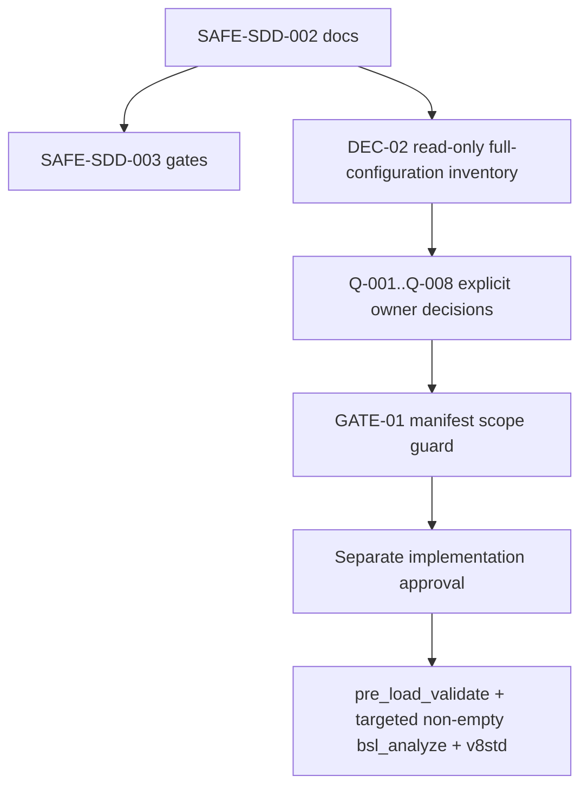

# Tasks: SAFE-SDD-003 remediation delta for APKTechPlan

> Requirements: `requirements.md`
> Design: `design.md`
> Baseline: spec-002 T13, generation `6693e570`
> Dependency: SAFE-SDD-001 (offline verification PASS, 2026-11-08)
> Status: Approved (user approval in chat; 2026-11-08); implementation in progress (owner reaffirmed variant 2, 2026-11-09)

## 1. Execution rules

- Use only models `erpband/deepseek-ai/deepseek-v4.1-flash-1017` (analysis) and `erpband/zai/glm-5.3:NVFP4` (synthesis) from provider `erpband`; anthropic and openai/gpt models are prohibited (owner decision 2026-11-09).
- This SAFE-SDD-003 task modifies only the three spec-003 artifacts listed by the scope fence.
- No type configuration object or main-configuration change is permitted. Approved safe implementation tasks may modify only their explicit CFE BSL/form/script scope; database, Designer, COM, Vanessa, Chrome, role mutation, and destructive operations are separate authorized gates.
- Q-001..Q-008 are ALL DECIDED as of 2026-11-09 (owner decisions recorded in chat). Closing a question does not grant implementation permission: every task below still needs GATE-01 plus explicit owner implementation approval. A review finding is not an owner decision and does not authorize implementation; closing a question does not authorize implementation either.
- Every implementation task below has an exact question gate; it remains `BLOCKED` until all named questions are explicitly closed and separate implementation authorization exists.
- `DEC-02` is the only pre-approval full-configuration preparation: read-only inventory only. It does not close questions or authorize implementation.
- `GATE-01` is a documentation/checking-only manifest guard. It rejects any type configuration object or unrelated main-configuration object change, regardless of static-analysis result.
- For any future BSL/XML edit, stop unless `GATE-01`, `pre_load_validate.py`, targeted non-empty `bsl_analyze`, and `v8std` when available all pass.
- Every task below must retain direct traceability to spec-002 or the dated 2026-11-07 review finding and to US-001..US-004 as applicable.

## 2. Dependency and readiness

| Check | Status | Evidence |
|---|---|---|
| SAFE-SDD-001 | PASS | `heartbeat/night.log`, 2026-11-08 |
| Baseline anchor | PASS | spec-002 T13, generation `6693e570` |
| Availability identity | Inherited | spec-002 D-006 / TD-007; posted `Документ.АпкПланТехническихРесурсов` |
| Q-002 narrowing | Applied, still open | requirements §8 and design §4 |
| Non-regression obligation | Applied | requirements FR-008; design §3 |
| Implementation authorization | Authorized (safe lane) | Owner decision 2026-11-09 (variant 2): safe source fixes + target test-IB verification approved; Q-001..Q-008 still block dependent business-rule tasks |
| BSL/XML static gates | Required for safe source tasks | pre_load_validate + targeted non-empty bsl_analyze + v8std where available |

## 3. Dependency graph

`DEC-02` is the only full-configuration preparation allowed before semantic approval. No implementation task is unblocked by this document-only change.

**Executable-lane rule:** no implementation task may move from `BLOCKED` until every question named in its matrix row is closed, GATE-01 passes, and separate implementation approval exists. Static analysis is downstream evidence, not a substitute for these prerequisites.

### 3.1 Question-to-task and verification-gate matrix

| Question | Exact FRs | Blocked implementation tasks | Blocked verification gate | Condition to become executable |
|---|---|---|---|---|
| Q-001 | FR-004, FR-008 | SRV-01 | GATE-02-PERIOD | Q-001 closed + implementation approval |
| Q-002 | FR-003, FR-008, FR-011 | SRV-02, UI-01 | GATE-02-AVAILABILITY | Q-002 closed + implementation approval |
| Q-003 | FR-003, FR-008 | SRV-02 | GATE-02-AVAILABILITY | Q-003 closed + implementation approval |
| Q-004 | FR-008 | SRV-08 (future concurrency lane; BLOCKED) | GATE-02-CONCURRENCY | Q-004 closed + implementation approval |
| Q-005 | FR-006, FR-008 | SRV-03, SRV-04 | GATE-02-ERROR | Q-005 closed + implementation approval |
| Q-006 | FR-007, FR-008, FR-011 | TEST-02 (role/IB/fixture boundary) | GATE-03-TEST | Q-006 closed + implementation approval |
| Q-007 | FR-005, FR-007, FR-008 | TEST-01, TEST-02 | GATE-03-TEST | Q-007 closed + implementation approval |
| Q-008 | FR-008, FR-011 | UI-01 (all UI follow-up remains in this blocked lane) | GATE-04-UI | Q-008 closed + implementation approval |

All rows remain BLOCKED. The matrix is a review control, not an authorization.

## 4. Safe preparation and documentation controls

### DEC-02 — Read-only full-configuration inventory

**Status:** ALLOWED PREPARATION ONLY; does not close any question.

**User stories:** US-002, US-003, US-004. **Requirements:** FR-003, FR-007, FR-011.

- [ ] inspect full-configuration metadata, modules, forms, roles, and existing tests only to establish facts for Q-002, Q-006, and Q-008 and to prepare a future manifest;
- [ ] record findings without editing BSL/XML, type configuration objects, roles, information bases, UI, or Vanessa artifacts;
- [ ] keep every dependent implementation task BLOCKED until the relevant question is explicitly closed.

**Acceptance:** read-only inventory only; no question is marked answered; no implementation authorization is inferred.

### GATE-01 — Manifest scope guard

**Status:** CHECKING/DOCUMENTATION ONLY; required before any future implementation lane.

**User stories:** US-001, US-003, US-004. **Requirements:** FR-001, FR-008, FR-012; NFR-001.

- [ ] inspect the declared manifest before static analysis;
- [ ] reject any type configuration object change, including properties/type metadata;
- [ ] reject any unrelated main-configuration object change;
- [ ] reject even when `pre_load_validate.py`, targeted `bsl_analyze`, or `v8std` would pass;
- [ ] do not mutate source, metadata, roles, or runtime state while checking.

**Acceptance:** scope violation is a hard FAIL; compliant documentation-only scope is PASS; this task has no product manifest.

## 4. Documentation tasks completed by SAFE-SDD-003

### SAFE-002-A — Anchor remediation to spec-002 T13

**Status:** DONE (documentation-only)

**Traceability:** spec-002 T13; generation `6693e570`; requirements FR-001; review report 2026-11-07.

- [x] Reference the approved spec-002 baseline and generation explicitly.
- [x] State that approved behavior remains inherited unless a future explicit owner decision supersedes it.
- [x] Preserve the baseline availability identity from D-006/TD-007.

**Acceptance:** requirements/design/tasks all name spec-002 T13 and `6693e570`; no spec-002 file is modified.

### SAFE-002-B — Classify overlapping topics

**Status:** DONE (documentation-only)

**Traceability:** spec-002 D-001..D-008, TD-001..TD-008, T1..T13; review findings P0-1..P2-6 (2026-11-07).

- [x] Label inherited behavior.
- [x] Label confirmed review deltas.
- [x] Label still-open questions and dependent blockers.
- [x] Keep Q-001..Q-008 open.

**Acceptance:** no finding is represented as an implicit business decision.

### SAFE-002-C — Narrow Q-002 without reopening document identity

**Status:** DONE (documentation-only)

**Traceability:** spec-002 D-006, TD-007, T8/T9; review P0-2, P2-4, P2-6; requirements FR-003; design §4.

- [x] Preserve `Документ.АпкПланТехническихРесурсов` as the current availability identity.
- [x] Request read-only confirmation of canonical tabular parts.
- [x] Request read-only confirmation of `Принят` filtering.
- [x] Request read-only confirmation of organization and subdivision scope.
- [x] Request read-only confirmation of quantity/capacity and duplicate-vehicle semantics.
- [x] Explicitly do not ask the owner to choose between the CFE document and the approved AПК availability document.
- [x] Leave Q-002 and Q-003 open.

**Acceptance:** Q-002 is factual/semantic confirmation only; it is not closed.

### SAFE-002-D — Add non-regression obligation

**Status:** DONE (documentation-only)

**Traceability:** spec-002 D-001..D-008, TD-001..TD-008, T1..T13; review report 2026-11-07; requirements FR-008.

- [x] Require preservation of approved spec-002 behavior outside the confirmed finding scope.
- [x] Block any change to a spec-002 decision until an explicit future owner decision records supersession and scope.
- [x] Preserve existing public contracts outside the precise finding being remediated.

**Acceptance:** requirements FR-008 and design §3.3 are enforceable review gates.

## 5. Future remediation tasks (defined, not authorized)

All tasks in this section remain **BLOCKED** unless their dependency questions are explicitly decided and separate implementation approval is granted.

### 5.0 Authorization matrix (owner decision 2026-11-09, variant 2)

Derived mechanically from each task's recorded question gate and the question list (Q-001..Q-008). The safe implementation lane approved on 2026-11-09 does NOT close any question. **Gate state refreshed 2026-11-09 after the Q-008 decision: all eight questions are closed.** No row below grants implementation permission — every READY task still needs GATE-01 plus an explicit owner implementation approval.

| Task | Gate questions | Authorization |
|---|---|---|
| SRV-01 | Q-001, Q-004 | Q-001 DECIDED 2026-11-09 (overlap-interval cleanup); Q-004 DECIDED 2026-11-09 (C1); variant A resolved the C1 contradiction (session 7). DONE 2026-11-13 under the owner session authorization (continuation prompt v2); evidence in §7.3 |
| SRV-02 | Q-002, Q-003 | Q-002 DECIDED 2026-11-09 (A2+B2+V1, remove Тх_ПланТехническихРесурсов); Q-003 DECIDED 2026-11-09 (per-machine count; attachment from АпкИсторияТранспортныхСредств, slice last once at period start). Gate questions closed — task is READY, awaiting explicit owner implementation approval (GATE-01 still applies) |
| SRV-03 | Q-005 | Q-005 DECIDED 2026-11-09 (Р1 metadata split, Warning+continue, Error+stop, no third state); owner refinements 2026-11-13 (soft non-reference branch, ЖР throttling). **DONE 2026-11-13..14** (implemented under the owner night-run authorization — continuation prompt docs/review/continue-prompt-srv03-2026-11-13.md; evidence in §7.3) |
| SRV-04 | Q-005, SRV-03 | Q-005 DECIDED 2026-11-09; SRV-03 gate closed. **DONE 2026-11-14** (implemented under the owner night-run authorization — continuation prompt docs/review/continue-prompt-srv03-2026-11-13.md, stage 2; evidence in §7.3) |
| TEST-01 | Q-007 | **DONE 2026-11-10** (implemented after explicit owner session authorization; Ж1 policy in runners, skip cause removed by rewriting ТестПланТехресурсовОтсутствует_ПометкаНеНоль with a self-sufficient fixture on registrar АпкТехнологическиеКартыНаПоле; unit suite 20 PASS / 0 FAIL / 0 SKIP, exit 0, generation 97f9042d; VA 01-09 9/9 PASS; RT 42=42, 0 orphans, 2 adjudicated S10 diffs; independent post-run residue probes all zero) |
| TEST-02 | Q-006, Q-007 | **DONE 2026-11-14** — Q-006/Q-007 implemented (guarded runner; constant + script firewall; script-only roles with guaranteed restore; registry + mask sweep with visible failure); evidence in §7.3 |
| TEST-03 — extract runner + test module into a separate test extension | none (engineering boundary, no business semantics) | DEFERRED by owner decision 2026-11-09: do AFTER the current development phase; not executable now |
| UI-01 | Q-008 | Q-008 DECIDED 2026-11-09 (no-data text in DCS, report still opens; full staleness marking; client input checks; closed event list; split no-data from write failures). Gate question closed — task is READY, awaiting explicit owner implementation approval (GATE-01 still applies) |
| SAFE-LANE-01 — runner result contract (scripts/run_va_feature.py) | none (test-runner infrastructure, no business semantics) | unlocked (safe lane) |
| SAFE-LANE-02 — strict PASS/FAIL/SKIP status parsing in runner | none (test-runner infrastructure) | unlocked (safe lane) |
| SAFE-LANE-03 — numeric `СтрНайти` usage, source-confirmed | none (mechanical fix, no business semantics) | unlocked (safe lane) |
| SAFE-LANE-04 — error logging/classification in runner scripts | none (test-runner infrastructure) | unlocked (safe lane) |
| TASK-0 — platform path parameterization (scripts/v8conf.py) | none (infrastructure, no business semantics) | **DONE 2026-11-10**: single source of truth for the 8.5 platform bin dir (autodetect newest 8.5.x with existing 1cv8.exe; overrides: --v8path CLI > APK_V8_PATH env); all 13 scripts with hardcoded 8.5.4.1683/2028 paths migrated; grep gate clean; selftests + control runs green (load exit 0, designer agent :1543, unit 20/20 exit 0) |

Safe-lane edits must be source-confirmed, must not IMPLEMENT any business semantic decided by Q-001..Q-008 (period scope, availability, duplicates, concurrency, error contract, test boundary, SKIP policy, form UX) — those belong to the named tasks — and must pass the product static gates of design 8.2 before any load or runtime verification.

### 5.1 Ready list as of 2026-11-09 (awaiting explicit owner implementation approval)

| Order | Task | Closed gates | Notes |
|---|---|---|---|
| 1 | SRV-01 — Period-scoped cleanup + concurrency | Q-001, Q-004 | atomicity and exact-key locking bundled, same transaction code |
| 2 | SRV-02 — Availability contract delta | Q-002, Q-003 | largest task: source switch, CFE document removal, two-level calc, two register numbers, trailers |
| 3 | SRV-03 — Error logging and classification | Q-005 | blocking prerequisite of SRV-04 |
| 4 | SRV-04 — Batch/cache model properties | Q-005, SRV-03 | after SRV-03 |
| 5 | TEST-01 — Result contract consumer + Ж1 policy | Q-007 | turns the historical 19+1 SKIP into a red run until the skip cause is removed |
| 6 | TEST-02 — Test boundary and cleanup | Q-006, Q-007 | marker, role boundary, registry cleanup |
| 7 | UI-01 — Form diagnostics and staleness marking | Q-008 | needs the new calculation-moment storage |
| deferred | TEST-03 — Extract runner into a test extension | owner decision | only after this development phase |

### SRV-01 — Period-scoped cleanup

**Status:** DONE 2026-11-13 (implemented under the explicit owner session authorization — continuation prompt docs/review/continue-prompt-srv01-2026-11-13-v2.md; evidence in §7.3) | **Depends:** Q-001, Q-004 (closed 2026-11-09: overlap-interval cleanup + C1 exact-key lock); contradiction C1 «exact lock vs reads-after-lock» resolved by variant A (session 7, design note §5)
**User stories:** US-001, US-003, US-004. **Traceability:** spec-002 T13; review P0-2; requirements FR-004/FR-008.

- [x] implement the owner-approved overlap-interval cleanup scope (Q-001): remove every register row whose period intersects the requested range by at least one day, with the demand selection made by the same intersection rule — `ЗапросКлючейОчистки` + full-key delete canon (probe F1); same symbolic rule as `ЗапросПотребности`;
- [x] implement the Q-004 concurrency scheme: all reads inside the transaction, exact-key managed lock through `ИсточникДанных` + `ИспользоватьИзИсточникаДанных` (delete set plus written keys), bounded lock wait, rollback and a clear user message on expiry, no automatic retry, plan documents not locked — variant A: pre-lock reads build ONLY the lock area, authoritative reads (demand №2, availability, delete-set №2) after the lock, area guard compares key sets №1/№2 (mismatch → full rollback, no retry); bounded wait = IB setting «ВремяОжиданияБлокировкиДанных» (default 20 s, probes F6/F7/F9: per-call timeout does not exist in 8.5);
- [x] re-query the delete set after the lock is acquired (implementation note of Q-004) — delete-set №2 is the only one used for deletion; delete-set №1 feeds only the lock area and the guard;
- [x] preserve atomicity and approved result-writing behavior outside the defect scope — the calculation loop body and `Записать(Ложь)` unchanged; `УстановитьОтборыЗапуска` kept for the write set (org/dept filter made key-optional, consistent with its own ВидТехники handling);
- [x] add the January/February non-regression scenario without changing unrelated periods — unit `ТестОчисткаНеТрогаетДругиеПериоды` + `ТестГраницаПересеченияОднимДнем` + `ТестПустыеДатыПолнаяПерезапись` (fixtures = clones with 2098/2099 periods, snapshot restore) and a VA scenario in feature 05 (calc 2099 must not wipe 2014–2015);
- [x] add a parallel-run scenario proving that two simultaneous calculations for the same scope leave exactly one consistent result set and that the loser receives the bounded-wait message — unit `ТестОжиданиеБлокировкиОграничено`: a background job (export helper `ДержатьБлокировкуДефицита`, the same lock area) holds the lock, `РассчитатьДефицит` gets the bounded-wait exception with the explicit message, the register is provably unchanged (full rollback); background jobs proven usable from a server session (probes 9–10; two COM sessions are impossible — probe F11), the «winner» is a lock-holder fixture rather than a second calculation — documented as flag №4-closed in the design note §2.2/§8.

**API facts F1–F12 (8.5.4.1683, runtime-proven, session 6–7) and the variant-A resolution are recorded in docs/review/srv01-design-2026-11-13.md.**

### SRV-02 — Availability contract verification and implementation delta

**Status:** DONE 2026-11-10..11 (implemented under the explicit owner session authorization; evidence in §7.3) | **Depends:** Q-002, Q-003 (closed 2026-11-09); availability source re-decided by the owner 2026-11-10 (docs/review/decision-dostupnost-2026-11-10.md)
**User stories:** US-001, US-002, US-003, US-004. **Traceability:** spec-002 D-006, TD-007, T8/T9; review P0-2/P2-4/P2-6; requirements FR-002/FR-003/FR-008/FR-011.

- [x] verified read-only what is factual: category from `ТС.АпкТипТС` (EnumRef.АпкТипыТС), attachment (Организация + ЭксплуатирующееПодразделение — двойное «е») from the register slice;
- [x] implemented the Q-002 delta: main-config `АпкПланТехническихРесурсов` as the formation target, CFE document `Тх_ПланТехническихРесурсов` removed, enum value `Прицепы` present, two-level A2/B2 calculation with two register numbers (shortage after own vehicles, final deficit) and move reporting;
- [x] implemented the Q-003 delta: units counted per physical vehicle (DISTINCT ТС in the slice — duplicates do not add units, no dedup flag, no posting lock); **and the 2026-11-10 owner decision**: availability = `РегистрСведений.АпкИсторияТранспортныхСредств`, slice-last at the ДатаНачала of the calculation (ТекущаяДатаСеанса when empty), `Исправно = Истина` mandatory; plan document data is NOT read as a source at all; machines without a history record are outside the pool (fallback to shared pool only applies to attachment, not existence);
- [x] formation still creates/updates `Документ.АпкПланТехническихРесурсов` as its output (unchanged scope; owner question on the output registered, default = keep);
- [x] anomaly 09 (NFR-004): root cause = `DefaultRoles` of the extension (auto-assigned roles made the section visible to Агроном); fixed by removing `<DefaultRoles>` from Configuration.xml in a separate load cycle — UI evidence now clean (see §7.3); the earlier `ПравоДоступа=Да` server probe was an instrument artifact (VA server steps run in the TestManager/admin session, not the Агроном session).
**Semantics per the 2026-11-09 decisions (Q-002, Q-003) + the 2026-11-10 availability-source decision; implemented and verified 2026-11-10/11 (unit 20/20, VA 9/9, round-trip clean).**

### SRV-03 — Error logging and classification

**Status:** DONE 2026-11-13..14 (implemented under the explicit owner night-run authorization — continuation prompt docs/review/continue-prompt-srv03-2026-11-13.md; owner decisions of 2026-11-13 incorporated: soft non-reference branch, ЖР throttling; evidence in §7.3) | **Depends:** GATE-01, and implementation approval
**User stories:** US-001, US-003, US-004. **Traceability:** spec-002 T5/T9/T13; review P1-1/P1-2/P1-3; requirements FR-006/FR-008/FR-012.

- [x] preserve the primary exception while correcting logging construction and numeric search — P1-1/P1-2 confirmed fixed before this task (b8d621e numeric `> 0` + pre-existing ЖР Error construction in `ВыполнитьЗапросАПК`), closed by the new tests: `ТестОшибкаЗапросаАПКПробрасывается` (exception not swallowed, message references the journal) + `ТестКлассификаторОтключенияМодуляАПК` (both synthetic branches);
- [x] implement the Q-005 (Р1) split: presence of the model requisite is checked against catalog metadata (`ЕстьРеквизитСправочника`: Метаданные.Справочники.Найти + Реквизиты.Найти, runtime-proven by the unit run); absent requisite → journal Warning, property treated as unfilled (0), calculation continues; infrastructure failure (rights, query, module, execution) → journal Error (inside `ВыполнитьЗапросАПК`), calculation stopped with a clear message referencing the journal entry, transaction rolled back, no partial rows — `ТестРеквизитМоделиОтсутствуетВМетаданных` proves the Warning+continue branch;
- [x] remove the swallowing points: the catch-all `Попытка…Результат = 0` in `ЗначениеРеквизитаМодели` deleted; the non-reference branches of `ИмяСправочникаПоТипуСсылки` re-decided by the owner 2026-11-13 (question 4): non-reference / non-catalog-reference → ЖР Warning + `""` + calculation continues (soft branch; `ТестНеСсылкаСправочникаПредупреждена`: no exception, result Ложь both directions); the only hard branch left is the double ПолноеИмя()/.ПолноеИмя failure (platform anomaly → ЖР Error + exception, Р1 infrastructure);
- [x] do not convert unknown failures to zero and do not parse platform error text — requisite classification is metadata-based; the only text-reading point (`ЭтоОтключениеМодуляАПК`) is the pre-existing disabled-module classifier, extracted as an export pure function and covered by tests per review P1-2;
- [x] do not add a third result state ("property unavailable"): the journal entry is the agreed visibility, and `КоэффициентНеЗадан` keeps its approved meaning; ЖР throttling per the owner decision 2026-11-13 (question 6): one Warning per «каталог.реквизит» pair per calculation — implemented as an optional cache parameter `ПредупрежденныеРеквизиты` threaded from the calculation entry points (module-level variables are NOT supported in common modules by the platform — bsl-ls Error CommonModuleVariables; the planned `Перем` mechanism was corrected the same night, design note §2.1/§5), mechanics covered by checks in `ТестРеквизитМоделиОтсутствуетВМетаданных`.

### SRV-04 — Batch/cache model properties

**Status:** DONE 2026-11-14 (implemented under the owner night-run authorization — continuation prompt docs/review/continue-prompt-srv03-2026-11-13.md, stage 2; evidence in §7.3) | **Depends:** Q-005 (closed 2026-11-09), SRV-03 (closed 2026-11-14)
**User stories:** US-001, US-003, US-004. **Traceability:** spec-002 D-003, TD-003, T5/T9; review P1-4; requirements FR-006/FR-008/FR-012.

- [x] batch/cache distinct model properties — `НовыйКэшРасчета` (Модели/Предупреждения/РеквизитыКаталогов) + `ПостроитьКэшРеквизитовМоделей`: all calculation models × all used catalog requisites in ONE selection per catalog (`ГДЕ Спр.Ссылка В (&Модели)` through `ВыполнитьЗапросАПК`), built at the calculation entry points (`РассчитатьДефицит` post-lock from ТЗПотребность+ТЗДоступность; `ЗаполнитьТЧПланаРабот` from Потребность+Доступность.Модели) — one or two selections per calculation instead of per-pair queries;
- [x] prove numerical equivalence of substitution coefficients — new unit test `ТестПакетныйКэшЭквивалентенПоштучному` (fixtures in 3 catalogs + duplicate model; every model×requisite pair: cache value = per-item query value; `КоэффициентЗамещения` with cache = without cache = 2); per-item branch of `ЗначениеРеквизитаМодели` kept as the reference/fallback;
- [x] preserve the Q-005 classification and fallback semantics; metadata checks are cached for the calculation — `ЕстьРеквизитСправочника` result cached in `РеквизитыКаталогов`; absent requisite = throttled ЖР Предупреждение (one per «каталог.реквизит» per calculation, `Предупреждения`) + value 0 «не заполнено» + calculation continues; selection failure = infrastructure → ЖР Error inside `ВыполнитьЗапросАПК` + exception + rollback, no partial rows; no third state; `ПодобратьЗамещение` without a passed cache creates a local one (throttle works, no batching) — one-off behavior unchanged.

**Acceptance:** SRV-04 removes the N+1 per-pair query pattern while keeping every Q-005 Р1 semantics literally; equivalence proven by test on live data; no caller-visible behavior change. — Met 2026-11-14: unit 29/29 PASS (exit 0), VA 01-09 9/9 PASS, RT v5 adjudicated-clean (no new diffs), residue probes zero.

### TEST-01 — Result contract consumer

**Status:** DONE 2026-11-10 (implemented under the explicit owner session authorization; evidence in §7.3) | **Depends:** Q-007 (closed 2026-11-09, variant Ж1)
**Traceability:** spec-002 T12/T13; review P0-1/P1-6; requirements FR-005/FR-008/FR-013; US-001/US-003/US-004.

- [x] align the UI consumer with `Статус` while preserving explicit PASS/FAIL/SKIP in the contract; the python report additionally surfaces a derived `Детали` line (СтрСоединить of the approved `Провалы` field) — no new statuses or exception-schema fields were introduced;
- [x] implement the Q-007 (Ж1) terminal policy in the runner: any SKIP fails the run, the "exit code 2 = SKIP-only" contract is retired, the skip counter and reason stay visible in output and artifact, strict status parsing and the expected-total check stay;
- [x] remove the skip cause of the currently skipped test (guarantee its data or rewrite the test so its conditions always hold); deleting or disabling it to reach green is forbidden; re-establish the T13 baseline as 20 PASS — the test was rewritten to create its entire fixture (scenario, subdivision, organization, work kind, model, registrar stub АпкТехнологическиеКартыНаПоле) and to write its demand row through the 8.5 movement-collection canon (Движения.Найти + Записывать = Истина + Движения.Записать), all deny-empty dimensions filled;
- [x] preserve model-level plan behavior;
- [x] preserve availability document identity and the posted-document baseline;
- [x] preserve approved coefficient semantics;
- [x] preserve accepted document/form contracts;
- [x] preserve rights behavior validated by spec-002 T13;
- [x] do not decide the SKIP terminal policy in code before Q-007 (policy implemented only after the 2026-11-09 owner decision);
- [x] do not invent missing exception-schema details; verify only the fields/contracts actually specified by FR-008 and the approved baseline.

**Acceptance:** TEST-01 covers every FR-008 field listed above, with no invented exception schema; the run verdict fails on any SKIP (Ж1); GATE-01 applies. — Met 2026-11-10: unit suite 20 PASS / 0 FAIL / 0 SKIP (exit 0), VA 01-09 9/9 PASS, RT adjudicated-clean, zero residue in independent probes.

### TEST-02 — Test boundary and cleanup

**Status:** DONE 2026-11-14 (implemented under the owner night-run authorization — continuation prompt docs/review/continue-prompt-srv03-2026-11-13.md, stage 3; design note docs/review/test02-design-2026-11-14.md; evidence in §7.3) | **Depends:** Q-006/Q-007 (closed 2026-11-09), GATE-01
**User stories:** US-003, US-004. **Traceability:** spec-002 T12/T13; review P1-5/P1-6/P1-7; requirements FR-007/FR-008/FR-012.

- [x] add the Q-006 test-infobase marker: a boolean CFE constant (proposed `Тх_ТестоваяБаза`, default False) set only in the test infobase; every test entry point and every writing test helper aborts with a clear exception when the marker is not set — implemented as `ПроверитьТестовуюБазу()` called from `НовыйКонтекстТеста` (the single entry of all 30 tests) and from every writing helper (13 call sites);
- [x] add the second, independent line: launch scripts verify the target infobase reference before running anything — `scripts/ib_guard.py` (allow-list `dev_erpapk_demo`) wired into `run_unit_tests_com.py`, `run_va_feature.py`, `va_assign_roles_direct.py`;
- [x] keep role assignment/removal exclusively in the external script (never in 1C scenarios), move the restore into a guaranteed block, verify the restored role state at the end and turn a failed restore into a VISIBLE run failure — `run_va_feature.py` rewritten: snapshot before, `try/finally` restore, post-verify `ROLE-RESTORE-FAILED`, forcing exit code 1;
- [x] keep a per-run registry of created objects and clean up from it on ANY exit; a failed cleanup is a VISIBLE run failure and the leftover list is written to an artifact file next to the logs — register `Тх_РеестрТестовыхОбъектов` (composite type over the 11 fixture types), `ОстаткиРеестра`/`ОстаткиПослеПрогона`, final `ЧистотаТестовыхДанных` row in the runner (EXPECTED_TOTAL 30), artifact `leftovers_<ts>.txt`;
- [x] sweep scenario fixtures by name masks (`Тх_Тест…`, `Тх_VA_…`) in addition to the registry — one static union query over 9 catalogs x 2 masks, with the stable scenario data set excluded by an explicit name list (mask collision found by a live run);
- [x] do not mutate shared or production-like data and do not treat an "Information"-level journal entry as cleanup evidence — proof of cleanliness = empty registry + empty sweep (visible FAIL otherwise); marker-off probe: 31/31 FAIL rows, marker restored afterwards.

### TEST-03 — Extract runner and test module into a separate test extension (DEFERRED)

**Status:** DEFERRED by owner decision 2026-11-09 — run AFTER the current development phase is finished | **Depends:** completion of the current phase; no open question
**User stories:** US-003, US-004. **Traceability:** spec-002 T12/T13; review P1-5/P1-6/P1-7; requirements FR-007/FR-012.

Owner wording: "раннер нужно вынести в отдельное расширение после того, как завершим этот этап разработки".

- [ ] move `Тх_РаннерТестов` and the test module `Тх_Тесты` out of the working CFE into a separate test extension;
- [ ] re-point the launch scripts, Vanessa features and the unit-test runner at the new extension without changing test semantics;
- [ ] keep the Q-006 infobase marker, role boundary and registry-based cleanup in force after the move;
- [ ] prove equivalence: the same suites produce the same PASS/FAIL/SKIP verdicts before and after the move;
- [ ] shrink the working CFE manifest accordingly (removing test objects must not break product modules).

This task is deliberately NOT executable during the current phase: it must not compete with SRV-01..SRV-04 / TEST-01 / TEST-02 / UI-01 work.

### TEST-04 — Production test contour in 1C (owner requirement 2026-11-14)

**Status:** PLANNED — owner requirement recorded, implementation NOT started | **Depends:** TEST-02 (DONE 2026-11-14)
**User stories:** US-003, US-004. **Traceability:** TEST-02 §10 (design note); review P1-5/P1-6/P1-7.

Owner requirement: the whole Python harness (`scripts/*.py`) is a DEVELOPMENT-TIME tool. Production ships 1C objects only: data processors on the built-in language that prepare fixtures and run the tests/scenarios themselves. No Python call may be required by a production run.

- [ ] move the stable scenario data preparation (currently `scripts/va_prep_data.py`: work item, 3 models, 4 vehicles with codes `ТХТС*`) into a 1C data processor method (idempotent find-or-create by name/code, `ПроверитьТестовуюБазу` guarded);
- [ ] move scenario execution into 1C: a data processor that launches Vanessa Automation and returns the verdict, with the role snapshot/restore and the teardown sweep inside `Попытка/Исключение` (no external script in the loop);
- [ ] role assignment/removal stays outside 1C scenarios (TEST-02 boundary), but its orchestration must be triggerable from 1C without Python;
- [ ] Python keeps only development duties: extension load/dump, designer agent command building, dump comparison, balance/pre-load checks, headless convenience launches of the same 1C entry points.

### UI-01 — Form diagnostics and batching

**Status:** DONE 2026-11-15 (stage 4 completed; variant b reverted as platform-rejected — open question, see design note §3) | **Depends:** Q-008 (closed 2026-11-09), GATE-01
**User stories:** US-001, US-003, US-004. **Traceability:** spec-002 T3/T9/T11/T12; review P2-1/P2-2/P2-3/P2-4/P2-5/P2-6; requirements FR-008/FR-012.

- [x] preserve inherited forms and public contracts outside each confirmed finding — no borrowed forms involved (ownership confirmed 2026-11-14), no public contract of the server module changed beyond additive export functions;
- [ ] configure the "no data" text in the deficit report data-composition scheme (Q-008 variant b) — BLOCKED/REVERTED 2026-11-15: `dcsset:noDataText` in the settings variant is REJECTED by platform 8.5.4 XDTO at load (`Исключение XDTO…Template.xml`, load_rc=1 twice), which blocked the whole extension load; the element was removed (file returned to ccfb5fa state). Alternatives (designer-interactive or programmatic at composition) require checking the platform's actual serialization first — open question for the owner (design note ui01-design-2026-11-15.md §3). The zero-rows case still opens the report with the platform default text plus the calculation form's own message;
- [x] implement stale-value marking (Q-008 variant c, full) — DONE 2026-11-15: register `Тх_МоментРасчета` (resource type corrected Date→DateTime), `ЗаписатьМоментРасчета` called strictly inside the `РассчитатьДефицит` transaction before `ЗафиксироватьТранзакцию()`, public `МоментРасчетаДефицита`/`ДанныеРасчетаУстарели`; form attribute `ПометкаУстаревания` + decoration, filled in `ПриСозданииНаСервере`, refreshed in `СценарийПланированияПриИзменении` and cleared after a successful calculation; detection = latest registrar period (`Период`) in the year-plan registers newer than the stored moment (owner default option (a); limitation: editing a document without changing its date is not detected — design note §1). COM probe proved both branches end-to-end (fresh→False, past→True, restored→False, no residue);
- [x] add client-side input checks before the server call: period boundaries filled, start not later than end, "shifts per day" greater than zero — as a message, not as a platform exception — `ПараметрыВводаКорректны()` in both forms (deficit calculation and work plan), called before the server call;
- [x] fix the closed list of supported events (`ПриИзменении`, `НачалоВыбора`, `ПередНачаломДобавления`, `ПриСозданииНаСервере`, form commands) in the form documentation and do not add handlers outside it without verifying them on platform 8.5 — the only addition is `СценарийПланированияПриИзменении` (`OnChange`, from the closed list), verified on 8.5.4 by load + round-trip (platform-accepted, canonical order) and exercised by VA-05;
- [x] separate the "no data" branch from the "write/access operation failed" branch in the work-plan form, journal the original error and show a meaningful message (P2-2) — both server functions wrapped in try/catch, `ОшибкаЗаписи` carried to the client, original text journaled with `ПодробноеПредставлениеОшибки`;
- [x] record that P2-3 (document-form counters) disappears with the CFE document removed by Q-002 — no work is required there beyond removing that form;
- [x] confirm organization scope of the forms before implementation — both forms are own CFE data-processor forms (not borrowed), no organization-scoped extension semantics involved.

## 6. Cross-reference matrix: every task to baseline/finding

| Task | User stories | Spec-002 reference | Review reference | Decision/question gate | Status |
|---|---|---|---|---|
| SAFE-002-A | US-001, US-003 | T13 / `6693e570` | 2026-11-07 report | none; docs only | DONE |
| SAFE-002-B | US-001, US-003 | D-001..D-008, TD-001..TD-008, T1..T13 | P0-1..P2-6 | Q-001..Q-008 remain open | DONE |
| SAFE-002-C | US-002, US-003 | D-006, TD-007, T8/T9 | P0-2, P2-4, P2-6 | Q-002/Q-003 | DONE |
| SAFE-002-D | US-001, US-003, US-004 | D-001..D-008, TD-001..TD-008, T1..T13 | 2026-11-07 report | future owner decision for supersession | DONE |
| DEC-02 | US-002, US-003, US-004 | D-006, TD-007, T12/T13 | P0-2, P1-5, P2-1..P2-6 | read-only preparation; questions remain open | ALLOWED PREPARATION ONLY |
| GATE-01 | US-001, US-003, US-004 | T13; NFR-001 | all findings in declared manifest | scope manifest; static analysis cannot override | CHECKING ONLY |
| SRV-01 | US-001, US-003, US-004 | T13 | P0-2 | Q-001/Q-004 closed 2026-11-09; owner session authorization 2026-11-13 | DONE 2026-11-13 (§7.3) |
| SRV-02 | US-001, US-002, US-003, US-004 | D-006, TD-007, T8/T9 | P0-2, P2-4, P2-6 | Q-002/Q-003 closed 2026-11-09 + GATE-01 | READY (approval pending) |
| SRV-03 | US-001, US-003, US-004 | T5/T9/T13 | P1-1/P1-2/P1-3 | Q-005 closed 2026-11-09 + GATE-01; owner night-run authorization 2026-11-13 | DONE 2026-11-13..14 (§7.3) |
| SRV-04 | US-001, US-003, US-004 | D-003, TD-003, T5/T9 | P1-4 | Q-005 closed + SRV-03 closed + GATE-01; owner night-run authorization 2026-11-13 | DONE 2026-11-14 (§7.3) |
| TEST-01 | US-001, US-003, US-004 | T12/T13 | P0-1/P1-6 | Q-007 closed 2026-11-09 + GATE-01 | READY (approval pending) |
| TEST-02 | US-003, US-004 | T12/T13 | P1-5/P1-6/P1-7 | Q-006/Q-007 closed 2026-11-09 + GATE-01 | DONE 2026-11-14 (evidence §7.3) |
| TEST-03 | engineering boundary | T12/T13 | P1-5/P1-6/P1-7 | owner decision 2026-11-09 | DEFERRED (after the current development phase) |
| UI-01 | US-001, US-003, US-004 | T3/T9/T11/T12 | P2-1..P2-6 | Q-008 closed 2026-11-09 + GATE-01 | DONE 2026-11-15 (evidence §7.3; variant b open question) |

**Verification rule:** a task lacking both a spec-002 reference and a 2026-11-07 finding reference is invalid. No task above lacks both.

## 7. Verification plan and results

### 7.1 Documentation-only verification for SAFE-SDD-003

- [ ] verify only the three allowed SDD files changed;
- [ ] verify Q-001..Q-008 map to exact FRs, blocked implementation tasks, and verification gates;
- [ ] verify DEC-02 is the only full-configuration preparation and is read-only;
- [ ] verify every business-dependent BSL/XML, role, information-base, UI, and Vanessa task is BLOCKED until its own question gate closes;
- [ ] verify US-001..US-004 appear in requirement, task, decision, and verification traceability;
- [ ] verify TEST-01 covers every FR-008 field without inventing exception-schema details;
- [ ] verify GATE-01 rejects type configuration objects and unrelated main-configuration objects independently of static-analysis results;
- [ ] verify no dependency lets an unresolved question reach executable implementation;
- [ ] verify the scope guard is documentation/checking only;
- [ ] verify Q-001..Q-008 remain open and no database/runtime operation occurred.

### 7.2 Required product static gates for future implementation

Not run for this documentation-only task: no BSL/XML was changed, so `pre_load_validate.py`, targeted non-empty `bsl_analyze`, and `v8std` are not applicable. For any future BSL/XML task, stop on failure and run `GATE-01`, `pre_load_validate.py`, targeted non-empty `bsl_analyze`, and `v8std` when available, in that order. Database and runtime verification are separately authorized only after the offline gates and owner decisions.

### 7.3 Verification report

**Safe-lane run 2026-11-09 (post Phase-0 reconciliation, owner decision variant 2):** SAFE-CFE-005 / SAFE-PY-006 / SAFE-BSL-007 implemented and gated (pre_load_validate 29 files OK; targeted bsl_analyze 0 errors, warnings 63->40 strict subset; v8std no violations; py_compile + selftests green). Loaded to dev_erpapk_demo, generation `11c6cca2229497616f269b8004885a8608f2d10d`; CheckModules/UpdateDBCfg PASS. RT compare: 2 REAL diffs, both byte-identical to adjudicated pre-existing S10 baseline artifacts (see fix-log-2026-11-06 S10); all 5 edited product files round-tripped identical. VA suite 01-09: 9/9 PASS. Unit suite: total=20, passed=19, skipped=1 (Q-007 documented SKIP, not a failure), failed=0. Web E2E: NOT_AVAILABLE (no publication; evidence docs/web-e2e-probe-2026-11-09.md). At that moment Q-001..Q-008 were all open and SRV-01..04 / TEST-01..02 / UI-01 were BLOCKED. Since then Q-001..Q-006 were DECIDED (owner, 2026-11-09); SRV-01..SRV-04 gate questions are closed and all four tasks are READY pending explicit implementation approval; TEST-02 gate questions are closed as well, so SRV-01..SRV-04 / TEST-01 / TEST-02 are READY pending explicit implementation approval; TEST-03 (extraction of the runner into a separate test extension) is DEFERRED until after the current development phase. UI-01 gate question is closed too, so all six remaining tasks are READY pending explicit implementation approval. NOTE: under Q-007 (Ж1) the historical "19 PASS + 1 SKIP" result is a FAILING run; the skip cause must be removed and the T13 baseline re-established as 20 PASS.

**TEST-01 implementation run 2026-11-10 (owner session authorization; Ж1):** implementation = runner Ж1 policy (scripts/run_unit_tests.py, run_unit_tests_com.py — exit code 2 retired, any SKIP = exit 1, strict Статус parsing and expected-total=20 kept), `Детали` derived line in Тх_РаннерТестов (СтрСоединить of the approved Провалы field), full rewrite of the previously skipped test in Тх_Тесты: self-sufficient fixture (test scenario/subdivision/organization/work-kind/model elements + registrar stub АпкТехнологическиеКартыНаПоле — the register's movements are declared on that document in the live 8.5 base), demand row written through the 8.5 canon (Движения.Найти + Набор.Записывать = Истина + Движения.Записать; direct набор записи rejected the registrar filter on 8.5), all five deny-empty register dimensions filled (СценарийПланирования, Организация, Подразделение, ВидРаботы, Техника), restore = deficit cleanup by scenario + registrar deletion (platform removes the movements) + residue control queries (Q-006/K4a visible-failure policy). Static gates each cycle: bsl_balance broken=0, pre_load_validate 29 OK, bsl_analyze non-empty 0 Errors (warnings not worse than HEAD). Loaded via load_extension.py (8.5.4.2028) + designer agent force-apply, final generation `97f9042d7d20b1fcf784cbe0c7cf9fcd1e41cd3f`. **Unit suite: total=20 passed=20 skipped=0 failed=0, exit 0** (9 iterations to green; each red iteration had a distinct, logged cause). Independent post-run residue probes (read-only COM): test organizations 0, test work kinds 0, stub docs 0, register fixture rows 0, deficit rows 0. **VA suite 01-09: 9/9 PASS** (01-08 first run; 09 first run hit a TestClient-connect flake in stage1 (UNKNOWN, strict verdict FAIL, retried standalone: FINAL PASS stage1/stage2/stage3, UI evidence OK, roles restored to none; two zombie TestManager clients killed, 0 x 1cv8c after). **Round-trip:** fresh dump via designer agent, files 42=42, only-in-source 0, only-in-dump 0, content REAL diffs = 2, both byte-identical in nature to the adjudicated pre-existing S10 baseline pair (SKD Template.xml use='true' serialization artifact; Rights.xml Use=true on the two write processors — source correct, 8.5 does not decrement extension role rights on load, owner action = re-attach extension). No new diffs; both TEST-01-edited product files round-tripped identical.

**SRV-02 implementation run 2026-11-10/11 (owner session authorization, сессии 1–4):** implementation = availability source per the owner decision of 10.11 (docs/review/decision-dostupnost-2026-11-10.md): `Тх_ТехникаСервер.ЗапросДоступности` rewritten — pool = `СрезПоследних(&ДатаСреза)` ГДЕ `Исправно`, INNER JOIN catalog ТС (АпкМодель, АпкТипТС → Тх_ВидыТехники via ВЫБОР КОГДА), attachment from the same slice; `ДоступныеМоделиПодразделения` — same slice, attachment filter (Организация + ЭксплуатирующееПодразделение В иерархия); `ПланОтсутствует` = «нет исправных ТС в срезе»; plan-document data not read as a source anywhere; СКД «ПометкаПлана» text re-targeted («нет исправных ТС в срезе»). Sessions 1–3 (already reported in heartbeat/night.log): CFE document removal, two-level calc, 4 hotfixes, extension recreation (delete→load), unit 20/20, VA 01–08 closed. Session 4 (this run): source rewrite applied (`scripts/srv02_istok_rewrite.py`, utf-8 file — no inline Cyrillic); one омоглиф fixed in the rewritten module («ЭксплуатирующеПодразделение» single-е → double-е, 4 occurrences — caught by the unit run, CheckModules does not see query-text errors); fixtures rewritten to history-register records (Период 1999, Исправно=Истина, срез 31.12.1999 — empty of demo data, isolation); va_prep_data.py now sets/updates `АпкТипТС = СХТехника` on ТХТС* (verified by probe: 4/4 True); unit fixtures (`ЗаписатьПрипискуТС`/`УдалитьПрипискуТС`); fixtures 03/04 mutually hardened (context cleanup widened to `Тх_VA% ТС%`, teardowns added — a 03→04 приписка leak was the cause of one 04 FAIL, fixed and re-verified); fixture 08 teardown (планы НИВА/Основной deleted in a dedicated step after closing client windows; direct in-block `Удалить()` hit «несоответствие версии» while the doc form was open — robust Прочитать()+Попытка pattern). Gates each cycle: pre_load_validate 24 files OK, bsl_balance broken=0, bsl_analyze 0 Errors (warnings: same known set — JoinWithVirtualTable 744, QueryParseError on concatenated queries, CognitiveComplexity). Loads via load_extension.py (8.5.4.2028) + designer agent apply: generations `e2194c14…` (source rewrite) → `3f271a0b…` (омоглиф fix) → `107c00c6…` (DefaultRoles removal). **Unit suite: total=20 passed=20 skipped=0 failed=0, exit 0** (first run after the source rewrite: 16/20 — the 4 failures all traced to the омоглиф; green after the fix). **VA suite 01–09: 9/9 PASS** (run `heartbeat/va_all_s4d.log`, 31.2 min; 04 and 08 re-verified standalone after the fixture hardening: PASS). **Anomaly 09 (NFR-004):** bisect per plan — `<DefaultRoles>` removed from Configuration.xml, separate load cycle (`107c00c6…`); probe_rights_agr still printed `Да` — but that probe is an instrument artifact (VA server steps execute in the TestManager/admin session; documented in feature 09 header and t12_probe_rights); the real check = t12 driver: stage2 (Тх_Чтение) PASS, stage3 (Тх_Редактирование) PASS, **UI-evidence OK** (50 Агроном-window captures, «Планирование техники» absent without roles); stage1 VA-completion hit the known TestClient-connect hang twice in-driver (UNKNOWN), passed standalone on retry («Ошибок не было», status artifact 0) — same shape as the TEST-01 flake; roles restored to none after the run. **Round-trip:** fresh dump `apktechplan_rt_dump_20261110_v2` after the DefaultRoles load: files 34=34 (new baseline: 42 minus the 8-file tree of the removed CFE document), only-in-source 0, only-in-dump 0, content REAL diffs = 2 — byte-identical in nature to the adjudicated pre-existing S10 pair (SKD use='true'; Rights Use=true on the two write processors). **Residue (Q-006/К4a):** планы НИВА/Основной 0/0 (все), приписки ТХТС* 0, приписки/элементы Тх_VA% ТС 0, помеченных на удаление маркеров 0, предусмотренный набор ТХТС* = 4 элемента (va_prep_data), дефицитные строки демо-расчёта 46 (замещаются каждым расчётом, вне списка требований). Open owner question (flag 14): does formation keep `Документ.АпкПланТехническихРесурсов` as its output — implemented as YES (unchanged scope), awaiting explicit confirmation.

**Status:** further results (SRV-03, SRV-04, TEST-02, UI-01) must be written here with exact commands, exit codes, and PASS/FAIL verdicts; unchecked items must not be represented as complete.

**SRV-01 implementation run 2026-11-13 (owner session authorization, continuation prompt v2; сессии 6–8):** implementation = period-scoped cleanup (Q-001 B) + concurrency (Q-004 C1, variant A). API-сверка 8.5.4.1683 completed first by runtime probes (EPF-зонд `Тх_ЗондSRV01`, COM V85, dev_erpapk_demo, no data changes; facts F1–F12 in docs/review/srv01-design-2026-11-13.md §2.1): full-key delete canon (F1), lock area full path (F2), ИсточникДанных+ИспользоватьИзИсточникаДанных mapping and argument order (F3), no-value element locks everything (F4), empty source safe (F5), `Заблокировать()` без параметров (F6), `НачатьТранзакцию(<param>)` removed in 8.5 — only `Неопределено` accepted (F7), no `УровеньИзоляцииТранзакции` (F8), `ПолучитьВремяОжиданияБлокировкиДанных()` = 20 s (F9), the setter is IB-level admin-only (F10), COM sessions cannot hold a transaction across calls (F11), `ВнешниеОбработки.Создать` works from COM (F12). Background jobs: usable (probes 9–10) — 8.5 API: `УникальныйИдентификатор` (not `Идентификатор`), `ИмяМетода`, `Наименование`, `Состояние`; `ОжидатьЗавершения(<sec>)` is a PROCEDURE; `СостояниеФоновогоЗадания.Выполняется` not reachable by runtime compilation. Contradiction C1 (exact lock needs pre-lock reads; C1 demands reads after) resolved by variant A (session 7, design note §5): pre-lock reads №1 (demand + delete-set) feed ONLY the lock ТЗ; after the lock — authoritative reads №2 (demand, availability per the SRV-02 contract with ДатаСреза = raw ДатаНачала, delete-set re-query); area guard compares key sets №1/№2 via `КлючЗаписиДефицита` (mismatch → full rollback + message, no retry); deletion enumerates keys (F1); write set unchanged (`Записать(Ложь)`). Code: `Тх_ТехникаСервер` — `РассчитатьДефицит` rebuilt per §5, new helpers `ИзмеренияБлокировкиДефицита`/`ЗапросКлючейОчистки`/`ТЗКлючейБлокировки`/`УдалитьСтрокиДефицитаПоКлючам`/`НаборыКлючейДефицитаИдентичны`/`КлючиНабораДефицита`, export fixture `ДержатьБлокировкуДефицита` (busy-loop hold, fixating empty transaction); the lying comment at the old :1480-1483 replaced with the real canon description; `УстановитьОтборыЗапуска` org/dept filters made key-optional (latent direct-access bug surfaced by the new tests — same class its own ВидТехники handling already avoided). Tests: 4 new unit tests in `Тх_Тесты` (jan/feb non-regression, one-day boundary both sides, empty-dates full rewrite, bounded-wait with the ФЗ holder; fixtures `ЗасеятьСтрокиДефицита`/`ЕстьСтрокаДефицитаСПериодом`/`ЗанятыйЦиклСекунд`/`ДождатьсяЗавершенияФоновогоЗадания`, snapshot restore in every test), runner wrappers + `EXPECTED_TOTAL` 20→24; VA feature 05 gained a second scenario (calc 2099 must not wipe 2014–2015; no seeding → no teardown, грабли №2 satisfied constructively). Static gates each cycle: bsl_balance broken=0 (all modules), pre_load_validate 24 files OK, bsl_analyze 0 Errors on the changed dirs (baseline HEAD = 0 Errors both modules; first pass had 25 Errors — 20 em-dash `InvalidCharacterInFile` + transaction-pair/empty-except in the ФЗ fixture, all fixed; remaining warnings = the pre-existing set + QueryParseError on the concatenated delete-set query, same class as `ЗапросПотребности`). Loads via load_extension.py (8.5.4.2028) + designer agent force-apply: generations `126fb54d…` (v1) → `24f0b16b…` (v2, УстановитьОтборыЗапуска fix; prior `107c00c6…`). **Unit suite: total=24 passed=24 skipped=0 failed=0, exit 0** (first run 21/24: the 3 failures all traced to the latent `УстановитьОтборыЗапуска` direct access — fixed, re-run green; `ТестОжиданиеБлокировкиОграничено` passed first try, wall ≈40 s: 15 s spin-up wait + 20 s IB lock timeout; the platform exception text is journaled to ЖР by the test). **VA suite 01–09: 9/9 PASS** (05 with both scenarios, ~50 min total run `tmp/srv01_va_all.log`). **Round-trip:** fresh dump `apktechplan_rt_dump_20261113_v3` (stale reuse of the previous dump dir exposed 8 phantom Documents/ files from the pre-SRV-02 era — the dir was cleaned and re-dumped; note: compare args are `<dump_dir> <source_dir>`): files 34=34, only-in-source 0, only-in-dump 0, content REAL diffs = 2 — byte-identical in nature to the adjudicated pre-existing S10 pair (SKD use='true'; Rights Use=true on the two write processors). **Residue (Q-006/К4a, probe_residue_s4 extended with the 2098+ synthetic-row check):** синтетика периодных фикстур 0, планы 0, приписки ТХТС* 0, Тх_VA% ТС 0, предусмотренный набор ТХТС* = 4, дефицит НИВА 25 (справочно, демо-спрос). OWNER-REVIEW flags carried to the report: №5 (bounded-wait = IB setting, default 20 s sufficient? admin may set otherwise), №4 closed (ФЗ-форма параллельности), variant A awaiting explicit confirmation, flag 14 (formation output) still open, Rights re-attach owner action pending.

**Owner decisions 2026-11-13 (evening, owner chat; recorded per the night-run prompt):** all six open questions closed. (1) SRV-01 variant A concurrency scheme CONFIRMED finally; (2) bounded lock wait = IB setting «ВремяОжиданияБлокировкиДанных», default 20 s is SUFFICIENT — recorded as an operational requirement (changes only by the IB administrator); (3) flag №14 closed, variant (а): `Документ.АпкПланТехническихРесурсов` REMAINS the formation output, tabular sections unchanged, formation not touched anywhere in the night run (justification facts: consumers = standard availability calculation АпкРасчетОбеспеченности, planning journal, version/ban-date/exchange infrastructure and RLS roles — collected 13.11, source search); (4) non-reference in model parameters → journal Warning + calculation CONTINUES (soft branch; implemented in SRV-03 step 0); (5) extension re-attach (Rights Use=true artifact) ASSIGNED TO THE IMPLEMENTER: delete + re-load at the very END of the night run with a proof dump (stage 5; data loss of Тх_ДефицитТехники demo rows accepted by the owner); (6) ЖР throttling for the missing-requisite warning ENABLED — one record per «каталог × реквизит» (implemented in SRV-03 step 0 as a per-calculation cache; the planned module-variable mechanism is platform-unsupported in common modules).

**SRV-03 implementation run 2026-11-13..14 (owner night-run authorization, continuation prompt docs/review/continue-prompt-srv03-2026-11-13.md; сессии 9-10):** implementation = error logging and classification (Q-005 Р1, review P1-1/P1-2/P1-3). Session 9 (recap): metadata-API check `ЕстьРеквизитСправочника` (Метаданные.Справочники.Найти + Реквизиты.Найти — proven working in 8.5 by the unit run); `ЗначениеРеквизитаМодели` now Export, requisite presence checked against catalog metadata BEFORE the query: absent = version mismatch → ЖР Предупреждение + value 0 («не заполнено») + calculation continues; existing requisite queried WITHOUT Попытка — any failure = infrastructure → ЖР Error inside `ВыполнитьЗапросАПК` + exception + rollback, no partial rows; catch-all «любое исключение → 0» deleted (P1-3); `ЭтоОтключениеМодуляАПК` extracted as an export pure function (the only pre-existing legitimate text classifier, per review P1-2); messages reference the journal. Session 10 (owner decisions of 13.11 incorporated, «шаг 0»): (вопрос 4) `ИмяСправочникаПоТипуСсылки` soft non-reference branch — non-reference primitive AND non-catalog reference → ЖР Предупреждение + `""` + calculation continues (callers keep returning 0/Ложь as before); the only hard branch left is the double ПолноеИмя()/.ПолноеИмя failure (platform anomaly, ЖР Error + exception); test renamed `ТестНеСсылкаСправочникаОстанавливает` → `ТестНеСсылкаСправочникаПредупреждена` (no exception, result Ложь both directions; runner wrapper updated; EXPECTED_TOTAL stays 28); (вопрос 6) ЖР throttling — one Warning per «каталог.реквизит» pair per calculation; the planned module-level `Перем` is NOT supported by the platform in common modules (bsl-ls Error CommonModuleVariables, state does not survive calls), so the mechanism is an optional cache parameter `ПредупрежденныеРеквизиты` (Соответствие, key «Каталог.Реквизит») created at the calculation entry points (`РассчитатьДефицит`, `ЗаполнитьТЧПланаРабот`; `ПодобратьЗамещение` local fallback) and threaded through `ДоступностьСтрокиДвумяУровнями` / `ДоступностьМашиныДляСтроки` / `КоэффициентЗамещения` / `РеквизитЗамещения` — this IS the SRV-04 target shape «кэш на расчёт», reached early; one-off calls without the cache write ЖР unconditionally; throttle mechanics verified inside `ТестРеквизитМоделиОтсутствуетВМетаданных` (cache fixes the pair once, repeat does not grow it). P1-1/P1-2 recorded as «fixed earlier» (b8d621e numeric `> 0` + pre-existing ЖР construction) and closed by the 4 new tests (metadata branch, query-error propagation, synthetic classifier, soft non-reference). Static gates: bsl_balance broken=0; pre_load_validate 24 files OK; bsl_analyze 0 Errors on all three changed dirs (warnings 12/7/29 — the pre-existing classes only). Loads via load_extension.py (8.5.4.2028, exit 0, UpdateDBCfg OK) + designer agent force-apply OK: generations `24f0b16b…` → `cb878aef…` (s9 v1) → `d5a7f778…` (s9 v2) → `723c81379d6766821171d17fd94fb92d0943d773` (s10 step-0 apply). **Unit suite: total=28 passed=28 skipped=0 failed=0, exit 0** (tmp/srv03_unit3.log, 256 s; runner `scripts/run_unit_tests_com.py`). **VA suite 01-09: 9/9 PASS** (strict status-artifact verdicts; suite log tmp/srv03_va_all.log, ~48 min; particular attention 01/02 substitution and 05 deficit recalc — all green; roles restored to none, verified [verify] OK; no zombie clients on :48000). **Round-trip v4:** dump catalog cleaned and re-dumped before compare (грабля: the %TEMP% dump dir is REUSED — phantom orphans otherwise), `apktechplan_rt_dump_20261114_v4`: files 34=34, only-in-source 0, only-in-dump 0, content REAL diffs = 2 — byte-identical in nature to the adjudicated pre-existing S10 pair (SKD use='true' serialization artifact; Rights Use='true' on the two write processors — source correct, 8.5 does not decrement extension role rights on load; owner-assigned re-attach action = stage 5 of the night run). **Residue (Q-006/К4а, read-only COM probes):** synthetic 2098+ rows 0, планы НИВА/Основной 0 (all states), приписки ТХТС* 0, приписки/элементы Тх_VA% ТС 0, помеченных на удаление маркеров 0, предусмотренный набор ТХТС* = 4 (va_prep_data), дефицит НИВА 25 (справочно, демо-спрос); additionally probed the 4 АпкМодели* catalogs for GUID-named fixture leftovers (fixtures self-delete; `УникальноеИмя` = fresh GUID): 0 across all four catalogs. Owner decisions of 2026-11-13 recorded as implemented: №4 soft branch, №6 throttling; №14 stays closed (variant а). Design note: docs/review/srv03-design-2026-11-13.md (§2.1/§2.3/§3/§5 updated for the actual throttle mechanism). Commit: source modules (Тх_ТехникаСервер, Тх_Тесты, Тх_РаннерТестов) + scripts/run_unit_tests.py + design note + tasks.md.

**SRV-04 implementation run 2026-11-14 (owner night-run authorization, continuation prompt docs/review/continue-prompt-srv03-2026-11-13.md, stage 2):** implementation = batch/cache model properties (review P1-4, Q-005 follow-up). Mechanism: `НовыйКэшРасчета()` (Структура: Модели — Ссылка→Соответствие реквизит→значение; Предупреждения — дроссель ЖР; РеквизитыКаталогов — кэш метаданных) replaces the SRV-03 bare Соответствие throttle everywhere (signatures: `ЗначениеРеквизитаМодели`, `РеквизитЗамещения`, `КоэффициентЗамещения`, `ПодобратьЗамещение`, `ДоступностьМашиныДляСтроки`, `ДоступностьСтрокиДвумяУровнями` — third parameter now `КэшРасчета`, default Неопределено keeps compatibility). `ПостроитьКэшРеквизитовМоделей(Модели, КэшРасчета)`: grouping by catalog (soft non-reference branch of `ИмяСправочникаПоТипуСсылки` — skip with ЖР Предупреждение, SRV-03 semantics), requisite set per catalog via extracted helper `ПриоритетРеквизитовКаталога` (`ПриоритетРеквизитовЗамещения` now Export, delegates), metadata split per Q-005 Р1 (existing → selection; absent → throttled ЖР + 0 «не заполнено» pre-seeded), then ONE selection per catalog (`ВЫБРАТЬ Спр.Ссылка … ГДЕ Спр.Ссылка В (&Модели)` via `ВыполнитьЗапросАПК`, plain catalog select — no virtual tables, string table names, 8.5 nuance kept; failure = Error+exception → rollback, no partial rows). Cache built at calculation entry points: `РассчитатьДефицит` after the authoritative post-lock reads (values reflect authoritative state), `ЗаполнитьТЧПланаРабот` before the substitution loop; `ПодобратьЗамещение` without a passed cache creates a local one (throttle works, no batching — one-off behavior unchanged). Per-item branch of `ЗначениеРеквизитаМодели` fully preserved as reference/fallback (cache hit → value; cache miss → metadata check → throttled ЖР → per-item query). No third state: `КоэффициентНеЗадан` untouched; ЖР Предупреждение remains the only visibility of absent requisites. Tests: new `ТестПакетныйКэшЭквивалентенПоштучному` (fixtures in АпкМоделиСХТехники ×2, АпкМоделиАвтотранспорта, АпкМоделиПрицепов + duplicate in the model list; verifies cache completeness/dedup = 4, per-pair value equivalence cache vs per-item query, and `КоэффициентЗамещения` with cache = without = 2); `ТестРеквизитМоделиОтсутствуетВМетаданных` updated for the Структура cache (throttle expectations unchanged: pair fixed once, repeat does not grow); EXPECTED_TOTAL 28→29; runner +1 wrapper. Static gates: bsl_balance broken=0; pre_load_validate 24 files OK; bsl_analyze 0 Errors on all three changed dirs (warnings 16/8/30 — pre-existing classes + complexity of the new batch builder; the one new MissingParameterDescription on `ЕстьРеквизитСправочника` closed with a docstring). Loads via load_extension.py (exit 0) + designer agent force-apply: generation `723c81379d6766821171d17fd94fb92d0943d773` → `dadd99ae49af3fb91e6583c7003a78f20ec78917`. INFRA RAKE discovered and root-caused (night.log 2026-11-14): batch LoadConfigFromFiles SAVES the extension into the IB as pending, but batch /UpdateDBCfg does NOT apply it; the agent's update-db-cfg does — and the agent MUST be restarted after the load (a session opened before the load does not see pending changes: it reports success without «Создано поколение», genid/dump/COM-probes all show the old code). SRV-03 worked because the agent was coincidentally restarted right after its load; the first SRV-04 apply silently no-oped until the agent restart. Canonical sequence from now on: load → restart agent → apply → genid. **Unit suite: total=29 passed=29 skipped=0 failed=0, exit 0** (tmp/srv04_unit2.log, 318 s). **VA suite 01-09: 9/9 PASS** (strict status-artifact verdicts; suite log tmp/srv04_va_all.log, ~48 min; 05 deficit recalc exercises the batch path end-to-end — green; roles restored to none, [verify] OK; no zombie clients on :48000). **Round-trip v5:** dump dir cleaned before dump (reuse rake), `apktechplan_rt_dump_20261114_v5`: files 34=34, only-in-source 0, only-in-dump 0, content REAL diffs = 2 — the same adjudicated pre-existing S10 pair (SKD use='true' serialization artifact; Rights Use='true' on write processors — 8.5 no-decrement on load; owner re-attach = stage 5); no new diffs. **Residue (read-only COM):** synthetic 2098+ = 0, планы НИВА/Основной 0, приписки ТХТС* 0, Тх_VA% ТС 0, помеченных на удаление 0, предусмотренный набор ТХТС* = 4 (va_prep_data), дефицит НИВА 25 (demo reference), GUID-named fixture leftovers in all four АпкМодели* catalogs = 0. Design note: docs/review/srv04-design-2026-11-14.md. Commit: source modules (Тх_ТехникаСервер, Тх_Тесты, Тх_РаннерТестов) + scripts/run_unit_tests.py + design note + tasks.md.

**TASK-0 infrastructure run 2026-11-10 (night run, platform parameterization):** new module `scripts/v8conf.py` — resolution order `--v8path` CLI > `APK_V8_PATH` env > autodetect (newest `C:\Program Files\1cv8\8.5.*\bin` containing 1cv8.exe, version-tuple sort, not mtime; gutted 8.5.4.1683 skipped automatically); clear `V8PathError` when nothing resolves. Migrated all 13 scripts that carried a hardcoded platform path (load_extension.py, designer_agent.py, run_va_feature.py, dump_extension.py — stale 1683 fixed, check_modules_extconn.py, designer_ps.py, db_cfe_list.py, cfe_list_via_tool.py, probe_gui.py, t9_epf_probe_build.py, _cfe_list.py, _dumpcfg_check.py, b6_updatedbcfg.py). Gates: `grep -rn "8\.5\.4\." scripts/*.py` — only v8conf.py doc/selftest references remain; `py_compile` all scripts OK; selftests: v8conf 10/10, run_va_feature 12/12, run_unit_tests 8/8; control runs: `load_extension.py` on autodetect → resolved 8.5.4.2028, exit 0 (UpdateDBCfg OK); `APK_V8_PATH` override resolve OK, bad override → clear V8PathError; `--v8path` CLI + `--selftest` OK; `designer_agent.py stop/start` → :1543 LISTENING; `run_unit_tests_com.py` → total=20 passed=20 skipped=0 failed=0 exit=0 (bonus full baseline). No CFE or product sources touched.

**TEST-02 implementation run 2026-11-14 (owner night-run authorization, continuation prompt docs/review/continue-prompt-srv03-2026-11-13.md, stage 3):** implementation = marker constant `Тх_ТестоваяБаза` + `ПроверитьТестовуюБазу()` (13 call sites, single entry `НовыйКонтекстТеста`), registry `Тх_РеестрТестовыхОбъектов` (composite type over the 11 actual fixture types), `УбратьОстаткиПоМаскам` (one static union query, 9 catalogs x 2 masks, stable data set excluded by an explicit name list), `ОстаткиПослеПрогона` + final `ЧистотаТестовыхДанных` row, `scripts/ib_guard.py` firewall, `run_va_feature.py` rewritten with snapshot/try-finally/verify restore, `scripts/va_prep_data.py` base-model bug fixed. Loaded by the canonical sequence (load -> agent restart -> update-db-cfg -> genid; rake #3), generation `05c040e756d61c1f8036d58fe0d9ea255eeae290`. Static gates: bsl_balance_check 13 files 0 broken; pre_load_validate 26 objects OK; bsl_analyze 0 Errors on the test module and the runner (8 warnings = the pre-existing baseline, no new ones). Unit suite: total=30, passed=30, skipped=0, failed=0, exit 0 (`ЧистотаТестовыхДанных` PASS). Marker probe: marker off -> 31/31 FAIL rows (first row `СтартоваяОчистка` carrying the marker text), marker restored -> 30/30 PASS. VA suite 01-09: 9/9 PASS, roles after every run empty, no leftovers. RT compare v6: 39=39 files, 0 orphans, exactly 2 pre-adjudicated S10 diffs (SKD `use='true'`; Rights `Use=true`). Residue probes: registry 0 rows, mask matches 8 = exactly the stable set (0 extra), 0 plans, 0 history attachments, 0 marked-for-deletion. Two live defects found and fixed: (1) mask `Тх_Тест%` collided with the stable scenario data set and deleted it on the first run — sweep now excludes the set by name; (2) `ТестДетерминированностьПовторногоРасчета` compared unordered rows — the DCS export ordered by 7 of 9 register dimensions, so `ИсточникОрганизации`/`ИсточникПодразделения` order was non-deterministic after scenarios 04/05 created such rows; both dimensions added to ORDER BY.

**UI-01 partial run 2026-11-14 (owner night-run authorization, stage 4; interrupted by the owner):** delivered = DCS "no data" text (`dcsset:noDataText` in the deficit report scheme), client input checks in both forms (`ПараметрыВводаКорректны()`: empty period bounds, start > end, shifts per day <= 0 -> warning message instead of a platform exception), P2-2 write-failure branch separation in the work-plan form (try/catch around create and refill, `ОшибкаЗаписи` to the client, original text journaled via `ПодробноеПредставлениеОшибки(ИнформацияОбОшибке())`), P2-3 recorded as closed-by-removal, form ownership confirmed (own CFE forms). New metadata object prepared: information register `Тх_МоментРасчета` (dimension СценарийПланирования, resource МоментРасчета). Static gates after the edits: bsl_balance_check 14 files 0 broken; pre_load_validate 27 files OK; bsl_analyze 0 Errors and warnings 36 = the pre-change baseline (hints 17 = baseline), no new findings. NOT delivered: the server-side staleness API did not get applied (the anchor matched two places in `РассчитатьДефицит`, the guarded script aborted before writing — `Тх_ТехникаСервер` is byte-identical to HEAD), the form decoration for the stale mark, the load/unit/VA/RT verification for this stage, and the owner decision on the staleness trigger (see the continuation prompt).

**UI-01 implementation run 2026-11-15 (continuation prompt docs/review/continue-prompt-ui01-2026-11-14.md, stage 4 completed):** staleness marking (Q-008 variant c) delivered in full — register `Тх_МоментРасчета` loaded (resource type corrected Date→DateTime: a date-only resource would truncate the calculation time and produce a false stale mark for same-day sources), `ЗаписатьМоментРасчета` inserted strictly inside the `РассчитатьДефицит` transaction before `ЗафиксироватьТранзакцию()` (function-slice anchoring to disambiguate the duplicated transaction block), public `МоментРасчетаДефицита`/`ДанныеРасчетаУстарели` (sources query in Попытка — unavailable АПК module/rights do not break form opening, reason to ЖР), form attribute `ПометкаУстаревания` + LabelDecoration with `СценарийПланированияПриИзменении` (OnChange) refresh and post-calculation clearing; detection rule = owner default option (a): latest registrar period in the year-plan registers newer than the stored moment (documented limitation: an edit that does not change the document date is not detected; design note §1). `ВосстановитьДефицитПоСценарию` in `Тх_Тесты` now also clears the scenario's moment record (no dangling reference after fixture deletion). VARIANT b REVERTED AS PLATFORM-REJECTED: `dcsset:noDataText` from commit 769efc2 makes the whole extension load fail (`Исключение XDTO … Template.xml`, load_rc=1 twice, reproducible) — removed from sources, open question for the owner (design note §3); `pre_load_validate` does not catch this XDTO mode (known gate limitation). Static gates: bsl_balance 14/0; pre_load_validate 27 OK; bsl_analyze per changed dir 0 Errors (Тх_ТехникаСервер 16 W = baseline +1 benign Hint +1 benign Info; Тх_Тесты 8 W/56 H = baseline unchanged; form 4 W UnusedLocalMethod = event-handler class). Load by the canonical sequence: load_rc=0, agent restarted, apply OK, **generation `7e5705ebc4c7835f12fd0cd9e0b6d7237546c917`**. **Unit suite: 30/30 PASS, exit 0** (tmp/ui01_unit.log; `ЧистотаТестовыхДанных` PASS — moment cleanup proven). **Round-trip v7** (clean dir `apktechplan_rt_dump_20261115_ui01`): 41=41, orphans 0, exactly 2 pre-adjudicated S10 diffs (SKD `use='true'`; Rights `Use=true` — stage 5); one NEW diff (platform reordered form events OnChange/StartChoice) eliminated by matching the source to the platform's canonical order — final compare clean; `noDataText` absent per the revert decision. **COM probe of the staleness API** (tmp/ui01_probe_moment.py): moment recorded by the calculation; fresh calculation → Устарели=Ложь; moment shifted to the past → Устарели=Истина with ПоследнееИзменение = max source period; restored → Ложь; no residual records. Visual display of the decoration is not provable headless («Интерактивные операции недоступны»); the OnChange handler is exercised by VA-05. **VA suite 01-09: 9/9 PASS** (tmp/ui01_va_all.log). Design note: docs/review/ui01-design-2026-11-15.md.

**Stage 5 extension re-attach run 2026-11-15 (owner instruction 13.11, executed after the UI-01 commit 61fb8b6):** pre-flight: only the designer agent's 1cv8 was alive, no VA/TestClient leftovers, netstat :48000 empty (rac session list unusable — two connection-reset failures, diagnostic path abandoned per the two-attempt rule). Batch delete via the designer agent (`config extensions properties set --active=no` → `config extensions delete`): first attempt dropped SSH mid-operation and the agent process died (delete incomplete — extension still listed); fresh agent restart, second delete attempt completed (`Прогресс: 100% ×2, Операция завершена успешно`), absence proven by `generation-id → Ошибка ExtensionNotFound`. Extension object data (deficit/moment register rows — demo-derived, owner-authorized loss) was wiped. Fresh load from sources by the canonical sequence: load_rc=0, agent restarted, apply OK, **generation `913c7be5a994c9f56e785f6911b1f21290fc7edb`**. First post-attach unit run: 27 PASS + 3 SKIP (fixture-clone tests `ТестОчисткаНеТрогаетДругиеПериоды`/`ТестГраницаПересеченияОднимДнем`/`ТестПустыеДатыПолнаяПерезапись` — the wiped deficit register had no rows to clone; SKIP = RED per Q-007/Ж1) — fixed by a deterministic reseed: `РассчитатьДефицит` on the demo scenario (60 rows, COM probe) restored the derived data; **re-run: 30/30 PASS, exit 0**. **Round-trip v8** (clean dir `apktechplan_rt_dump_20261115_stage5`): 41=41, 0 orphans, 2 diffs — the **Rights `Use=true` diff did NOT disappear** after the re-attach: the source grants Use only to `Report.Тх_ДефицитТехники`, while the platform dump carries Use=true on three objects (also `DataProcessor.Тх_ФормированиеПланаРаботТехники`, `DataProcessor.Тх_РасчетДефицита`) — i.e. platform 8.5.4 ADDS the Use right to extension data processors on ANY batch load; this is load-generated behavior, not stale-attach residue, and a batch re-attach cannot remove it. Only a manual rights adjustment in the Configurator could (and would likely reappear at the next batch load anyway) — shown to the owner as required. The SKD `use='true'` serialization artifact remains as the only other diff.

- Read-only matrix review: PASS — every implementation lane names a closed-question condition or is explicitly `BLOCKED`; unresolved Q-001..Q-008 do not reach executable implementation.
- Scope-control review: PASS — GATE-01 is documentation/checking only and independently rejects type configuration object and unrelated main-configuration object changes.

### 7.4 Final status

SAFE-SDD-003 documentation reconciliation is complete. Safe source tasks may proceed under their explicit scope and gates; business-dependent tasks remain BLOCKED. No question is closed.
