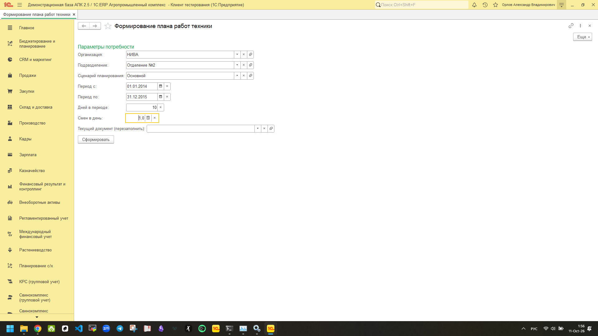
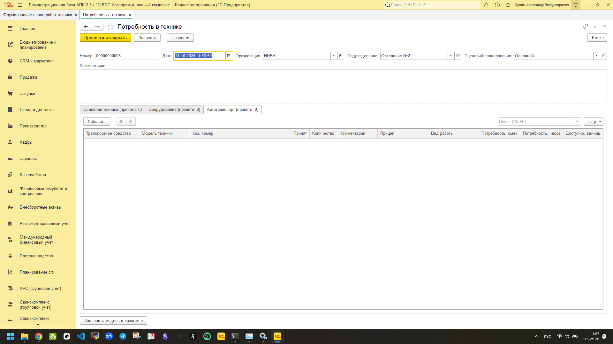
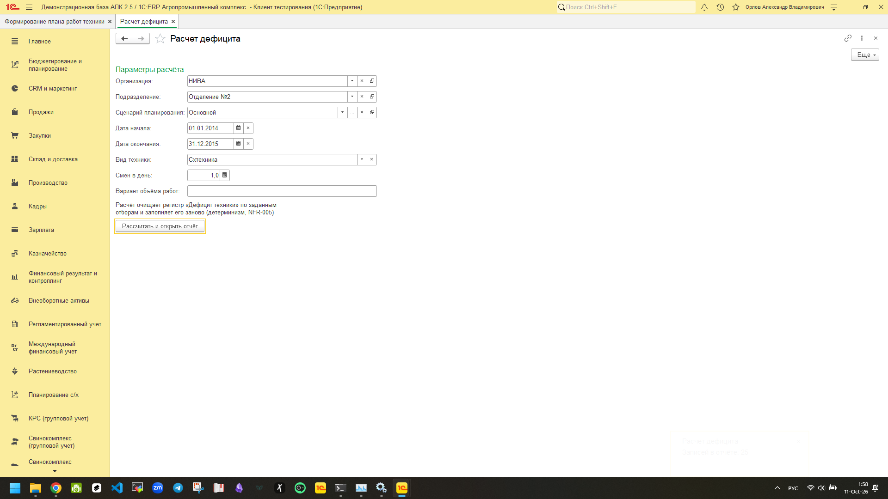
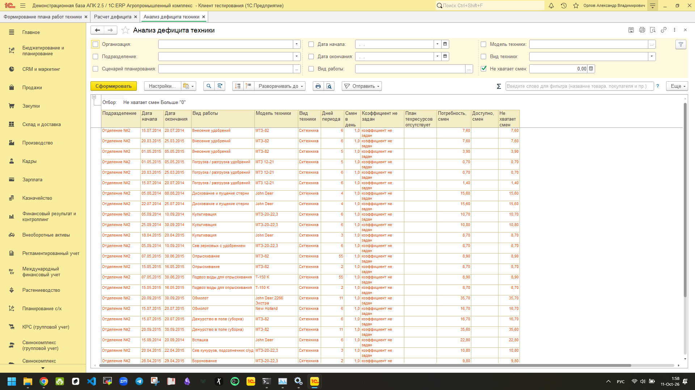

# Руководство пользователя
## Расширение «Планирование техники АПК»

---

*Версия расширения: для 1С:ERP АПК 2.5, платформа 1С:Предприятие 8.5*
*Дата актуализации: 2026 год*

---

## Оглавление

1. [Что делает расширение](#1-что-делает-расширение)
2. [Подготовка данных](#2-подготовка-данных)
3. [Формирование плана работ техники](#3-formirovanie-plana-rabot-tekhniki)
4. [Документ «Потребность в технике»](#4-dokument-potrebnost-v-tehnike)
5. [Расчёт дефицита техники](#5-raschet-deficita-tekhniki)
6. [Отчёт «Анализ дефицита техники»](#6-otchyot-analiz-deficita-tekhniki)
7. [Частые вопросы (FAQ)](#7-faq-chastye-voprosy)

---

## 1. Что делает расширение

Расширение **«Планирование техники АПК»** помогает агроному-планировщику ответить на
главный вопрос: *хватит ли техники и оборудования в хозяйстве на запланированные
полево-аграрные работы в заданный период?*

В системе реализованы четыре рабочих объекта в подсистеме **«Планирование техники»**:

| Объект | Тип | Для чего нужен |
|---|---|---|
| **Потребность в технике** | документ | Планы работ, сведённые по моделям техники (результат автоматического расчёта) |
| **Анализ дефицита техники** | отчёт | Список работ, на которые техники не хватает |
| **Расчет дефицита** | обработка | Пересчёт регистра «Дефицит техники» по новым данным |
| **Формирование плана работ техники** | обработка | Автозаполнение документа потребности из проведённых техкарт |

Подсистема работает с данными из 1С:ERP АПК: проведёнными технологическими картами
(техкартами) на поле, планом распределения техники **АпкПланТехническихРесурсов** и
паспортными характеристиками моделей техники.

---

## 2. Подготовка данных

Чтобы расчёты были точными, перед началом планирования проверьте, что в базе
проведены следующие документы:

### Технологические карты (техкарты)
* **Что это:** планы работ по полю, привязанные к конкретному подразделению
  выращивания и моделям техники.
* **Зачем нужны:** обработка «Формирование плана работ техники» строит потребность
  именно из них — сколько и каких операций требуется за период.
* **Что проверить:** все актуальные техкарты должны быть **проведены**; даты начала и
  окончания работ в них должны покрывать планируемый период.

### План распределения техники (АпкПланТехническихРесурсов)
* **Что это:** документ, где указано, какая техника доступна подразделению в заданный
  период (обороты техники).
* **Зачем нужен:** на его основе система считает «доступно» — сколько единиц техники
  реально можно выставить на работу.
* **Что проверить:** документ должен быть **проведён**; для каждой модели техники
  указаны обороты по подразделению выращивания.

### Паспортные характеристики моделей техники
* **Что это:** реквизиты моделей техники — мощность двигателя, ширина обработки
  (для сеялок/опрыскивателей), грузоподъёмность (для грузовиков/самосвалов),
  вместимость/объём бункера (для зерноуборочных комбайнов) и связанные коэффициенты.
* **Зачем нужны:** если нужной модели техники нет в наличии, система пробует
  **заместить** её другой моделью подходящей производительности. Для этого и нужны
  паспортные данные.
* **Что проверить:** у каждой модели техники, планируемой в техкартах, должны быть
  заполнены соответствующие паспортные реквизиты (ширина/грузоподъёмность/мощность).

> ⚠️ Если какие-либо из перечисленных документов не проведены, расчёт либо выдаст
> неполный результат, либо покажет, что техники «не хватает» — хотя на самом деле
> данные просто не подтянулись.

---

## 3. Формирование плана работ техники

Обработка автоматически собирает потребность в технике из проведённых техкарт.
Вручную каждую строку вводить не нужно.

### Шаг 1. Откройте обработку
В меню выберите: **Планирование техники → Формирование плана работ техники**.
Откроется форма с параметрами расчёта.

### Шаг 2. Заполните параметры

| Параметр | Что означает | Как заполнять |
|---|---|---|
| **Организация** | Хозяйство | Выбрать из справочника организаций |
| **Подразделение** | Подразделение выращивания | Например, «Поле №5» или название поля |
| **Сценарий планирования** | Вариант плана | Выберите актуальный сценарий |
| **Период с / по** | Даты расчёта потребности | Период, на который планируете работы |
| **Дней в периоде** | Количество дней | Автоматически считается по датам периода, можно уточнить |
| **Смен в день** | Количество смен | Обычно «1», если техника работает в одну смену; при двухсменной работе укажите «2» |

> Смена в контексте расчёта — это не рабочий день сотрудника, а одна рабочая смена
> техники (утро/день/вечер). Указание «2 смены в день» удваивает ёмкость техники
> за день.

### Шаг 3. Запустите расчёт
Нажмите кнопку **«Сформировать»**. Обработка:

1. прочитает все **проведённые техкарты** за выбранный период по указанному
   подразделению;
2. посчитает, сколько и каких моделей техники требуется (в сменах и часах);
3. сопоставит потребность с техникой, **доступной** подразделению
   (из проведённых документов АпкПланТехническихРесурсов);
4. при нехватке предложит **замещение** моделей по их паспортным характеристикам;
5. создаст новый документ **«Потребность в технике»** и заполнит его табличную часть
   результатами расчёта.

Готовый документ откроется автоматически.

Если проведённых техкарт за выбранный период нет, обработка сообщит:
**«Техкарты за период не найдены.»** — документ при этом не создаётся.

---

## 4. Документ «Потребность в технике»

Документ — это итоговый план. Он формируется автоматически, но его **всегда можно
отредактировать** перед проведением: потребности можно увеличить/уменьшить, убрать
лишние строки, добавить комментарий.

### Шапка документа

В верхней части документа указаны общие параметры:

* **Организация** — хозяйство, на которое составлен план;
* **Подразделение** — подразделение выращивания;
* **Сценарий планирования** — вариант плана;
* **Комментарий** — свободное текстовое поле для заметок (например, ссылка на техкарту
  или ссылка на согласование).

### Табличные части

У документа три табличные части:

| Табличная часть | Что в ней | Как заполняется |
|---|---|---|
| **Основная техника** | Тракторы, зерноуборочные комбайны, косилки и т.п. | Автоматически из техкарт: «Модель техники» + «Оборудование» (конкретное ТС выбирается вручную или кнопкой «Заполнить модель и хозномер») |
| **Оборудование** | Прицепное/сцепное оборудование (опрыскиватели, сеялки, культиваторы) | **Вручную** — агроном добавляет строки сам |
| **Автотранспорт** | Грузовики и прицепы | Автоматически: «Модель техники» + «Прицеп» (конкретное ТС выбирается вручную) |

### Как читать колонки

Колонки «Транспортное средство», «Модель техники», «Вид работы» описывают саму
операцию и технику под неё. Дальше — количественные показатели:

* **Потребность, смен / Потребность, часов** — сколько работы нужно выполнить.
  Смены считаются исходя из длительности операции, часы — из норм выработки.
* **Принят** — флаг. Помечайте галочкой только те строки, которые **точно войдут** в
  фактический план. Строки без галочки в сводные итоги не попадают.
* **Количество** — сколько единиц техники запланировано.
* **Комментарий** — примечание по строке.
* **Доступно, единиц** — сколько таких единиц есть у подразделения по планам
  техники.

### Правила, которые гарантируют типы данных

* В табличной части **«Основная техника»** к одной модели техники привязывается
  только **СХ-оборудование** (сельскохозяйственное, предназначенное для полевых работ).
* В табличной части **«Автотранспорт»** к транспортному средству привязывается только
  **прицеп**.

Эти ограничения заданы типами реквизитов и соблюдаются системой автоматически —
выбрать неподходящее оборудование нельзя.

После корректировки проведите документ — на его основе будут строиться следующие
расчёты.

---

## 5. Расчет дефицита техники

Обработка пересчитывает регистр накопления **«Дефицит техники»** — сводную таблицу
потребности против доступности — и открывает отчёт с результатами.

### Шаг 1. Откройте обработку
**Планирование техники → Расчет дефицита**.

### Шаг 2. Заполните параметры

| Параметр | Что означает |
|---|---|
| **Организация** | Хозяйство |
| **Подразделение** | Подразделение выращивания |
| **Сценарий планирования** | Вариант плана |
| **Дата начала / Дата окончания** | Период анализа |
| **Вид техники** | Фильтр по видам (тракторы, комбайны, автотранспорт и т.п.) |
| **Смен в день** | Количество смен техники в сутки |
| **Вариант объёма работ** | Минимальный / Вероятный / Максимальный — **по умолчанию «Вероятный»** |

### Шаг 3. Запустите расчёт
Нажмите **«Рассчитать и открыть отчет»**. Система пересчитает дефицит по всем
указанным критериям и сразу откроет отчёт **«Анализ дефицита техники»**.

> Повторно запускайте обработку каждый раз, когда в базе появились новые техкарты или
> изменён план распределения техники — без этого отчёт покажет устаревшие данные.

---

## 6. Отчёт «Анализ дефицита техники»

Отчёт показывает, каких операций и техники не хватает в хозяйстве в заданный период.
Он построен на схеме компоновки данных (СКД) — значит, его можно сортировать, группировать
и настраивать под себя.

### Ключевая колонка

* **«Не хватает смен»** — самый важный показатель. Значение больше нуля означает, что
  для этой работы доступной техники меньше, чем требуется.

### Как работают отборы

Сверху отчёта находятся фильтры. Все они обязательны для понимания контекста:

* **Организация** — хозяйство;
* **Подразделение** — подразделение выращивания;
* **Сценарий планирования** — вариант плана;
* **Дата начала / Дата окончания** — границы периода анализа;
* **Вид работы** — тип операции (посев, обработка, уборка и т.п.);
* **Модель** — модель техники;
* **Вид техники** — группа техники (тракторы, комбайны, прицепы, автотранспорт).

### Дефицитные и не-дефицитные строки

По умолчанию отчёт показывает **только дефицитные строки** — те, где «Не хватает смен»
> 0. Это удобно: сразу видно проблемы, а не избыточную технику.

Если нужно увидеть и избыток, и баланс:

1. откройте **Настройки** отчёта (иконка настроек над таблицей);
2. найдите отбор **«НехватаетСмен > 0»** и снимите его;
3. сохраните настройки и перестройте отчёт.

Теперь в отчёте появятся и строки с избытком техники, и строки с нулевым дефицитом.

---

## 7. FAQ. Частые вопросы

### 1. Обработка пишет «Техкарты за период не найдены.» — что делать?

Это сообщение о том, что обработка не нашла проведённых техкарт для выбранного
подразделения и периода. Проверьте:

* проведены ли нужные техкарты;
* попадает ли дата начала/окончания работ в них в выбранный период;
* верно ли выбрано подразделение выращивания.

Документ в этом случае не создаётся — расчёт попросту не на что опираться.

### 2. Почему строка помечена «коэффициент не задан»?

При нехватке техники система пытается **заместить** недостающую модель другой — с
похожей производительностью. Для этого сравниваются паспортные характеристики:
ширина обработки, грузоподъёмность, мощность двигателя, вместимость.

Если у моделей **не заполнены** необходимые паспортные реквизиты, коэффициент
пересчитать нельзя — в комментарий строки выводится «коэффициент замещения не задан»; в отчёте это отражается колонкой «Коэффициент не задан».
Такую строку нужно доработать вручную: либо дополнить паспорт модели, либо
выбрать замещающую модель вручную.

### 3. Что такое «замещение модели»?

Замещение — это замена недостающей модели техники на другую, способную выполнить ту
же работу. Например, если не хватает сеялки определённой ширины, система предлагает
сеялку с аналогичной или большей рабочей шириной.

Замещение работает автоматически, но только если у моделей заполнены паспортные
характеристики. Если коэффициент не вычисляется (см. вопрос 2), строка остаётся
помеченной и требует ручного решения.

### 4. Почему в списке оборудования только СХ-оборудование?

В табличной части **«Основная техника»** к модели техники привязывается только
сельскохозяйственное оборудование, предназначенное для полевых работ (опрыскиватели,
сеялки, культиваторы). Это ограничение гарантировано типами полей — выбрать
транспортный прицеп или промышленный агрегат в этой табличной части нельзя.
Автотранспорт с прицепами ведётся в отдельной табличной части.

### 5. Почему в отчёте нет строк с нулевым дефицитом?

По умолчанию отчёт показывает только дефицитные операции — с показателем
«Не хватает смен» > 0. Чтобы увидеть и баланс, и избыток:

1. нажмите **Настройки** отчёта;
2. снимите отбор **«НехватаетСмен > 0»**;
3. перестройте отчёт.

Эту настройку можно сохранить для будущего использования.

### 6. Можно ли перезаполнить уже созданный документ?

Да. Обработка «Формирование плана работ техники» умеет пересоздавать содержимое
существующего документа потребности по новым данным. При запуске с выбранной датой
существующего документа система предложит **подтверждение перезаполнения** — после
подтверждения старые расчётные строки будут пересчитаны.

### 7. Почему в колонке «Доступно, единиц» стоит ноль?

Показатель «Доступно, единиц» берётся из проведённого документа
**АпкПланТехническихРесурсов** — плана распределения техники по подразделению
выращивания. Ноль означает, что либо:

* документ распределения ещё не проведён;
* в нём не указаны обороты для нужной модели техники и подразделения;
* выбрана другая организация/подразделение, чем в плане техники.

Если проведённый план распределения не найден вовсе, расчёт дополнительно
фиксирует признак **«План техресурсов отсутствует»** — в отчёте «Анализ дефицита
техники» видна соответствующая колонка-пометка; замещение моделей при этом
не выполняется.

Перепроведите план распределения или уточните параметры расчёта.

### 8. Как скорректировать автоматическую потребность?

После формирования откройте документ «Потребность в технике» и отрегулируйте:

* галочку **«Принят»** — помечайте только реально планируемые работы;
* **«Количество»** — увеличьте или уменьшите плановое число единиц техники;
* **«Комментарий»** — оставьте пояснения по изменениям.

Изменённый и проведённый документ станет основой для последующих расчётов дефицита.

---

*Конец документа*
